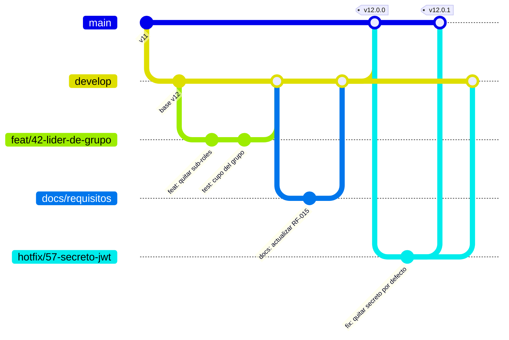
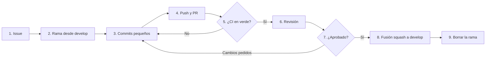

# Flujo de trabajo en GitHub — ZENDA

<!--
  ¿Qué? Cómo el equipo trabaja en el repositorio: ramas, commits, issues, pull requests, revisión, versiones y despliegue.
  ¿Para qué? Que cada cambio sea pequeño, revisado, trazable y que `main` siempre esté estable.
  ¿Impacto? Sin un flujo común, los cambios se pisan, se pierden o llegan a `main` sin que nadie los haya revisado.
-->

---

## Identificación

| Campo | Valor |
|---|---|
| **Repositorio** | `player7842/ZENDA` |
| **Ramas permanentes** | `main` (estable) y `develop` (integración) |
| **Modelo** | Ramas de trabajo cortas que se fusionan en `develop` mediante Pull Request |
| **Origen del requisito** | Observación del instructor: documentación en `docs/`, `main` estable y rama `develop` ([RO-005](../requisitos/restricciones.md#ro-005--flujo-de-ramas-en-git)) |
| **Plantillas listas** | `.github/` (PR, issues, CI), `.gitattributes`, `.editorconfig` |
| **Fecha** | Octubre 2026 |

---

## 1. Por qué este flujo

| Problema que evita | Cómo lo evita |
|---|---|
| "Rompí `main` y nadie se dio cuenta" | Nadie sube directo a `main` ni a `develop`: todo pasa por Pull Request con CI verde. |
| "No sé quién cambió esto ni por qué" | Cada cambio nace de un issue y se vincula con su PR y con su requisito (`RF-014`). |
| "Dos personas editaron lo mismo" | Ramas cortas y PR pequeños: los conflictos son raros y fáciles de resolver. |
| "La documentación quedó vieja" | La documentación se actualiza **en el mismo PR** que el cambio ([sección 12](#12-documentación-dentro-del-pr)). |
| "Se subió una contraseña" | `.gitignore`, revisión del PR y una [guía de respuesta](#13-archivos-que-nunca-se-suben). |

---

## 2. Modelo de ramas



| Rama | Propósito | Quién escribe | Se fusiona en | Vida |
|---|---|---|---|---|
| `main` | Versión estable y entregable. Cada fusión es una versión con etiqueta. | Nadie directamente | — | Permanente |
| `develop` | Integración de todo lo terminado y revisado. | Nadie directamente | `main` en cada versión | Permanente |
| `feat/*` | Funcionalidad nueva | Un integrante | `develop` | Días |
| `fix/*` | Corrección de un defecto | Un integrante | `develop` | Horas a días |
| `docs/*` | Solo documentación | Un integrante | `develop` | Horas a días |
| `refactor/*` | Reorganizar código sin cambiar su comportamiento | Un integrante | `develop` | Días |
| `test/*` | Solo pruebas | Un integrante | `develop` | Días |
| `chore/*` | Dependencias, configuración, Docker | Un integrante | `develop` | Horas |
| `hotfix/*` | Corrección urgente de algo ya publicado | Un integrante | `main` **y** `develop` | Horas |

### Nombre de la rama

```text
<tipo>/<número-del-issue>-<descripción-corta-en-minúsculas>
```

| ✅ Bien | ❌ Mal |
|---|---|
| `feat/42-lider-de-grupo` | `nueva-rama`, `cambios`, `juan2` |
| `fix/57-secreto-jwt-por-defecto` | `fix` (sin descripción) |
| `docs/61-esquema-bd-v12` | `Documentacion Final FINAL` |
| `refactor/70-extraer-cascada-service` | Espacios, mayúsculas o tildes |

> **Regla del tamaño:** una rama vive **menos de una semana**. Si un cambio es grande, se divide en varios issues y varios PR.

---

## 3. Ciclo completo, paso a paso



### En una sesión de terminal

```bash
# 1. Parte siempre de develop actualizado
git checkout develop
git pull origin develop

# 2. Crea la rama del issue
git checkout -b feat/42-lider-de-grupo

# 3. Trabaja y guarda en pasos pequeños
git status                      # revisa que no aparezca .env, node_modules ni dist
git add backend/src/controllers/aprendiz/proyecto.controller.js
git commit -m "feat(proyecto): el creador del proyecto queda como líder"

# 4. Publica la rama
git push -u origin feat/42-lider-de-grupo

# 5. Abre el Pull Request hacia develop (en la web o con la CLI de GitHub)
gh pr create --base develop --fill

# 6. Si la CI falla o piden cambios: corrige, commitea y vuelve a hacer push.
#    El PR se actualiza solo; no abras otro.
git add . && git commit -m "fix(proyecto): validar el cupo al crear" && git push

# 7. Tras la aprobación, se fusiona con "Squash and merge" y se limpia
git checkout develop && git pull origin develop
git branch -d feat/42-lider-de-grupo
```

> `git add .` es cómodo, pero **revisa antes con `git status`**. Si dudas, agrega los archivos de uno en uno.

---

## 4. Commits

Se usa **Conventional Commits**, escritos en español y en tiempo imperativo.

```text
<tipo>(<ámbito>): <qué hace el cambio>

[cuerpo opcional: por qué, no cómo]

[Cierra #42]
```

| Tipo | Úsalo para | Ejemplo |
|---|---|---|
| `feat` | Funcionalidad nueva | `feat(tareas): permitir al líder confirmar una tarea` |
| `fix` | Corregir un defecto | `fix(auth): responder igual si el correo no existe` |
| `docs` | Solo documentación | `docs(api): agregar los endpoints de la lista de chequeo` |
| `refactor` | Reorganizar sin cambiar el comportamiento | `refactor(evaluacion): extraer CascadaService` |
| `test` | Agregar o corregir pruebas | `test(cascada): casos de carpeta con evidencias sin evaluar` |
| `style` | Formato, sin cambio de lógica | `style(ui): unificar sangría` |
| `chore` | Dependencias, configuración, Docker | `chore(docker): actualizar Node a LTS` |
| `perf` | Mejora de rendimiento | `perf(fichas): índice en grupos.ficha_id` |
| `build` / `ci` | Construcción y CI | `ci: ejecutar lint en cada PR` |

**Ámbitos del proyecto:** `auth`, `usuarios`, `fichas`, `programas`, `proyecto`, `grupo`, `carpetas`, `evidencias`, `evaluacion`, `observaciones`, `tareas`, `lista-chequeo`, `reportes`, `ui`, `bd`, `docker`, `api`, `docs`.

| ✅ Bien | ❌ Mal |
|---|---|
| `fix(evidencias): impedir eliminar una evidencia aprobada` | `arreglos` |
| `feat(bd): agregar la tabla evidencia_versiones` | `cambios varios` |
| `docs(rf): corregir el campo codigo_grupo en RF-015` | `listo` |

**Reglas**

| Regla | Detalle |
|---|---|
| Un commit, una idea | Si necesitas escribir "y" en el mensaje, probablemente son dos commits. |
| Primera línea | Hasta 72 caracteres, sin punto final. |
| Cambio que rompe el contrato | Agrega `!` y explícalo: `feat(api)!: eliminar rol_scrum del cuerpo de /unirse`. |
| Vincular el issue | `Cierra #42` en el cuerpo del último commit o del PR. |
| Sin secretos ni datos reales | Nunca en el mensaje ni en el código. |

---

## 5. Pull requests

| Aspecto | Regla |
|---|---|
| **Destino** | `develop` (salvo `hotfix/*`, que va a `main`). |
| **Tamaño** | Idealmente menos de 400 líneas cambiadas. Si es más grande, dividirlo. |
| **Título** | Igual que un commit: `feat(proyecto): cupo del grupo`. |
| **Descripción** | Usa la plantilla: qué cambia, por qué, cómo probarlo, requisito relacionado. |
| **Borrador** | Si aún no está listo para revisión, ábrelo como *Draft*. |
| **Aprobaciones** | Mínimo 1 de alguien que no sea el autor. |
| **CI** | Debe estar en verde antes de fusionar. |
| **Fusión** | **Squash and merge** a `develop`: un commit limpio por funcionalidad. |
| **Después** | Se borra la rama. |

**Plantilla** (`.github/PULL_REQUEST_TEMPLATE.md`): ya está lista en el paquete de colaboración.

---

## 6. Issues

Todo trabajo empieza en un issue. Hay cuatro tipos con plantilla: **Defecto**, **Funcionalidad**, **Mejora técnica** y **Documentación**.

### Etiquetas

| Grupo | Etiquetas |
|---|---|
| **Tipo** | `defecto`, `funcionalidad`, `mejora-tecnica`, `documentacion` |
| **Prioridad** | `prioridad-alta`, `prioridad-media`, `prioridad-baja` |
| **Módulo** | `auth`, `administracion`, `proyecto`, `evidencias`, `evaluacion`, `tareas`, `lista-chequeo`, `ui`, `bd`, `docker`, `docs` |
| **Estado** | `listo-para-trabajar`, `en-curso`, `bloqueado`, `necesita-informacion` |
| **Origen** | `instructor`, `requisito`, `hallazgo` |

**Cómo enlazar con la documentación:** en el título o la descripción, cita el requisito (`RF-014`, `RN-009`) o el hallazgo (`H-02`). Así se puede ir del issue al requisito y de vuelta.

> Para un defecto, pega el **caso de prueba** (`CP-014.2`) o el hallazgo que lo describe, y los pasos para reproducirlo ([plan de pruebas](../testing/plan-de-pruebas.md#8-gestión-de-defectos)).

---

## 7. Protección de ramas

Configuración en **GitHub → Settings → Branches** (la hace quien administra el repositorio, una sola vez).

| Ajuste | `main` | `develop` |
|---|:---:|:---:|
| Exigir Pull Request antes de fusionar | ✅ | ✅ |
| Aprobaciones requeridas | 1 | 1 |
| Descartar aprobaciones al subir cambios nuevos | ✅ | ✅ |
| Exigir que pase la CI (`CI`) | ✅ | ✅ |
| Exigir que la rama esté actualizada | ✅ | — |
| Prohibir *force push* | ✅ | ✅ |
| Prohibir borrar la rama | ✅ | ✅ |
| Incluir a administradores | ✅ | ✅ |

> Mientras el equipo sea pequeño, el autor del repositorio puede aprobar con **un compañero distinto de quien escribió el cambio**; lo importante es que nadie apruebe su propio código.

---

## 8. Versiones y publicación

Se usa **versionado semántico**: `vMAYOR.MENOR.PARCHE`.

| Parte | Cambia cuando | Ejemplo |
|---|---|---|
| **MAYOR** | Cambio incompatible (de contrato o de esquema de base de datos) | `v11` → `v12.0.0` |
| **MENOR** | Funcionalidad nueva compatible | `v12.1.0` |
| **PARCHE** | Corrección compatible | `v12.0.1` |

### Pasos para publicar una versión

| # | Paso | Comando o acción |
|:---:|---|---|
| 1 | `develop` está estable y con la CI en verde | — |
| 2 | Actualizar `CHANGELOG.md` y las versiones de los `package.json` | PR `chore(release): v12.0.0` a `develop` |
| 3 | Probar: lista de humo y pruebas de integración | [Plan de pruebas](../testing/plan-de-pruebas.md) |
| 4 | Hacer una **copia de seguridad** de la base de datos | `pg_dump` ([RNF-008.8](../requisitos/RNFs/RNF-008_disponibilidad_y_despliegue.md)) |
| 5 | Abrir PR de `develop` a `main` y fusionar **sin squash** (para conservar la historia) | "Create a merge commit" |
| 6 | Etiquetar | `git tag -a v12.0.0 -m "ZENDA v12.0.0"` y `git push origin v12.0.0` |
| 7 | Crear la *Release* en GitHub con el texto del changelog | GitHub → Releases |
| 8 | Desplegar | [Con Docker](../setup/con-docker.md#8-llevarlo-a-producción) |

> **Migraciones de base de datos:** van numeradas (`001_v12.sql`, `002_…`) y **nunca se editan una vez fusionadas**; los cambios nuevos van en una migración nueva. La migración del lanzamiento debe probarse antes sobre una copia ([IT-13](../testing/pruebas-de-integracion.md#it-13--migración-de-v11-a-v12)).

---

## 9. Corrección urgente (`hotfix`)

Para un defecto grave ya publicado (por ejemplo, [H-02](../testing/hallazgos.md)):

```bash
git checkout main && git pull origin main
git checkout -b hotfix/57-secreto-jwt-por-defecto
# ...corregir, probar, commitear...
git push -u origin hotfix/57-secreto-jwt-por-defecto
# PR hacia main (revisión rápida) → fusionar → etiquetar v12.0.1
# Después, llevar la misma corrección a develop:
git checkout develop && git pull origin develop
git merge main            # o un PR de main a develop
```

---

## 10. Mantener la rama al día y resolver conflictos

```bash
git fetch origin
git checkout feat/42-lider-de-grupo
git rebase origin/develop       # reaplica tus commits sobre lo último de develop
# Si hay conflicto: edita los archivos, luego
git add <archivo-resuelto>
git rebase --continue
git push --force-with-lease     # SOLO en tu rama de trabajo, nunca en develop ni main
```

| Regla | Motivo |
|---|---|
| Haz `rebase` solo en **tu** rama sin compartir | Reescribir la historia de una rama compartida rompe el trabajo de los demás. |
| Usa `--force-with-lease`, no `--force` | Falla si alguien más subió algo a esa rama. |
| Si te pierdes, `git rebase --abort` | Vuelve al estado anterior sin perder nada. |
| Archivos de bloqueo (`pnpm-lock.yaml`) | No los edites a mano: acepta uno de los dos y ejecuta `pnpm install`. |

---

## 11. Cambios que requieren cuidado especial

| Tipo de cambio | Qué hacer además |
|---|---|
| **Base de datos** | Nueva migración numerada; actualizar [esquema-bd.md](../referencia-tecnica/esquema-bd.md) y [mer-mr.md](../diagramas/mer-mr.md); probar sobre una copia. |
| **Endpoint nuevo o modificado** | Actualizar [api-endpoints.md](../referencia-tecnica/api-endpoints.md) y su RF; si cambia el contrato, avisarlo en el PR (`feat(api)!`). |
| **Regla de negocio** | Actualizar [reglas-de-negocio.md](../requisitos/reglas-de-negocio.md) y los RF y pruebas que la citan. |
| **Permisos** | Actualizar la [matriz de permisos](../requisitos/matriz-permisos.md) y las pruebas de autorización. |
| **Variable de entorno** | Actualizar los tres `.env.example` y [variables-de-entorno.md](../setup/variables-de-entorno.md). |
| **Dependencia** | Versión **exacta**; solo con `pnpm`; revisar `pnpm audit`. |
| **Docker o despliegue** | Probar `docker compose up --build` desde cero. |

---

## 12. Documentación dentro del PR

La documentación es parte del cambio, no una tarea posterior.

| Si cambias… | Actualiza… |
|---|---|
| El comportamiento visible de una función | HU y RF correspondientes; estado en la [matriz de trazabilidad](../requisitos/matriz-trazabilidad.md) |
| La estructura de carpetas | [Arquitectura](../referencia-tecnica/arquitectura.md), sección 8, y el árbol del `README.md` |
| Un diagrama (flujo, estado, clase) | El archivo de [diagramas](../diagramas/) que lo contiene |
| Un defecto de la lista de hallazgos | Marcarlo como corregido en [hallazgos.md](../testing/hallazgos.md) |

> **Pregunta de revisión:** "¿Qué documento de `docs/` quedaría mentiroso si se fusiona este PR?"

---

## 13. Archivos que nunca se suben

| Nunca subas | Motivo |
|---|---|
| `.env` y cualquier `.env.*` (menos `.env.example`) | Contienen contraseñas y claves |
| `node_modules/`, `dist/`, `build/` | Se generan al instalar o compilar |
| `pgdata/`, `uploads/`, respaldos `.sql` con datos reales | Datos de personas |
| Capturas o registros con correos o tokens reales | Datos personales |

El `.gitignore` entregado cubre todo esto.

### Si subiste un secreto por error

1. **Revócalo y cámbialo de inmediato** (contraseña de la base de datos, clave de Gmail, `JWT_SECRET`). Borrar el commit **no basta**: el secreto ya se pudo copiar.
2. Quita el archivo del control de versiones: `git rm --cached .env`.
3. Si hace falta limpiar la historia, usa `git filter-repo` o BFG Repo-Cleaner y avisa al equipo, porque todos deberán volver a clonar.
4. Anótalo como incidente en un issue (sin pegar el secreto).

---

## 14. Integración continua (CI)

El flujo `.github/workflows/ci.yml` se ejecuta en cada PR y en cada `push` a `develop` y `main`.

| Trabajo | Qué comprueba |
|---|---|
| **backend** | `pnpm install --frozen-lockfile`, pruebas (si existen) |
| **frontend** | `pnpm install --frozen-lockfile`, `pnpm lint`, pruebas (si existen) y `pnpm build` |
| **docker** | Que las dos imágenes se construyan |

Un PR con la CI en rojo **no se fusiona**. Más adelante se agregan las pruebas de integración con una base de datos de servicio y el escaneo de secretos ([plan de pruebas](../testing/plan-de-pruebas.md)).

---

## 15. Errores comunes

| Síntoma | Causa | Solución |
|---|---|---|
| `rejected… non-fast-forward` al hacer push | Tu rama está desactualizada | `git pull --rebase origin <tu-rama>` |
| El PR muestra cientos de archivos | Se creó la rama desde un `develop` viejo o se fusionó mal | Rehacer la rama desde `develop` actualizado y aplicar `git cherry-pick` de tus commits |
| La CI falla solo en el PR | Dependencias sin `pnpm-lock.yaml` actualizado | `pnpm install` y commitear el lockfile |
| `.env` aparece en `git status` | Falta o está mal el `.gitignore` | Copiar el `.gitignore` entregado; `git rm --cached .env` |
| Archivos "modificados" sin haber cambiado nada | Saltos de línea CRLF frente a LF | Usar el `.gitattributes` entregado |
| Hice commit directo en `develop` | La protección de rama no está activa | Crear una rama desde ahí (`git branch fix/xx`), volver `develop` a `origin/develop` y abrir PR |
| Quiero deshacer el último commit | — | `git reset --soft HEAD~1` (conserva los cambios) |

---

## Documentos relacionados

- [Guía de contribución](guia-de-contribucion.md) · [Convenciones de código](convenciones-de-codigo.md) · [Revisión de código](revision-de-codigo.md)
- [Restricciones](../requisitos/restricciones.md) · [Plan de pruebas](../testing/plan-de-pruebas.md) · [Instalación con Docker](../setup/con-docker.md)
