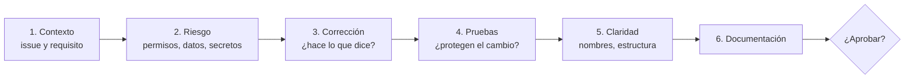

# Revisión de código — ZENDA

<!--
  ¿Qué? Cómo se revisa un Pull Request: qué mirar, en qué orden, cómo comentar y cuándo aprobar.
  ¿Para qué? Que la revisión encuentre los defectos que importan (permisos, datos, reglas) y no se pierda en discusiones de estilo.
  ¿Impacto? Una revisión superficial deja pasar fallos de seguridad; una revisión agresiva desmotiva y frena al equipo.
-->

---

## Identificación

| Campo | Valor |
|---|---|
| **Aplica a** | Todo Pull Request hacia `develop` o `main` |
| **Aprobaciones mínimas** | 1, de alguien que **no** sea el autor |
| **Plazo de respuesta** | 24 horas hábiles |
| **Se apoya en** | [Flujo de GitHub](flujo-github.md) · [Convenciones de código](convenciones-de-codigo.md) |
| **Fecha** | Octubre 2026 |

---

## 1. Objetivo de la revisión

| Se busca | No se busca |
|---|---|
| Que el cambio **cumpla lo que pide el issue** y sus criterios de aceptación | Que el código sea idéntico al que habría escrito el revisor |
| Que **no rompa** reglas de negocio, permisos ni datos | Discutir gustos que el linter ya resuelve |
| Que sea **entendible** por quien lo lea en seis meses | Perfección: lo bueno y seguro se aprueba, lo mejorable se anota |
| Que tenga **pruebas** y **documentación al día** | Reescribir el PR en los comentarios |

---

## 2. Responsabilidades

| Rol | Hace |
|---|---|
| **Autor** | Entrega un PR pequeño, con la plantilla completa, la CI en verde y una revisión propia previa (léelo como si fuera de otro). |
| **Revisor** | Responde dentro del plazo, revisa con la lista de esta guía, comenta con respeto y aprueba o pide cambios con claridad. |
| **Ambos** | Resuelven los desacuerdos con evidencia (una prueba, un requisito), no con insistencia. |

> **Nunca se aprueba el propio PR**, ni "porque es chiquito".

---

## 3. Orden de revisión

Empieza por lo que más daño hace si falla. El estilo va al final.

---

## 4. Lista de verificación general

| # | Pregunta | ✅ |
|:---:|---|:---:|
| 1 | ¿El PR cita su issue y su requisito (`RF-…`, `RN-…`)? | ☐ |
| 2 | ¿Hace una sola cosa y es pequeño (menos de ~400 líneas)? | ☐ |
| 3 | ¿Cumple los **criterios de aceptación** de la historia? | ☐ |
| 4 | ¿Hay **pruebas** nuevas o actualizadas, y pasan? | ☐ |
| 5 | ¿La CI está en verde? | ☐ |
| 6 | ¿No hay `.env`, secretos, `node_modules`, datos reales ni archivos sobrantes? | ☐ |
| 7 | ¿Los mensajes, comentarios y nombres son profesionales y en español? | ☐ |
| 8 | ¿La documentación afectada está actualizada ([tabla](flujo-github.md#12-documentación-dentro-del-pr))? | ☐ |
| 9 | ¿No quedó código comentado, `console.log` de depuración ni `TODO` sin dueño? | ☐ |
| 10 | ¿Está claro **cómo probarlo** a mano? | ☐ |

---

## 5. Listas por tipo de cambio

### 5.1 Backend y API

| Pregunta | Referencia |
|---|---|
| ¿La ruta valida el token y el **rol** (`auth` + `is<Rol>`)? | [RS-004](../Requisitos/restricciones.md#rs-004--autorización-siempre-en-el-servidor) |
| ¿Verifica además la **pertenencia** (grupo, líder, ficha del instructor)? | [Matriz de permisos](../Requisitos/matriz-permisos.md) |
| ¿Toda consulta usa parámetros (`$1`) y ninguna concatena entradas? | [RS-005](../Requisitos/restricciones.md#rs-005--consultas-sql-parametrizadas) |
| ¿Las operaciones compuestas usan transacción con `ROLLBACK` y `release()` en `finally`? | [Convenciones, sección 5](convenciones-de-codigo.md#5-sql-y-acceso-a-datos) |
| ¿Valida la entrada: tipo, longitud, formato y límites? | [RF correspondiente](../Requisitos/RFs/) |
| ¿Devuelve el código HTTP correcto y `{ message }` en español? | [RNF-013](../Requisitos/RNFs/RNF-013_interoperabilidad_y_api.md) |
| ¿El `500` evita filtrar detalles técnicos? | [RNF-001.13](../Requisitos/RNFs/RNF-001_seguridad.md) |
| ¿Respeta las reglas de negocio citadas (por ejemplo, cascada, cupo, historial)? | [Reglas de negocio](../Requisitos/reglas-de-negocio.md) |
| ¿La respuesta **no incluye** contraseñas, hashes ni tokens? | [RS-003](../Requisitos/restricciones.md#rs-003--no-exponer-contraseñas) |
| ¿Se actualizó [api-endpoints.md](../Referencia-Tecnica/api-endpoints.md) si cambió el contrato? | — |

### 5.2 Frontend

| Pregunta | Referencia |
|---|---|
| ¿Las llamadas pasan por la capa `api/`? | [Arquitectura](../Referencia-Tecnica/arquitectura.md#5-frontend) |
| ¿Se ve bien y con **buen contraste** en tema claro y oscuro? | [RD-001](../Requisitos/restricciones.md#rd-001--contraste-mínimo-accesible), [RD-005](../Requisitos/restricciones.md#rd-005--tema-claro-y-oscuro) |
| ¿Hay estados de carga, vacío y error? | [RNF-003.4](../Requisitos/RNFs/RNF-003_usabilidad_ux_ui.md) |
| ¿Funciona con teclado y los iconos tienen `aria-label`? | [RNF-004](../Requisitos/RNFs/RNF-004_accesibilidad.md) |
| ¿Las animaciones son consistentes con las de componentes equivalentes? | [RD-002](../Requisitos/restricciones.md#rd-002--animaciones-consistentes) |
| ¿Las acciones secundarias están en el menú de tres puntos? | [RD-003](../Requisitos/restricciones.md#rd-003--menú-de-tres-puntos-para-acciones-secundarias) |
| ¿Se usa el rol o permiso solo para **mostrar**, nunca como control de acceso? | [RS-004](../Requisitos/restricciones.md#rs-004--autorización-siempre-en-el-servidor) |
| ¿Funciona a 360 px sin desplazamiento horizontal? | [RNF-003.6](../Requisitos/RNFs/RNF-003_usabilidad_ux_ui.md) |
| ¿No hay textos fijos que deban ser dinámicos (por ejemplo, el año)? | [RD-006](../Requisitos/restricciones.md#rd-006--pie-de-página-con-año-vigente-y-enlaces-legales) |

### 5.3 Base de datos y migraciones

| Pregunta | Referencia |
|---|---|
| ¿Es una **migración nueva y numerada**, sin editar una anterior ya fusionada? | [Flujo, sección 8](flujo-github.md#8-versiones-y-publicación) |
| ¿Usa `IF [NOT] EXISTS` y corre en una transacción? | [`002_semana2.sql`](../../Database/migrations/002_semana2.sql) |
| ¿Conserva los datos existentes y rellena las columnas nuevas? | [Esquema, notas de migración](../Referencia-Tecnica/esquema-bd.md#5-migración-002_semana2sql) |
| ¿Define restricciones (`NOT NULL`, `CHECK`, `UNIQUE`) donde corresponde? | [MR](../Diagramas/mer-mr.md) |
| ¿Crea índices para las claves foráneas que se consultan? | [RNF-002.3](../Requisitos/RNFs/RNF-002_rendimiento.md) |
| ¿Se probó sobre una **copia** de la base? | [IT-13](../Testing/pruebas-de-integracion.md#it-13--migración-de-v11-al-esquema-actual) |
| ¿Se actualizaron `esquema-bd.md` y `mer-mr.md`? | — |

### 5.4 Docker, dependencias y configuración

| Pregunta | Referencia |
|---|---|
| ¿Las versiones son **exactas** (sin `^`, `~`, `*`)? | [RH-003](../Requisitos/restricciones.md#rh-003--versiones-exactas-de-dependencias) |
| ¿Se usó **pnpm** y se actualizó el `pnpm-lock.yaml`? | [RH-001](../Requisitos/restricciones.md#rh-001--gestor-de-paquetes) |
| ¿Node es una versión LTS fijada? | [RH-002](../Requisitos/restricciones.md#rh-002--versión-lts-de-nodejs-fija) |
| ¿El contenedor no corre como `root` y excluye `.env` con `.dockerignore`? | [RT-008](../Requisitos/restricciones.md#rt-008--contenedores-con-docker) |
| ¿Hay variables nuevas? ¿Están en los tres `.env.example` y en su documento? | [Variables de entorno](../Setup/variables-de-entorno.md) |
| ¿La dependencia nueva es necesaria, mantenida y pasa `pnpm audit`? | [Plan de pruebas](../Testing/plan-de-pruebas.md) |

### 5.5 Documentación

| Pregunta | |
|---|:---:|
| ¿El texto es claro, en español profesional, sin groserías? | ☐ |
| ¿Los enlaces internos funcionan y los diagramas Mermaid se ven? | ☐ |
| ¿Sigue el formato de los documentos existentes (cabecera `¿Qué? ¿Para qué? ¿Impacto?`, tablas, enlaces)? | ☐ |
| ¿No contradice otro documento (reglas, permisos, API, esquema)? | ☐ |

---

## 6. Banderas rojas

Si ves alguna, **no se aprueba** hasta resolverla.

| 🚩 | Por qué |
|---|---|
| Una ruta sin `auth` o sin verificación de rol | Expone datos o acciones a cualquiera |
| Concatenación de texto dentro de una consulta SQL | Inyección SQL |
| Contraseñas, claves o tokens en el código o en un commit | Compromete todo el sistema |
| `cors()` abierto, `JWT_SECRET` con valor por defecto, `eval` o `dangerouslySetInnerHTML` sin necesidad | Vulnerabilidades conocidas |
| `UPDATE` o `DELETE` sobre registros que deben conservar historial (evaluaciones, versiones, vinculaciones) | Pérdida de datos irrecuperable ([RN-017](../Requisitos/reglas-de-negocio.md#rn-017--historial-de-evaluaciones)) |
| Cambio de esquema sin migración o editando una migración vieja | Rompe a quien ya la aplicó |
| Cambio de una regla de negocio sin tocar `reglas-de-negocio.md` ni las pruebas | Documentación y pruebas mentirosas |
| `npm install` o un `package-lock.json` | Rompe la reproducibilidad ([RH-001](../Requisitos/restricciones.md#rh-001--gestor-de-paquetes)) |
| Mensajes con groserías o lenguaje inapropiado | Imagen del proyecto ([RI-002](../Requisitos/restricciones.md#ri-002--documentación-y-comentarios-profesionales-en-español)) |

---

## 7. Cómo comentar

### Niveles de comentario

Marca cada comentario para que el autor sepa qué es obligatorio.

| Etiqueta | Significado | ¿Bloquea? |
|---|---|:---:|
| 🔴 **Bloqueante** | Defecto, riesgo de seguridad o regla rota | Sí |
| 🟡 **Sugerencia** | Mejora que conviene pero no es obligatoria | No |
| 🔵 **Pregunta** | Duda para entender | No (hasta que se aclare) |
| 🟢 **Elogio** | Algo bien hecho | No |
| ⚪ **Detalle** | Estilo o preferencia menor | No |

### Cómo se escribe

| ❌ Evita | ✅ Prefiere |
|---|---|
| "Esto está mal." | "🔴 Esta consulta concatena `req.params.id`; usa un parámetro (`$1`) para evitar inyección SQL (RS-005)." |
| "¿Por qué hiciste esto así?" | "🔵 ¿Qué pasa si `cupo` es `null`? No lo veo cubierto en las pruebas." |
| "Cámbialo." | "🟡 Podríamos extraer esto a `CascadaService`; así lo reutiliza el instructor. ¿Te parece?" |
| Silencio ante algo bueno | "🟢 Muy claro el nombre de `puedeTransicionar`." |

**Principios**

| Principio | Detalle |
|---|---|
| Se comenta el **código**, no a la persona | "Esta función…", no "tú siempre…" |
| Se explica el **porqué** y se cita la regla | Con un enlace al requisito, la regla o la restricción |
| Se propone una **solución** cuando se puede | Un ejemplo vale más que un reproche |
| Se separa lo obligatorio de lo opcional | Con las etiquetas de arriba |
| Se agradece | Revisar es tiempo que alguien regala |

---

## 8. Decisión de la revisión

| Resultado | Cuándo | Qué hace el autor |
|---|---|---|
| ✅ **Aprobar** | No quedan bloqueantes; las sugerencias pueden ir en otro PR | Fusionar con *squash* |
| 🔁 **Pedir cambios** | Hay al menos un bloqueante | Corregir, responder cada comentario y volver a pedir revisión |
| 💬 **Comentar** | Solo hay preguntas o sugerencias y falta información | Responder y aclarar |

**Cuándo escalar:** si dos personas no se ponen de acuerdo tras dos rondas, se lleva a una tercera persona (líder técnico o instructor) con el requisito y la evidencia sobre la mesa.

---

## 9. Autorrevisión antes de pedir revisión

El autor revisa su propio PR en GitHub, pestaña *Files changed*, y responde:

| # | Pregunta |
|:---:|---|
| 1 | ¿Hay archivos que no deberían estar (`.env`, capturas, respaldos, `node_modules`)? |
| 2 | ¿Dejé `console.log`, código comentado o `TODO` sin dueño? |
| 3 | ¿El título y la descripción explican **qué** y **por qué**? |
| 4 | ¿Corrí `pnpm lint`, las pruebas y la lista de humo? |
| 5 | ¿Actualicé la documentación que quedaría desactualizada? |
| 6 | ¿Un compañero que no conoce el tema entendería este cambio en 10 minutos? |

---

## Documentos relacionados

- [Flujo de GitHub](flujo-github.md) · [Guía de contribución](guia-de-contribucion.md) · [Convenciones de código](convenciones-de-codigo.md)
- [Reglas de negocio](../Requisitos/reglas-de-negocio.md) · [Matriz de permisos](../Requisitos/matriz-permisos.md) · [Plan de pruebas](../Testing/plan-de-pruebas.md)
