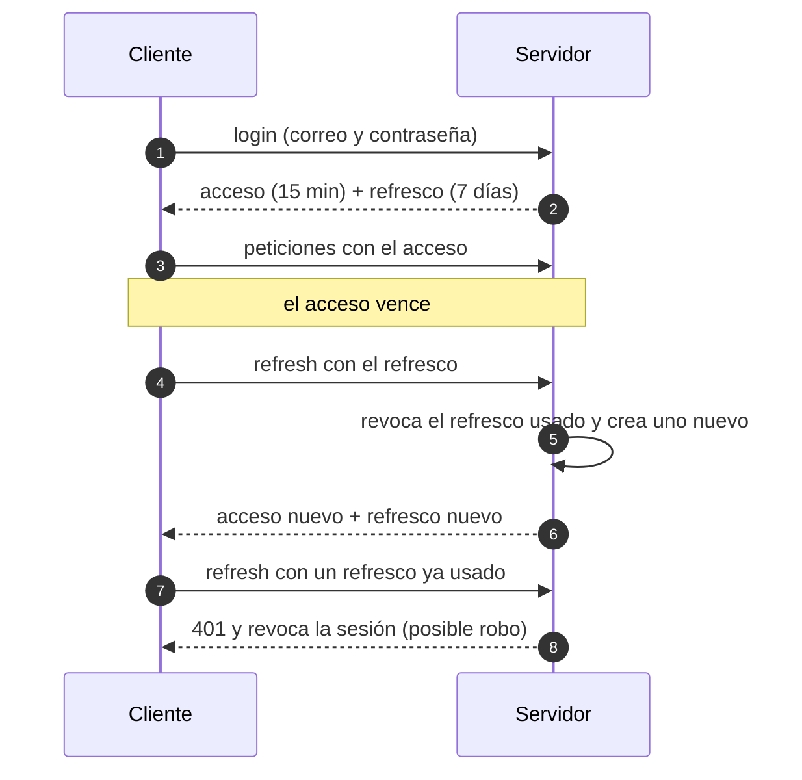

# Autenticación, JWT y contraseñas — ZENDA

<!--
  ¿Qué? Cómo funciona la identidad en ZENDA: tokens JWT de acceso y de refresco, almacenamiento de contraseñas con bcrypt y política de sesiones.
  ¿Para qué? Entender por qué cada decisión (15 minutos, refresco rotativo, hash, límites) existe y cómo implementarla sin errores comunes.
  ¿Impacto? La autenticación es la puerta del sistema: si se rompe, se rompen todos los permisos que dependen de ella.
-->

---

## Identificación

| Campo | Valor |
|---|---|
| **Tema** | Autenticación sin estado con JWT, refresco de sesión y credenciales |
| **Requisitos** | [RF-002](../requisitos/RFs/RF-002_inicio_de_sesion.md), [RF-003](../requisitos/RFs/RF-003_recuperacion_de_contrasena.md), [RF-004](../requisitos/RFs/RF-004_sesion_segura.md), [RT-004](../requisitos/restricciones.md#rt-004--método-de-autenticación), [RT-005](../requisitos/restricciones.md#rt-005--algoritmo-de-hash-de-contraseñas) |
| **Tablas** | `usuarios`, `sesiones_refresh`, `tokens_verificacion_correo` ([esquema](../referencia-tecnica/esquema-bd.md)) |
| **Fecha** | Octubre 2026 |

---

## 1. Autenticación y autorización

| Concepto | Pregunta que responde | En ZENDA |
|---|---|---|
| **Autenticación** | ¿Quién eres? | Correo y contraseña → token ([RF-002](../requisitos/RFs/RF-002_inicio_de_sesion.md)) |
| **Autorización** | ¿Qué puedes hacer? | Rol del token + pertenencia al grupo o a la ficha ([matriz de permisos](../requisitos/matriz-permisos.md)) |

El token **identifica** al usuario; los **permisos se verifican en cada petición** en el servidor.

---

## 2. Qué es un JWT

Un **JSON Web Token** es una cadena de tres partes separadas por puntos, firmada por el servidor:

```text
eyJhbGciOiJIUzI1NiJ9 . eyJ1c3VhcmlvX2lkIjo3LCJyb2wiOiJBUFJFTkRJWiJ9 . 3x9Qe…firma…
   encabezado               contenido (payload)                         firma
```

| Parte | Contiene | Ejemplo decodificado |
|---|---|---|
| **Encabezado** | Algoritmo de firma | `{ "alg": "HS256" }` |
| **Contenido** | Datos (*claims*) | `{ "usuario_id": 7, "rol": "APRENDIZ", "iat": 1760000000, "exp": 1760000900 }` |
| **Firma** | Huella del encabezado y el contenido con la clave secreta | Verifica que nadie lo alteró |

> **El contenido NO está cifrado, solo firmado.** Cualquiera puede leerlo (está en Base64). Por eso **nunca** se guardan en él contraseñas, documentos ni datos sensibles.

| Dato del token | Para qué |
|---|---|
| `usuario_id` | Identificar a la persona |
| `rol` | Primer filtro de permisos |
| `iat` / `exp` | Cuándo se emitió y cuándo caduca |

### Cómo se valida

1. El cliente envía `Authorization: Bearer <token>`.
2. El servidor recalcula la firma con su `JWT_SECRET`; si no coincide → `401`.
3. Comprueba la caducidad (`exp`); si venció → `401`.
4. Carga `usuario_id` y `rol` y deja pasar a los controles de rol y de pertenencia.

```js
import jwt from 'jsonwebtoken';

// Emitir: contenido mínimo y vida corta
const token = jwt.sign({ usuario_id: usuario.usuario_id, rol: usuario.rol }, process.env.JWT_SECRET, {
  algorithm: 'HS256',
  expiresIn: '15m',
});

// Verificar: SIEMPRE con lista blanca de algoritmos
const datos = jwt.verify(token, process.env.JWT_SECRET, { algorithms: ['HS256'] });
```

---

## 3. Por qué hay dos tokens

| | **Token de acceso** | **Token de refresco** |
|---|---|---|
| **Para qué** | Autorizar cada petición a la API | Obtener un acceso nuevo sin volver a pedir la contraseña |
| **Vida** | **15 minutos** | **7 días** |
| **Qué pasa si se roba** | Sirve solo unos minutos | Sirve más tiempo, por eso se **rota** y se puede **revocar** |
| **Dónde se guarda en el servidor** | En ningún lado (sin estado) | Solo su **hash SHA-256** en `sesiones_refresh` |
| **Se envía** | En cada petición | Solo a `/api/auth/refresh` y `/logout` |



### Rotación y detección de reutilización

| Regla | Motivo |
|---|---|
| Cada refresco **se usa una sola vez**; al usarlo se emite otro | Un refresco robado deja de servir en cuanto el dueño legítimo renueva |
| Si llega un refresco **ya usado**, se revoca la sesión entera | Es señal de que alguien lo copió |
| Se guarda el **hash**, no el token | Si se filtra la base de datos, los tokens no sirven |
| El cierre de sesión **revoca** el refresco | Para que "cerrar sesión" signifique algo |

---

## 4. Dónde guardar el token en el navegador

| Opción | Ventaja | Riesgo |
|---|---|---|
| **`localStorage`** (hoy en ZENDA) | Simple; no se envía solo en cada petición | Cualquier script de la página lo lee: un XSS lo roba ([H-13](../testing/hallazgos.md)) |
| **Cookie `HttpOnly` + `Secure` + `SameSite`** | JavaScript no puede leerla | Requiere configurar CORS con credenciales y protección CSRF |
| **En memoria** (variable de JavaScript) | No persiste ante XSS posterior | Se pierde al recargar la página |

**Decisión para v12:** acceso de corta duración en memoria o `localStorage` (mitigado por los 15 minutos y las cabeceras de seguridad) y, si el despliegue lo permite, el **refresco en cookie `HttpOnly`**. Queda por confirmar según el dominio de producción ([pendientes](../requisitos/restricciones.md#pendientes-de-confirmación)).

---

## 5. Sesión y cierre por inactividad

| Regla | Valor | Cómo se implementa |
|---|---|---|
| Vida del acceso | 15 minutos | `expiresIn` del JWT |
| Vida del refresco | 7 días | `fecha_expiracion` en `sesiones_refresh` |
| Inactividad | **30 minutos** | El frontend mide eventos de usuario; aviso a los 29 |
| Cierre manual | Revoca el refresco | `POST /api/auth/logout` |

La renovación cuesta una petición liviana cada 15 minutos; a cambio, un token robado deja de servir rápido.

---

## 6. Contraseñas

### Almacenamiento con bcrypt

| Idea | Explicación |
|---|---|
| **Hash, no cifrado** | Se guarda una huella irreversible; nadie (ni el administrador) puede recuperar la contraseña. |
| **Sal (*salt*)** | bcrypt agrega un valor aleatorio por contraseña: dos usuarios con la misma clave tienen hashes distintos. |
| **Costo (*work factor*)** | ZENDA usa **costo 10**: cada intento tarda lo suficiente para frenar la fuerza bruta. |
| **Nunca se devuelve** | Ni el hash ni la contraseña aparecen en respuestas, registros ni errores ([RS-003](../requisitos/restricciones.md#rs-003--no-exponer-contraseñas)). |

```js
import bcrypt from 'bcryptjs';
const hash = await bcrypt.hash(password, 10);        // al registrar o restablecer
const coincide = await bcrypt.compare(password, hash); // al iniciar sesión
```

### Política de contraseña

| Regla | Detalle |
|---|---|
| Mínimo | **8 caracteres** con al menos **un número** ([RNF-001.8](../requisitos/RNFs/RNF-001_seguridad.md)) |
| Medidor | 5 niveles: muy baja, baja, media, fuerte, muy segura |
| Contraseñas comunes | No superan el nivel `baja` |
| Pegado | Permitido en el campo de contraseña (gestores de contraseñas); bloqueado solo en la confirmación |
| Algoritmo del medidor | Propuesta en [pruebas unitarias, sección 7](../testing/pruebas-unitarias.md#7-medidor-de-fortaleza-propuesta-de-algoritmo) (por confirmar) |

> Una contraseña larga y fácil de recordar (una frase) es más segura que una corta con símbolos. Por eso la longitud pesa más que las reglas de composición.

---

## 7. Recuperación de contraseña

| Paso | Detalle | Por qué |
|---|---|---|
| 1 | El usuario pide el enlace con su correo | — |
| 2 | La respuesta es **siempre la misma**, exista o no el correo | Evita descubrir qué correos tienen cuenta ([H-01](../testing/hallazgos.md)) |
| 3 | Se envía un token de **15 minutos** de **un solo uso** | Limita la ventana de ataque |
| 4 | Al restablecer, el token se invalida | No se puede reutilizar |
| 5 | El enlace sale de `FRONTEND_URL`, no de `localhost` | Funciona en producción ([H-03](../testing/hallazgos.md)) |

---

## 8. Errores comunes y cómo evitarlos

| Error | Consecuencia | Prevención en ZENDA |
|---|---|---|
| Secreto débil o con valor por defecto en el código | Cualquiera fabrica tokens válidos ([H-02](../testing/hallazgos.md)) | El servidor no arranca sin `JWT_SECRET`; mínimo 32 bytes aleatorios |
| Aceptar `alg: none` o no fijar el algoritmo | Tokens sin firma aceptados | `verify` con `algorithms: ['HS256']` |
| Tokens que no caducan | Un robo es permanente | `exp` de 15 minutos |
| Datos sensibles dentro del token | Quedan visibles | Solo `usuario_id`, `rol` y fechas |
| Confiar en el `rol` del token **sin** más controles | Un rol viejo sigue vigente hasta que venza | Vida corta y verificación de pertenencia en el servidor |
| Mensajes distintos para "correo no existe" y "clave incorrecta" | Enumeración de usuarios | Mensaje único: "Credenciales incorrectas" |
| Sin límite de intentos | Fuerza bruta | Límite por IP y por correo ([RF-001](../requisitos/RFs/RF-001_registro_de_aprendiz.md)) |

---

## 9. Hoy y mañana

| Aspecto | v11 | v12 |
|---|---|---|
| Duración del token | 24 horas | 15 minutos + refresco de 7 días |
| Refresco y revocación | No existe | Rotativo, con hash en BD |
| Cierre por inactividad | No | 30 minutos con aviso |
| Política de contraseña | Solo al restablecer | Registro y restablecimiento, con medidor |
| Recuperación | `404` si el correo no existe | Respuesta idéntica; enlace de un solo uso |
| Límite de intentos | No | Sí |
| Verificación de correo | No | Sí |

---

## Documentos relacionados

- [Seguridad y OWASP](seguridad-owasp.md) · [Protección de datos personales](proteccion-de-datos-personales.md)
- [Arquitectura — flujo de login](../referencia-tecnica/arquitectura.md#61-inicio-de-sesión-y-renovación) · [API de autenticación](../referencia-tecnica/api-endpoints.md#4-autenticación--apiauth)
- [Pruebas de integración — sesión](../testing/pruebas-de-integracion.md#it-11--sesión-con-refresco)
