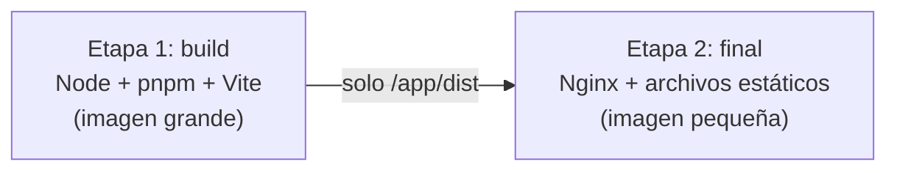
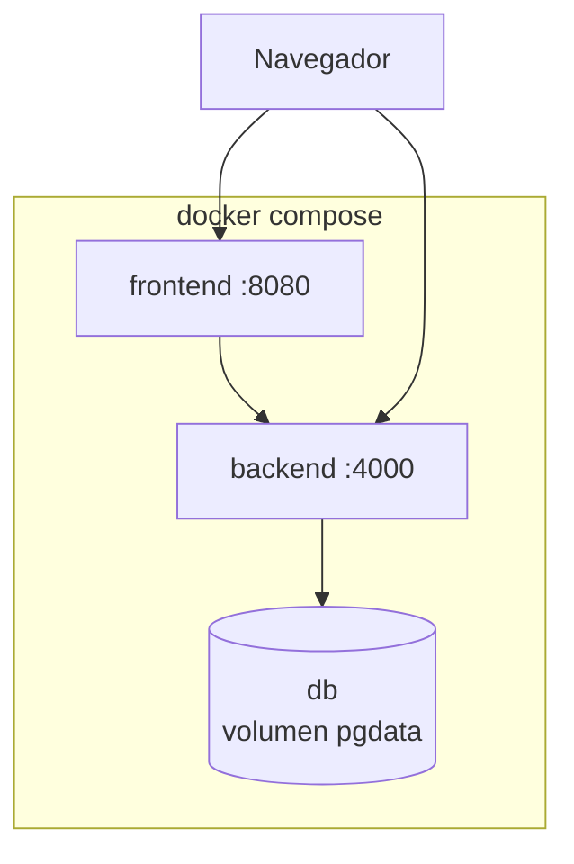

# Contenedores, Docker y Docker Compose — ZENDA

<!--
  ¿Qué? Los conceptos de Docker y Docker Compose explicados con los Dockerfiles y el compose reales de ZENDA.
  ¿Para qué? Entender qué hace cada línea, por qué está ahí y qué se rompe si se cambia.
  ¿Impacto? El despliegue depende de estos archivos: un error aquí significa un sistema que no arranca o que expone secretos.
-->

---

## Identificación

| Campo | Valor |
|---|---|
| **Archivos** | `docker-compose.yml`, `backend/Dockerfile`, `frontend/Dockerfile`, `frontend/nginx.conf`, `.dockerignore` de cada servicio |
| **Guía práctica** | [Instalación con Docker](../setup/con-docker.md) |
| **Requisito** | [RT-008](../requisitos/restricciones.md#rt-008--contenedores-con-docker) · [RNF-006](../requisitos/RNFs/RNF-006_compatibilidad_y_portabilidad.md) · [RNF-008](../requisitos/RNFs/RNF-008_disponibilidad_y_despliegue.md) |
| **Estado** | Sintaxis validada; la ejecución completa la prueba el equipo |
| **Fecha** | Octubre 2026 |

---

## 1. Qué es un contenedor

Un **contenedor** es un proceso aislado que lleva consigo lo que necesita para funcionar: el programa, sus librerías y su configuración. Resuelve el clásico "en mi equipo sí funciona".

| Concepto | Qué es | Analogía | En ZENDA |
|---|---|---|---|
| **Imagen** | Plantilla de solo lectura con el sistema de archivos y el programa | La receta | `zenda-backend`, `zenda-frontend` |
| **Contenedor** | Una imagen **en ejecución** | El plato servido | El backend corriendo en el puerto 4000 |
| **Dockerfile** | Instrucciones para construir una imagen | La receta escrita | `backend/Dockerfile` |
| **Volumen** | Almacenamiento que sobrevive al contenedor | Una nevera aparte | `pgdata`, con los datos de PostgreSQL |
| **Red** | Comunicación entre contenedores por nombre | Una línea interna | El backend llama a `db`, no a `localhost` |
| **Registro** | Almacén de imágenes | Una biblioteca | Docker Hub (de ahí salen `node`, `nginx`, `postgres`) |
| **Compose** | Define y levanta varios contenedores juntos | El menú completo | `docker-compose.yml` |

| | Máquina virtual | Contenedor |
|---|---|---|
| **Aísla** | Un sistema operativo completo | Un proceso |
| **Tamaño** | Gigabytes | Megabytes |
| **Arranque** | Minutos | Segundos |
| **Uso** | Sistemas completos | Aplicaciones |

---

## 2. Cómo se construye una imagen

Cada instrucción del `Dockerfile` crea una **capa**; Docker reutiliza las capas que no cambiaron (**caché**).

| Instrucción | Qué hace |
|---|---|
| `FROM` | Imagen de partida |
| `ARG` | Valor que se da **al construir** |
| `ENV` | Variable que existe **al ejecutar** |
| `WORKDIR` | Carpeta de trabajo |
| `COPY` | Copia archivos al contenedor |
| `RUN` | Ejecuta un comando **al construir** |
| `USER` | Con qué usuario corre el proceso |
| `EXPOSE` | Documenta el puerto (no lo publica) |
| `CMD` | Comando que arranca el contenedor |

### Por qué se copian primero los `package.json`

```dockerfile
COPY package.json pnpm-lock.yaml ./
RUN pnpm install --frozen-lockfile --prod
COPY . .
```

Instalar dependencias es lo más lento. Al copiar **primero** solo los archivos de dependencias, Docker **reutiliza la capa** de `pnpm install` mientras no cambien. Si se hiciera `COPY . .` antes, cualquier cambio en el código obligaría a reinstalar todo.

---

## 3. Los Dockerfiles de ZENDA, línea por línea

### Backend

| Línea | Qué hace | Por qué |
|---|---|---|
| `ARG NODE_VERSION=22` y `FROM node:${NODE_VERSION}-alpine` | Imagen base de Node.js LTS en Alpine | La versión se cambia en **un solo lugar** ([RH-002](../requisitos/restricciones.md#rh-002--versión-lts-de-nodejs-fija)); Alpine pesa poco |
| `ENV NODE_ENV=production` | Modo producción | Menos registros de depuración, mejor rendimiento |
| `RUN corepack enable` | Activa pnpm | pnpm viene con Node vía Corepack |
| `COPY package.json pnpm-lock.yaml ./` y `RUN pnpm install --frozen-lockfile --prod` | Instala solo lo de ejecución, igual al lockfile | Instalación reproducible y sin herramientas de desarrollo |
| `COPY . .` | Copia el código | Después de instalar, para aprovechar la caché |
| `USER node` | El proceso **no** corre como `root` | Si alguien vulnera la aplicación, tiene permisos limitados |
| `EXPOSE 4000` y `CMD ["node", "server.js"]` | Puerto y arranque | Coincide con el puerto real del servidor |

### Frontend: construcción en dos etapas (*multi-stage*)



| Etapa | Contiene | Se envía a producción |
|---|---|:---:|
| **1 — build** | Node, pnpm, el código y `node_modules` | ❌ |
| **2 — final** | Nginx y la carpeta `dist` compilada | ✅ |

**Resultado:** una imagen final de pocos megabytes, sin código fuente ni herramientas de compilación.

| Detalle | Explicación |
|---|---|
| `ARG VITE_API_URL` + `ENV VITE_API_URL=$VITE_API_URL` | Vite **incrusta** esa URL dentro del JavaScript al compilar: es un valor de **construcción**, no de ejecución. Cambiarla exige reconstruir el frontend. |
| `nginx.conf` con `try_files $uri $uri/ /index.html` | React Router maneja las rutas en el navegador; si alguien recarga `/aprendiz`, Nginx debe devolver `index.html` y no un `404`. |
| Cabeceras de seguridad en `nginx.conf` | `X-Content-Type-Options`, `X-Frame-Options`, `Referrer-Policy` ([RNF-001.10](../requisitos/RNFs/RNF-001_seguridad.md)). |

### El archivo `.dockerignore`

Indica qué **no** se copia a la imagen. Debe llamarse **`.dockerignore`** (con punto).

| Se excluye | Motivo |
|---|---|
| `node_modules` | Se reinstala dentro de la imagen con las versiones del lockfile |
| `.env` y `.env.*` | **Los secretos nunca entran en una imagen** (quedan en sus capas y se pueden extraer) |
| `.git`, `*.log`, `dist` | Peso y ruido |

---

## 4. Docker Compose

`docker-compose.yml` describe **todos los servicios y cómo se conectan**.



| Elemento | En el archivo | Qué hace |
|---|---|---|
| `services` | `db`, `backend`, `frontend` | Los tres contenedores |
| `depends_on` con `condition: service_healthy` | `backend` espera a `db` | Evita que el backend arranque antes de que PostgreSQL esté listo |
| `healthcheck` | `pg_isready` cada 5 s | Define qué significa "sano" para la base de datos |
| `environment` | `DB_HOST: db`, `JWT_SECRET: ${JWT_SECRET}` | Pasa configuración; `${…}` se lee del `.env` de la raíz |
| `volumes` | `pgdata` y `./Database/zenda_bd.sql:/docker-entrypoint-initdb.d/…` | Conserva los datos y carga el esquema **solo la primera vez** |
| `ports` | `"4000:4000"`, `"8080:80"` | `puerto del equipo : puerto del contenedor` |
| `restart` | `unless-stopped` | Se reinicia solo tras un fallo ([RNF-008.4](../requisitos/RNFs/RNF-008_disponibilidad_y_despliegue.md)) |
| `args` (build) | `VITE_API_URL` | Entrega el valor de construcción al frontend |

### Detalles que causan problemas

| Detalle | Explicación |
|---|---|
| **`db` no publica puerto** | Solo el backend la alcanza por la red interna: la base de datos no queda expuesta ([RNF-008](../requisitos/RNFs/RNF-008_disponibilidad_y_despliegue.md)). |
| **`DB_HOST` es `db`, no `localhost`** | Dentro de un contenedor, `localhost` es **el propio contenedor**. Los servicios se hablan por el nombre del servicio. |
| **El script SQL corre una sola vez** | Solo cuando el volumen está **vacío**. Si cambias `zenda_bd.sql`, hay que borrar el volumen (`docker compose down -v`, que **borra los datos**). |
| **Cambiar la contraseña de la base no surte efecto** | `POSTGRES_PASSWORD` solo se aplica al crear el volumen. |
| **`VITE_API_URL` es la URL que ve el navegador** | Es la del backend **desde afuera** (por ejemplo `http://localhost:4000`), no `http://backend:4000`. |

---

## 5. Buenas prácticas de seguridad

| Práctica | Cómo se aplica | Riesgo que evita |
|---|---|---|
| Proceso **sin `root`** | `USER node` | Escalada de privilegios si hay una vulnerabilidad |
| **Secretos fuera de la imagen** | `.dockerignore` + variables de entorno en tiempo de ejecución | Que una imagen publicada contenga claves |
| **Imagen base pequeña y oficial** | `node:<LTS>-alpine`, `nginx:alpine`, `postgres:16-alpine` | Menos paquetes = menos vulnerabilidades |
| **Versiones controladas** | `NODE_VERSION` como argumento; evitar la etiqueta `latest` | Cambios inesperados entre construcciones |
| **Solo dependencias de ejecución** | `pnpm install --prod` en el backend | Herramientas de desarrollo en producción |
| **Exponer solo lo necesario** | La base de datos no publica puertos | Acceso directo a los datos |
| **Reconstruir para parchear** | Reconstruir las imágenes cuando haya correcciones del sistema base | Vulnerabilidades en la imagen base |
| **Escanear imágenes** | `docker scout` o Trivy (propuesta) | Paquetes vulnerables en la imagen |

---

## 6. Desarrollo y producción

| Aspecto | Desarrollo (Compose local) | Producción |
|---|---|---|
| Base de datos | Contenedor `db` con volumen | Servicio gestionado o servidor con copias programadas |
| Almacenamiento de archivos | MinIO | S3 gestionado |
| HTTPS | No necesario | **Obligatorio** (proxy inverso con certificado) |
| Secretos | `.env` local | Gestor de secretos del proveedor |
| `VITE_API_URL` | `http://localhost:4000` | La URL pública del backend |
| Datos de prueba | Cargados con el *seed* | **Nunca** |
| Puertos expuestos | Backend y frontend | Solo el proxy inverso |

Los pasos de despliegue están en [Instalación con Docker, sección 8](../setup/con-docker.md#8-llevarlo-a-producción).

---

## 7. Comandos de uso diario

| Objetivo | Comando |
|---|---|
| Construir y levantar | `docker compose up --build` |
| Ver estado y registros | `docker compose ps` · `docker compose logs -f backend` |
| Detener conservando datos | `docker compose down` |
| Detener **y borrar la base** | `docker compose down -v` |
| Reconstruir un servicio | `docker compose up -d --build backend` |
| Entrar a un contenedor | `docker compose exec backend sh` |
| Consola SQL | `docker compose exec db sh -c 'psql -U "$POSTGRES_USER" -d "$POSTGRES_DB"'` |
| Limpiar imágenes sin uso | `docker image prune` |

La lista completa y los problemas frecuentes están en [Instalación con Docker](../setup/con-docker.md#6-comandos-del-día-a-día).

---

## 8. Lista de verificación de un Dockerfile

| # | Pregunta | ✅ |
|:---:|---|:---:|
| 1 | ¿La imagen base es oficial, pequeña y de una versión **LTS** fijada con un argumento? | ☐ |
| 2 | ¿Se copian primero los archivos de dependencias y luego el código? | ☐ |
| 3 | ¿Usa `pnpm install --frozen-lockfile` (y `--prod` si es de ejecución)? | ☐ |
| 4 | ¿El proceso corre con un usuario sin privilegios? | ☐ |
| 5 | ¿Hay un `.dockerignore` (con punto) que excluye `node_modules` y `.env`? | ☐ |
| 6 | ¿El puerto de `EXPOSE` coincide con el que usa la aplicación? | ☐ |
| 7 | ¿Los valores de construcción son `ARG` y los de ejecución, variables de entorno? | ☐ |
| 8 | ¿Se probó `docker compose up --build` desde cero? | ☐ |

---

## Documentos relacionados

- [Instalación con Docker](../setup/con-docker.md) · [Variables de entorno](../setup/variables-de-entorno.md) · [Arquitectura — despliegue](../referencia-tecnica/arquitectura.md#3-contenedores-y-despliegue)
- [Dependencias y cadena de suministro](dependencias-y-cadena-de-suministro.md) · [Seguridad y OWASP](seguridad-owasp.md) · [Hallazgos — Docker](../testing/hallazgos.md)
