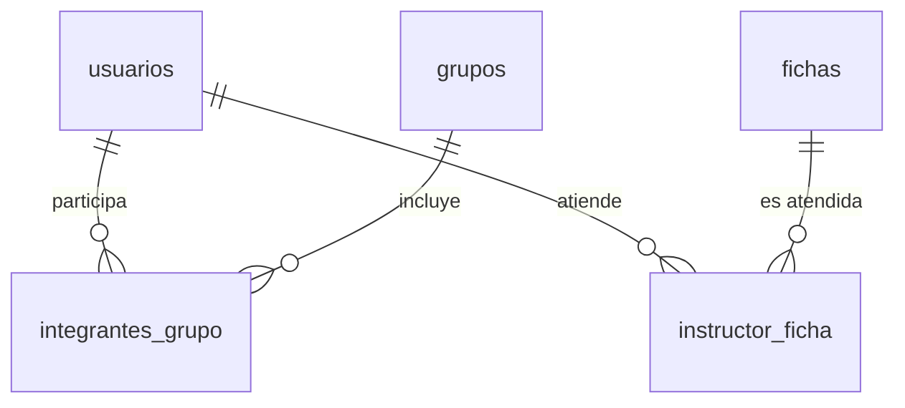

# Modelo relacional, SQL y transacciones — ZENDA

<!--
  ¿Qué? Los conceptos de bases de datos relacionales que sostienen el esquema de ZENDA, explicados con sus propias tablas y consultas.
  ¿Para qué? Entender por qué el esquema tiene esa forma y poder escribir consultas correctas, rápidas y seguras (ZENDA usa SQL directo, sin ORM).
  ¿Impacto? Sin ORM, cada consulta depende de que quien la escribe conozca el modelo: un error aquí es un dato incorrecto o una fuga.
-->

---

## Identificación

| Campo | Valor |
|---|---|
| **Motor** | PostgreSQL 16 ([RT-003](../Requisitos/restricciones.md#rt-003--base-de-datos-obligatoria)) |
| **Acceso** | Biblioteca `pg` con SQL parametrizado ([RS-005](../Requisitos/restricciones.md#rs-005--consultas-sql-parametrizadas)) |
| **Esquema** | [esquema-bd.md](../Referencia-Tecnica/esquema-bd.md) · [MER y MR](../Diagramas/mer-mr.md) |
| **Fecha** | 23-oct-2026 |

---

## 1. Conceptos básicos

| Concepto | Qué es | Ejemplo en ZENDA |
|---|---|---|
| **Tabla** | Conjunto de filas con las mismas columnas | `evidencias` |
| **Clave primaria (PK)** | Identifica una fila de forma única | `evidencia_id` |
| **Clave foránea (FK)** | Apunta a la PK de otra tabla; garantiza que lo referenciado existe | `evidencias.carpeta_id → carpetas.carpeta_id` |
| **Restricción única (UNIQUE)** | Impide repetidos | `usuarios.correo`, `fichas.numero_ficha` |
| **NOT NULL** | La columna es obligatoria | `evidencias.nombre_evidencia` |
| **CHECK** | Limita los valores permitidos | `tareas.prioridad IN ('Alta','Media','Baja')` |
| **DEFAULT** | Valor si no se indica | `usuarios.estado = 'Activo'` |
| **Columna de identidad** | Número generado automáticamente | `GENERATED BY DEFAULT AS IDENTITY` |

**Por qué importan:** las restricciones hacen que la **base de datos defienda sus propias reglas**, aunque el código de la aplicación falle o alguien edite datos a mano. Una validación solo en el backend se puede saltar; una restricción, no.

---

## 2. Relaciones entre tablas

| Tipo | Significado | Cómo se modela | Ejemplo |
|---|---|---|---|
| **1 : N** | Un registro se relaciona con muchos | FK en el lado "muchos" | Una carpeta tiene muchas evidencias |
| **1 : 1** | Uno con uno | FK con `UNIQUE` | Un grupo tiene un proyecto (`proyectos.grupo_id` único) |
| **N : M** | Muchos con muchos | **Tabla intermedia** con dos FK | Aprendices y grupos → `integrantes_grupo`; instructores y fichas → `instructor_ficha` |



Las tablas intermedias suelen cargar **datos propios de la relación**: `integrantes_grupo` guarda `fecha_ingreso` y `fecha_salida`; `instructor_ficha`, `fecha_inicio` y `fecha_fin`. Por eso esas relaciones tienen historia.

---

## 3. Normalización: guardar cada dato una sola vez

| Forma | Regla | Cómo se ve en ZENDA |
|---|---|---|
| **1FN** | Un valor por celda; sin listas dentro de una columna | Los integrantes **no** van como una lista en `grupos`: tienen su tabla |
| **2FN** | Cada columna depende de **toda** la clave | `integrantes_grupo` guarda solo datos de la relación grupo–usuario, no datos del usuario |
| **3FN** | Las columnas no dependen de otras columnas que no son clave | El nombre del programa vive en `programas`, no se copia en cada ficha |

**Estado derivado:** `carpetas.estado_carpeta` y `fases.estado_fase` no son datos independientes: se recalculan a partir de las evaluaciones vigentes (RN-018). No hay versionado de evidencias en el esquema actual; `evidencias.tipo_evidencia` y `evidencias.ubicacion` son la fuente de verdad.

---

## 4. Transacciones

Una **transacción** agrupa varias operaciones para que ocurran **todas o ninguna**.

| Propiedad (ACID) | Significa | Ejemplo |
|---|---|---|
| **A**tomicidad | Todo o nada | Crear el proyecto crea grupo, proyecto y 5 fases, o nada |
| **C**onsistencia | Se respetan las restricciones | Nunca queda un proyecto sin fases |
| **A**islamiento | Las transacciones simultáneas no se estorban | Dos aprendices que se unen a la vez no superan el cupo |
| **D**urabilidad | Lo confirmado no se pierde | Tras `COMMIT`, sobrevive a un reinicio |

```js
const client = await pool.connect();
try {
  await client.query('BEGIN');
  // ...varios INSERT y UPDATE con client.query(...)
  await client.query('COMMIT');
} catch (e) {
  await client.query('ROLLBACK');   // deshace todo lo hecho dentro del BEGIN
  throw e;
} finally {
  client.release();                 // SIEMPRE devolver la conexión al pool
}
```

> Usar `pool.query` para cada paso **no** es una transacción: cada llamada podría usar una conexión distinta. Dentro de una transacción se usa **un mismo** `client`.

### Concurrencia: el último cupo

El aislamiento por defecto de PostgreSQL (*Read Committed*) no impide que dos transacciones lean "queda 1 cupo" al mismo tiempo. Se resuelve **bloqueando la fila** del grupo:

```sql
BEGIN;
SELECT cupo_maximo FROM grupos WHERE grupo_id = $1 FOR UPDATE;   -- la otra transacción espera aquí
SELECT count(*) FROM integrantes_grupo WHERE grupo_id = $1 AND estado_integrante = 'Activo';
-- si hay cupo: INSERT INTO integrantes_grupo ...
COMMIT;
```

Prueba: [IT-12](../Testing/pruebas-de-integracion.md#it-12--concurrencia-del-último-cupo).

---

## 5. Consultas de ejemplo con el esquema actual

### Resultado vigente de cada evidencia de una carpeta

```sql
SELECT e.evidencia_id, e.nombre_evidencia, ev.resultado
  FROM evidencias e
  LEFT JOIN LATERAL (
    SELECT resultado
      FROM evaluaciones
     WHERE evidencia_id = e.evidencia_id
     ORDER BY evaluacion_id DESC
     LIMIT 1
  ) ev ON true
 WHERE e.carpeta_id = $1;
```

`LEFT JOIN` conserva las evidencias **sin evaluar** (`resultado` queda en `NULL`). Con `INNER JOIN` desaparecerían, y la carpeta parecería completa.

### Avance de una fase (evidencias aprobadas sobre el total)

```sql
SELECT count(*) FILTER (WHERE ev.resultado = 'APROBADO') AS aprobadas,
       count(*)                                         AS total
  FROM carpetas c
  JOIN evidencias e ON e.carpeta_id = c.carpeta_id
  LEFT JOIN LATERAL (
    SELECT resultado
      FROM evaluaciones
     WHERE evidencia_id = e.evidencia_id
     ORDER BY evaluacion_id DESC
     LIMIT 1
  ) ev ON true
 WHERE c.fase_id = $1;
```

### ¿El instructor atiende hoy esta ficha?

```sql
SELECT 1
  FROM instructor_ficha
 WHERE instructor_id = $1 AND ficha_id = $2 AND fecha_fin IS NULL;
```

### ¿El aprendiz ya tiene un proyecto activo?

```sql
SELECT 1
  FROM integrantes_grupo i
  JOIN grupos g    ON g.grupo_id = i.grupo_id AND NOT g.es_general
  JOIN proyectos p ON p.grupo_id = g.grupo_id AND p.estado_proyecto = 'Activo'
 WHERE i.usuario_id = $1 AND i.estado_integrante = 'Activo';
```

### Recalificar sin perder la evaluación anterior (en una transacción)

```sql
INSERT INTO evaluaciones (evidencia_id, instructor_id, resultado, fecha_evaluacion)
VALUES ($1, $2, $3, clock_timestamp());
```

No se actualiza ninguna fila: la vigente es la de mayor `evaluacion_id`. Así se conserva el historial y dos evaluaciones concurrentes no se pisan.

---

## 6. Índices

Un índice acelera la búsqueda a costa de algo de espacio y de escritura. PostgreSQL crea uno automático para cada PK y cada `UNIQUE`, **pero no para las claves foráneas**.

| Tipo | Para qué | En ZENDA |
|---|---|---|
| **Sobre clave foránea** | Acelerar `JOIN` y `WHERE` por esa columna | `evidencias(carpeta_id)`, `tareas(proyecto_id)` ([migración](../../Database/migrations/002_semana2.sql)) |
| **Único** | Impedir repetidos | `usuarios(correo)` |
| **Único parcial** | Impedir repetidos **solo entre las filas que cumplen una condición** | Una evaluación `vigente` por evidencia; una vinculación con `fecha_fin IS NULL` por instructor y ficha |

**Cómo saber si una consulta usa índice:**

```sql
EXPLAIN ANALYZE SELECT ... ;   -- busca "Index Scan"; "Seq Scan" en una tabla grande es una alerta
```

Prueba: [PNF-R06](../Testing/pruebas-no-funcionales.md#2-pruebas).

---

## 7. Historial, borrado lógico y migraciones

| Técnica | Idea | Dónde |
|---|---|---|
| **Historial por inserción** | No se actualiza: cada recalificación agrega una fila y la vigente es la de mayor `evaluacion_id` | `evaluaciones` |
| **Historial por fechas** | Se cierra con `fecha_fin` en lugar de borrar | `instructor_ficha` |
| **Borrado lógico** | `eliminada = true`; las consultas filtran | **No implementado** (Semana 4) |
| **Auditoría** | Tabla `auditoria` con `detalle` en `JSONB` | **No implementado** (Semanas 3–6) |
| **Migraciones** | Scripts numerados que llevan el esquema de una versión a otra sin borrar datos | `002_semana2.sql` |

**Reglas de migración:** corren en una transacción; usan `IF [NOT] EXISTS`; **nunca se edita una ya fusionada**; se prueban sobre una copia ([IT-13](../Testing/pruebas-de-integracion.md#it-13--migración-de-v11-al-esquema-actual)).

---

## 8. Tipos de datos y decisiones del esquema

| Tema | Decisión | Motivo o pendiente |
|---|---|---|
| **Identidad** | `GENERATED BY DEFAULT AS IDENTITY` | Reemplaza a `SERIAL`; es el estándar actual |
| **Roles** | `ENUM tipo_rol` | Cuatro valores estables; cambiarlo exige migración |
| **Estados** | `VARCHAR` con `CHECK` | Más fácil de ampliar que un `ENUM` |
| **Fechas** | `TIMESTAMP` sin zona horaria | Pendiente: valorar `TIMESTAMPTZ` para evitar ambigüedades; [RNF-013.4](../Requisitos/RNFs/RNF-013_interoperabilidad_y_api.md) pide mostrar en hora de Colombia |
| **Textos largos** | `VARCHAR(500)` en descripciones | El límite se valida también en el backend ([RNF-009.9](../Requisitos/RNFs/RNF-009_integridad_de_datos.md)) |
| **Booleanos** | `BOOLEAN NOT NULL DEFAULT …` | Evita el "tres estados" (verdadero, falso, nulo) |
| **JSON** | `JSONB` solo en una futura tabla `auditoria` | Datos variables que no se consultan a diario |
| **Contraseñas y tokens** | Solo hash | [Autenticación](autenticacion-jwt.md) |

---

## 9. Errores comunes

| Error | Consecuencia | Prevención |
|---|---|---|
| Concatenar valores en el SQL | Inyección | Parámetros `$1`, `$2` |
| `INNER JOIN` donde hacía falta `LEFT JOIN` | Desaparecen filas sin relación (evidencias sin evaluar) | Pensar qué pasa con lo que **no** tiene pareja |
| Olvidar elegir la evaluación vigente | Se cuenta una evaluación histórica | Usar siempre `LATERAL … ORDER BY evaluacion_id DESC LIMIT 1` |
| `pool.query` dentro de una transacción | No es atómico | Un solo `client` |
| No liberar el cliente | Se agota el pool | `release()` en `finally` |
| El problema N+1: una consulta por cada fila | Lentitud | Una consulta con `JOIN` o `IN` |
| Dividir por cero en porcentajes | Error o `NaN` | Controlar el caso de total `0` |
| `SELECT *` | Trae columnas sensibles (`contrasena`) | Listar columnas ([RS-003](../Requisitos/restricciones.md#rs-003--no-exponer-contraseñas)) |
| `OFFSET` enorme para paginar | Se vuelve lento | Paginar con límite y criterio estable; evaluar paginación por cursor |

---

## 10. Lista de verificación para una tabla nueva

| # | Pregunta | ✅ |
|:---:|---|:---:|
| 1 | ¿Tiene clave primaria y nombre en español, `snake_case`, plural? | ☐ |
| 2 | ¿Cada FK tiene su restricción **y** su índice? | ☐ |
| 3 | ¿Las columnas obligatorias son `NOT NULL` y los valores cerrados tienen `CHECK`? | ☐ |
| 4 | ¿Necesita historial (vigencia o fechas) en lugar de `UPDATE`? | ☐ |
| 5 | ¿Debe usar borrado lógico? | ☐ |
| 6 | ¿Registra quién y cuándo cuando el modelo lo necesita (`usuario_id`, `fecha_creacion`, `fecha_subida`)? | ☐ |
| 7 | ¿Hay una migración numerada y se actualizaron [esquema](../Referencia-Tecnica/esquema-bd.md) y [MER/MR](../Diagramas/mer-mr.md)? | ☐ |

---

## Documentos relacionados

- [Esquema de base de datos](../Referencia-Tecnica/esquema-bd.md) · [MER y MR](../Diagramas/mer-mr.md) · [Patrones de arquitectura](patrones-arquitectonicos.md)
- [Convenciones de código — SQL](../Colaboracion/convenciones-de-codigo.md#5-sql-y-acceso-a-datos) · [Pruebas de integración](../Testing/pruebas-de-integracion.md)
