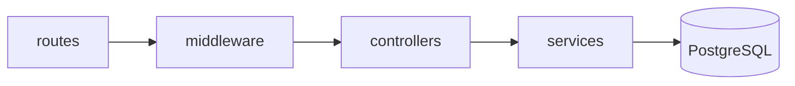

# Patrones de arquitectura y diseño — ZENDA

<!--
  ¿Qué? Los patrones de diseño y de arquitectura que ZENDA usa o adopta, con el problema concreto que resuelve cada uno.
  ¿Para qué? Que las decisiones de estructura tengan una razón y se puedan explicar en la sustentación y en las revisiones de código.
  ¿Impacto? Un patrón sin problema detrás es complejidad gratuita; un problema sin patrón termina en código duplicado y frágil.
-->

---

## Identificación

| Campo | Valor |
|---|---|
| **Alcance** | Backend, frontend y datos |
| **Se aplica en** | [Arquitectura](../Referencia-Tecnica/arquitectura.md) · [Clases](../Diagramas/clases.md) · [Componentes](../Diagramas/componentes.md) |
| **Fecha** | Octubre 2026 |

**Leyenda:** ✅ ya existe en el código actual · 🔄 se reorganiza · 🆕 propuesto para las Semanas 3–6.

> **Regla de oro:** un patrón se adopta cuando hay un problema real. En un proyecto formativo, *menos estructura bien aplicada* vale más que mucha estructura a medias.

---

## 1. Mapa de patrones

| # | Patrón | Problema que resuelve en ZENDA | Dónde | Estado |
|:---:|---|---|---|:---:|
| 1 | Cliente–servidor con SPA y API REST | Separar la interfaz de las reglas y los datos | Frontend ↔ backend | ✅ |
| 2 | Arquitectura en capas | Que cada archivo tenga una sola responsabilidad | `routes` → `controllers` → `services` → `config` | ✅ 🔄 |
| 3 | Cadena de middleware | Autenticar y autorizar antes de llegar a la lógica | `auth`, `isAprendiz`… | ✅ |
| 4 | Capa de servicios con funciones puras | Probar y reutilizar reglas sin base de datos | `CascadaService`, `AvanceService` | 🆕 |
| 5 | Transacción (unidad de trabajo) | Que una operación compuesta ocurra completa o no ocurra | `crearProyecto`, evaluar | ✅ |
| 6 | Máquina de estados | Que solo existan transiciones válidas | Tarea, fase, carpeta, cuenta, sesión | ✅ 🔄 |
| 7 | Registro con historial (*append-only*) | No perder quién hizo qué ni cuándo | Evaluaciones, versiones, vinculaciones | 🆕 |
| 8 | Borrado lógico | Quitar de la vista sin destruir el rastro | Evidencias | 🆕 |
| 9 | Agregados | Cambiar un conjunto de datos de forma consistente | Proyecto, grupo, ficha | 🆕 |
| 10 | Adaptador / estrategia de almacenamiento | Cambiar de MinIO a S3 sin tocar la lógica | `AlmacenamientoService` | 🆕 |
| 11 | Control optimista de concurrencia | Evitar que dos personas se pisen al editar | Tareas, proyectos | 🆕 |
| 12 | Capa cliente de la API (fachada) | Un solo lugar para token, errores y rutas | `api/` | ✅ 🔄 |
| 13 | Contexto y *hooks* de React | Compartir tema y sesión sin pasar propiedades | `ThemeContext`, `AuthContext` | ✅ 🆕 |
| 14 | Configuración externa (12 factores) | Mismo código en desarrollo, pruebas y producción | `.env`, Docker | ✅ 🔄 |

---

## 2. Patrones del backend

### 2.1 Arquitectura en capas



| Capa | Responsabilidad | Regla |
|---|---|---|
| `routes` | Dice qué ruta usa qué controlador y qué middleware | No contiene lógica |
| `middleware` | Autenticación, roles, errores | No consulta datos del negocio |
| `controllers` | Valida la entrada y arma la respuesta HTTP | No duplica reglas |
| `services` | Reglas de negocio reutilizables | No conoce `req` ni `res` |
| `config` | Conexión y variables de entorno | Sin secretos por defecto |

**Beneficio:** la regla de la cascada se escribe **una vez** en `CascadaService` y la usan el instructor y el aprendiz; si cambia, cambia en un solo lugar. **Costo:** más archivos. Se justifica porque hoy esa lógica vive dentro de un controlador y no se puede probar aislada.

### 2.2 Cadena de middleware

Cada petición pasa por una cadena de funciones; cualquiera puede **cortarla** respondiendo un error.

```js
// El orden importa: primero la identidad, luego el rol, al final la lógica
router.post('/evidencias/:evidenciaId/evaluar', auth, isInstructor, evaluarEvidencia);
```

| Eslabón | Si falla |
|---|---|
| `auth` | `401` (sin token o token inválido) |
| `isInstructor` | `403` (el rol no corresponde) |
| `evaluarEvidencia` | `403` si la ficha no está a su cargo; `400` si el dato es inválido |

### 2.3 Funciones puras y capa de servicios

Una **función pura** devuelve siempre lo mismo para los mismos datos y no toca la base de datos. Son las más fáciles de probar ([pruebas unitarias](../Testing/pruebas-unitarias.md)).

```js
// Pura: no lee la base de datos; recibe los resultados ya consultados
export function calcularEstadoCarpeta(resultados) {
  if (resultados.length === 0) return 'Pendiente';
  if (resultados.includes('REPROBADO')) return 'Desaprobada';
  if (resultados.every((r) => r === 'APROBADO')) return 'Aprobada';
  return 'En revisión';
}
```

**Patrón de uso:** el servicio **consulta** (con SQL), llama a la función pura para **decidir** y luego **guarda**. Así la decisión se prueba sin base de datos y la consulta se prueba en integración.

### 2.4 Transacción (unidad de trabajo)

Cuando una operación toca varias tablas, todas se guardan o ninguna.

| Operación | Tablas que toca | Si falla a la mitad |
|---|---|---|
| Crear proyecto | `grupos`, `integrantes_grupo`, `proyectos`, `fases` | `ROLLBACK`: no queda un grupo huérfano |
| Evaluar evidencia | `evaluaciones`, `carpetas`, `fases` | `ROLLBACK`: el estado nunca queda incoherente |
| Reasignar instructor | `instructor_ficha`, `auditoria` | `ROLLBACK` |

Esqueleto con `BEGIN`, `COMMIT`, `ROLLBACK` y `release()` en `finally`: [convenciones, sección 5](../Colaboracion/convenciones-de-codigo.md#5-sql-y-acceso-a-datos). Prueba: [IT-03](../Testing/pruebas-de-integracion.md#it-03--atomicidad-al-crear-un-proyecto).

### 2.5 Máquina de estados

Se define **qué estados existen y qué transiciones son válidas** en un solo lugar, y todo lo demás consulta esa definición.

```js
// constants/estados.js
export const TRANSICIONES_TAREA = {
  'Pendiente':   [{ a: 'En proceso', actor: 'responsable' }],
  'En proceso':  [{ a: 'Finalizada', actor: 'responsable' }],
  'Finalizada':  [{ a: 'Confirmada', actor: 'lider' }, { a: 'Incompleta', actor: 'lider' }],
  'Incompleta':  [{ a: 'En proceso', actor: 'responsable' }],
  'Confirmada':  [],
};
export const puedeTransicionar = (de, a, actor) =>
  (TRANSICIONES_TAREA[de] ?? []).some((t) => t.a === a && t.actor === actor);
```

Los diagramas están en [estados](../Diagramas/estados.md); las reglas, en [RN-022](../Requisitos/reglas-de-negocio.md#rn-022--flujo-de-estados-de-la-tarea).

### 2.6 Registro con historial (*append-only*)

En lugar de **actualizar** un registro, se **agrega uno nuevo** y el anterior queda como histórico.

| Registro | Marca de vigencia | Garantiza |
|---|---|---|
| Evaluación de evidencia | `vigente` | Autoría del instructor anterior ([RN-017](../Requisitos/reglas-de-negocio.md#rn-017--historial-de-evaluaciones)) |
| Versión de evidencia | `vigente` | Versiones anteriores a salvo ([RN-014](../Requisitos/reglas-de-negocio.md#rn-014--versionado-y-borrado-lógico)) |
| Vinculación instructor–ficha | `fecha_fin` | Quién atendió cada ficha y cuándo ([RN-024](../Requisitos/reglas-de-negocio.md#rn-024--asignación-instructorficha-con-historial)) |

La base de datos lo refuerza con **índices únicos parciales** (`WHERE vigente`): imposible tener dos evaluaciones vigentes para la misma evidencia ([esquema](../Referencia-Tecnica/esquema-bd.md#3-restricciones-e-índices)).

> **Qué problema evita:** hoy un `UPDATE` sobrescribe la evaluación y al instructor anterior ([H-06](../Testing/hallazgos.md)).

### 2.7 Borrado lógico

Eliminar una evidencia marca `eliminada = true`, con quién y cuándo; las consultas normales la filtran. Permite auditar, deshacer y conservar el historial de versiones. **Contrapartida:** todas las consultas deben filtrar `eliminada = false`; por eso se centraliza en el servicio.

### 2.8 Agregados

Un **agregado** es un grupo de objetos que se modifican juntos a través de su raíz ([modelo de dominio, sección 4](../Diagramas/modelo-dominio.md#4-agregados)).

| Agregado | Raíz | Regla que protege |
|---|---|---|
| Proyecto | `Proyecto` | Siempre tiene sus 5 fases |
| Grupo | `Grupo` | No se supera el cupo; un solo proyecto activo por aprendiz |
| Ficha | `Ficha` | El historial de instructores y la lista de chequeo permanecen |

**Consecuencia práctica:** no se modifica una `fase` ni una `carpeta` "por fuera"; se hace mediante la operación del servicio que recalcula los estados.

### 2.9 Adaptador de almacenamiento

El resto del sistema habla con una **interfaz** (`guardar`, `urlDeDescarga`, `eliminar`); detrás hay un **adaptador** para MinIO en desarrollo o S3 en producción.

```js
// El controlador no sabe si es MinIO, S3 o disco
const ruta = await almacenamiento.guardar(archivo);
```

**Beneficio:** cambiar de proveedor es cambiar configuración, no código ([RT-006](../Requisitos/restricciones.md#rt-006--evidencias-como-archivo-o-enlace)). Es también lo que permite probar subidas con un adaptador en memoria.

### 2.10 Control optimista de concurrencia

Cuando dos personas editan lo mismo a la vez, **gana quien guarda primero** y al segundo se le avisa. Se compara la fecha de última modificación con la que el cliente leyó.

```sql
UPDATE tareas SET titulo = $1, fecha_actualizacion = now()
 WHERE tarea_id = $2 AND fecha_actualizacion = $3;   -- si no afecta filas: hubo un cambio ajeno
```

Prueba: [PNF-I09](../Testing/pruebas-no-funcionales.md#2-pruebas). Para el cupo del grupo se usa **bloqueo de fila** (`SELECT … FOR UPDATE`), porque ahí un conflicto no debe resolverse con un aviso sino con exclusión ([RNF-014.1](../Requisitos/RNFs/RNF-014_concurrencia_y_consistencia.md)).

---

## 3. Patrones del frontend

| Patrón | Cómo se aplica | Regla |
|---|---|---|
| **Fachada de la API** | `api/` agrupa todas las llamadas HTTP, adjunta el token y normaliza errores | Las pantallas no usan `fetch` directo |
| **Contexto** | `ThemeContext` (tema) y `AuthContext` (usuario, rol, renovación) | Solo lo verdaderamente global va al contexto |
| ***Hooks* personalizados** | `useInactividad`, `useApi` | Lógica reutilizable fuera de los componentes |
| **Rutas protegidas** | Un componente que comprueba sesión y rol antes de mostrar la pantalla | Comodidad, no seguridad: el servidor decide |
| **Componentes pequeños y reutilizables** | `components/ui`: tarjeta, tabla, menú de tres puntos, barra lateral | Un componente, una tarea |
| **Estados de pantalla** | Cargando, vacío, error y con datos, siempre contemplados | Nunca una pantalla en blanco |

---

## 4. Configuración y despliegue: los 12 factores

Conjunto de buenas prácticas para aplicaciones desplegables. Los que más pesan en ZENDA:

| Factor | En ZENDA |
|---|---|
| **Configuración** en el entorno | Variables en `.env`, nunca en el código ([RS-001](../Requisitos/restricciones.md#rs-001--secretos-fuera-del-código-y-del-repositorio)) |
| **Dependencias** declaradas | `package.json` con versiones exactas y `pnpm-lock.yaml` |
| **Servicios de apoyo** como recursos | Base de datos, correo y almacenamiento se cambian por configuración |
| **Procesos sin estado** | El backend no guarda sesiones ni archivos en disco: se puede replicar |
| **Paridad entre entornos** | Docker Compose para que desarrollo y producción se parezcan |
| **Registros** como flujo | Se escribe en la salida estándar; el entorno los recoge |
| **Desechabilidad** | Arranca rápido y se detiene sin dañar nada |

---

## 5. Antipatrones a evitar

| Antipatrón | Señal | Alternativa |
|---|---|---|
| **Controlador gigante** | 200 líneas con SQL, reglas y respuesta | Extraer a servicios |
| **Regla repetida** | La misma validación en tres controladores | Un servicio o una función pura |
| **Lógica solo en el frontend** | Ocultar un botón como único control | Validar en el servidor |
| **SQL por concatenación** | `` `... '${valor}'` `` | Parámetros `$1` |
| **Números mágicos** | `15 * 60` suelto | Constantes con nombre |
| **Actualizar lo que debe conservar historial** | `UPDATE` sobre evaluaciones | Insertar y marcar `vigente` |
| **Atrapar y callar** | `catch {}` vacío | Registrar y responder con el código correcto |
| **Estado imposible** | Una tarea `Confirmada` que vuelve a `Pendiente` | Máquina de estados |
| **Sobreingeniería** | Capas y abstracciones sin problema detrás | Empezar simple; extraer cuando duela |

---

## 6. Qué patrón elegir

| Si necesitas… | Usa… |
|---|---|
| Reutilizar una regla de negocio | Servicio con función pura |
| Que algo ocurra completo o no ocurra | Transacción |
| Limitar qué cambios de estado son válidos | Máquina de estados |
| Conservar quién hizo qué | Registro con historial |
| Cambiar de proveedor sin reescribir | Adaptador |
| Evitar que dos usuarios se pisen | Control optimista; o bloqueo si es un cupo |
| Compartir sesión o tema en la interfaz | Contexto |

---

## Documentos relacionados

- [Arquitectura](../Referencia-Tecnica/arquitectura.md) · [Clases](../Diagramas/clases.md) · [Componentes](../Diagramas/componentes.md) · [Modelo de dominio](../Diagramas/modelo-dominio.md)
- [Modelo relacional y SQL](modelo-relacional-y-sql.md) · [Contenedores y Docker](contenedores-docker.md)
- [Convenciones de código](../Colaboracion/convenciones-de-codigo.md)
