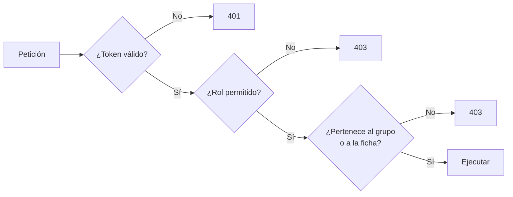

# REST y diseño de la API — ZENDA

<!--
  ¿Qué? Los conceptos de REST y HTTP que sostienen la API de ZENDA y las convenciones que el equipo sigue para diseñar rutas, respuestas y errores.
  ¿Para qué? Que cada endpoint nuevo se parezca a los existentes y que el frontend no tenga que adivinar cómo responde el servidor.
  ¿Impacto? Una API inconsistente complica el frontend, las pruebas y cualquier integración futura.
-->

---

## Identificación

| Campo | Valor |
|---|---|
| **Estilo** | API REST sobre HTTP con cuerpos JSON bajo el prefijo `/api` |
| **Contrato vigente** | [api-endpoints.md](../Referencia-Tecnica/api-endpoints.md) |
| **Requisito** | [RNF-013 Interoperabilidad y API](../Requisitos/RNFs/RNF-013_interoperabilidad_y_api.md) |
| **Fecha** | Octubre 2026 |

---

## 1. Qué es REST

**REST** es una forma de diseñar APIs sobre HTTP en la que todo es un **recurso** (una evidencia, una tarea, una ficha) identificado por una **URL**, y las **acciones** son los **métodos HTTP**.

| Idea | Significa | En ZENDA |
|---|---|---|
| **Recursos** | Se nombran con sustantivos | `/api/aprendiz/proyectos/tareas` |
| **Métodos** | El verbo expresa la acción | `GET` leer, `POST` crear, `PUT` actualizar, `DELETE` eliminar |
| **Sin estado** | Cada petición trae todo lo necesario (el token) | JWT en `Authorization` |
| **Representación** | Se intercambian datos en un formato | JSON |
| **Códigos de estado** | El resultado se dice con un número estándar | `201`, `403`, `404`… |

---

## 2. Métodos HTTP

| Método | Para qué | ¿Seguro? | ¿Idempotente? | Ejemplo en ZENDA |
|---|---|:---:|:---:|---|
| `GET` | Leer, sin cambiar nada | ✅ | ✅ | `GET /api/aprendiz/proyectos/mio` |
| `POST` | Crear un recurso o ejecutar una acción | ❌ | ❌ | `POST /api/aprendiz/proyectos` |
| `PUT` | Reemplazar o actualizar un recurso | ❌ | ✅ | `PUT /api/fichas/:id` |
| `DELETE` | Eliminar | ❌ | ✅ | `DELETE /api/users/:id` |

| Término | Significado |
|---|---|
| **Seguro** | No modifica datos: se puede repetir sin consecuencias |
| **Idempotente** | Repetirlo da el mismo resultado final que hacerlo una vez |

> **Por qué importa la idempotencia:** si el cliente no recibe respuesta (red caída) y reintenta, un `PUT` o `DELETE` no causa daño; un `POST` podría crear **dos** evidencias. Por eso el botón de envío se deshabilita mientras se procesa y las subidas repetidas se detectan por el hash del archivo ([RNF-014.3](../Requisitos/RNFs/RNF-014_concurrencia_y_consistencia.md)).

---

## 3. Códigos de respuesta

| Código | Nombre | Cuándo usarlo en ZENDA |
|:---:|---|---|
| `200` | OK | Lectura o actualización correcta |
| `201` | Creado | Se creó un recurso (proyecto, carpeta, evidencia, tarea) |
| `400` | Petición inválida | Datos faltantes, formato incorrecto, regla de negocio incumplida ("grupo completo") |
| `401` | No autenticado | Sin token, token inválido o vencido |
| `403` | Prohibido | Hay sesión, pero **no tiene permiso** (rol, pertenencia, líder) |
| `404` | No encontrado | El recurso no existe |
| `409` | Conflicto | El estado actual lo impide (eliminar una evidencia aprobada; programa con fichas) |
| `429` | Demasiadas peticiones | Límite de intentos superado |
| `500` | Error del servidor | Fallo inesperado; **sin detalles técnicos** al cliente |

**Dos distinciones que se confunden:**

| Pregunta | `401` | `403` |
|---|---|---|
| ¿Sabemos quién es? | **No** | **Sí** |
| Solución del usuario | Iniciar sesión | Pedir permiso: no le corresponde |

| Pregunta | `400` | `409` |
|---|---|---|
| ¿Qué falla? | La **petición** está mal | La petición es válida, pero el **estado actual** lo impide |

---

## 4. Diseño de rutas

| Regla | Ejemplo ✅ | Evitar ❌ |
|---|---|---|
| Sustantivos, no verbos | `POST /carpetas` | `POST /crearCarpeta` |
| Plural para colecciones | `/tareas` | `/tarea` |
| `kebab-case` en palabras compuestas | `/lista-chequeo` | `/listaChequeo`, `/lista_chequeo` |
| Jerarquía para la pertenencia | `/fases/:faseId/carpetas` | `/carpetas?fase=…` para crear |
| Identificadores en la ruta; filtros en la consulta | `/evidencias?estado=…` | Datos de filtrado en el cuerpo de un `GET` |
| Una acción que no es CRUD, como subrecurso | `POST /evidencias/:id/versiones`, `POST /carpetas/:id/aprobar` | `POST /aprobarCarpeta` |
| Los permisos por prefijo de rol | `/api/instructor/…`, `/api/coordinador/…` | Mezclar roles en la misma ruta |

**Deuda conocida de v11:** el prefijo `/api/aprendiz/proyectos` también contiene ficha, tareas y resumen. A futuro se mueve a `/api/aprendiz` conservando un alias ([inconsistencia 2](../Referencia-Tecnica/api-endpoints.md#13-inconsistencias-conocidas-no-bloqueantes)).

---

## 5. Formato de las respuestas

| Caso | Forma |
|---|---|
| **Éxito con datos** | El recurso o la lista como JSON |
| **Creación** | `201` con el identificador del recurso nuevo: `{ "evidencia_id": 41 }` |
| **Éxito de una acción** | `{ "message": "Tarea actualizada" }` más los datos que el cliente necesite |
| **Error** | **Siempre** `{ "message": "texto en español" }` |

```json
{ "message": "El grupo ya alcanzó su cupo" }
```

| Regla del mensaje | Detalle |
|---|---|
| Claro y en español profesional | Dice qué pasó y, si se puede, qué hacer |
| No revela detalles internos | Nada de SQL, rutas del servidor ni trazas ([RNF-001.13](../Requisitos/RNFs/RNF-001_seguridad.md)) |
| No distingue lo que no debe | "Credenciales incorrectas", no "el correo no existe" |
| Sin groserías ni coloquialismos | [RI-002](../Requisitos/restricciones.md#ri-002--documentación-y-comentarios-profesionales-en-español) |

**Datos que nunca salen en una respuesta:** `contrasena`, `token_hash`, tokens de otros usuarios, rutas internas de almacenamiento ([RS-003](../Requisitos/restricciones.md#rs-003--no-exponer-contraseñas)).

### Formatos de datos

| Dato | Formato |
|---|---|
| Fechas | `YYYY-MM-DD`; marcas de tiempo en ISO 8601 |
| Identificadores | Enteros |
| Booleanos | `true` / `false` (no `"si"`, no `1`) |
| Textos | UTF-8 |
| Archivos | `multipart/form-data` en la subida; el resto, JSON |

---

## 6. Validación de la entrada

> **Nunca confíes en el cliente.** Todo lo que llega a la API se valida en el servidor, aunque el frontend ya lo haya validado.

| Qué se valida | Ejemplo | Respuesta si falla |
|---|---|---|
| **Presencia** | `nombre_carpeta` no vacío | `400` |
| **Tipo** | `responsable_id` es un entero | `400` |
| **Longitud** | `descripcion` ≤ 500 caracteres | `400` (no `500` por un error de la base de datos) |
| **Formato** | Correo `@soy.sena.edu.co`; fecha válida | `400` |
| **Valores permitidos** | `prioridad` ∈ {Alta, Media, Baja} | `400` |
| **Regla de negocio** | Cupo disponible, transición de tarea válida | `400` o `409` |
| **Pertenencia** | La fase es de **mi** grupo | `403` |

**Orden recomendado:** identidad (`401`) → rol (`403`) → existencia del recurso (`404`) → pertenencia (`403`) → validez de los datos (`400`) → estado y reglas (`409` o `400`) → ejecutar.

---

## 7. Autorización en capas



El detalle por rol y condición está en la [matriz de permisos](../Requisitos/matriz-permisos.md); su verificación, en las [30 pruebas de autorización](../Testing/pruebas-de-integracion.md#3-pruebas-de-autorización-desde-la-matriz-de-permisos).

---

## 8. Listados, paginación y rendimiento

| Tema | Convención |
|---|---|
| **Paginación** | Los listados que pueden crecer (usuarios, evidencias, fichas) se devuelven por páginas: `?pagina=1&limite=25` ([RNF-002.4](../Requisitos/RNFs/RNF-002_rendimiento.md)) |
| **Forma** | `{ "datos": [...], "pagina": 1, "limite": 25, "total": 130 }` (propuesta) |
| **Orden** | Un criterio estable (por ejemplo, fecha descendente e identificador) |
| **Filtros** | En la consulta (`?ficha=2724285`) y validados |
| **Campos** | Devolver solo lo que la pantalla necesita |
| **Una consulta, no cien** | Evitar pedir al servidor una consulta por cada fila (problema N+1) |

---

## 9. Evolución y compatibilidad

| Situación | Cómo se maneja |
|---|---|
| **Campo nuevo opcional** | Compatible: los clientes viejos lo ignoran |
| **Campo que se elimina** (`sub_rol`, `rol_scrum`) | Primero el backend lo **ignora**, después el frontend deja de enviarlo, al final se elimina |
| **Cambio de comportamiento** (token de 15 min) | Se anuncia como cambio de contrato ([tabla de cambios](../Referencia-Tecnica/api-endpoints.md#11-cambios-de-contrato-ya-aplicados-semanas-12)) |
| **Ruta que cambia de nombre** | Se mantiene la antigua como alias durante un tiempo |
| **Versionado en la ruta** (`/api/v2`) | No se usa durante el proyecto formativo; se reconsidera si hay clientes externos |

> **Regla de oro:** un cambio de contrato se hace en **un solo PR** que actualice el backend, `api/` del frontend, [api-endpoints.md](../Referencia-Tecnica/api-endpoints.md) y las pruebas. Se marca como `feat(api)!` ([flujo de GitHub](../Colaboracion/flujo-github.md#4-commits)).

---

## 10. Lista de verificación para un endpoint nuevo

| # | Pregunta | ✅ |
|:---:|---|:---:|
| 1 | ¿La ruta usa sustantivos, plural y `kebab-case`? | ☐ |
| 2 | ¿El método HTTP corresponde a la acción? | ☐ |
| 3 | ¿Valida token, rol **y** pertenencia? | ☐ |
| 4 | ¿Valida presencia, tipo, longitud, formato y reglas de negocio? | ☐ |
| 5 | ¿Devuelve el código correcto (`201` al crear, `403` y no `401` si falta permiso)? | ☐ |
| 6 | ¿El error es `{ message }`, en español y sin detalles técnicos? | ☐ |
| 7 | ¿La respuesta excluye contraseñas, hashes y datos de otros? | ☐ |
| 8 | ¿Las consultas son parametrizadas y las operaciones compuestas, transaccionales? | ☐ |
| 9 | ¿Se documentó en [api-endpoints.md](../Referencia-Tecnica/api-endpoints.md) y su RF? | ☐ |
| 10 | ¿Tiene prueba de integración y de autorización? | ☐ |

---

## Documentos relacionados

- [Referencia de la API](../Referencia-Tecnica/api-endpoints.md) · [Arquitectura](../Referencia-Tecnica/arquitectura.md) · [Seguridad y OWASP](seguridad-owasp.md)
- [Autenticación y JWT](autenticacion-jwt.md) · [Convenciones de código](../Colaboracion/convenciones-de-codigo.md) · [Pruebas de integración](../Testing/pruebas-de-integracion.md)
