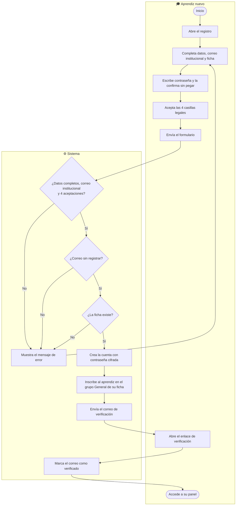
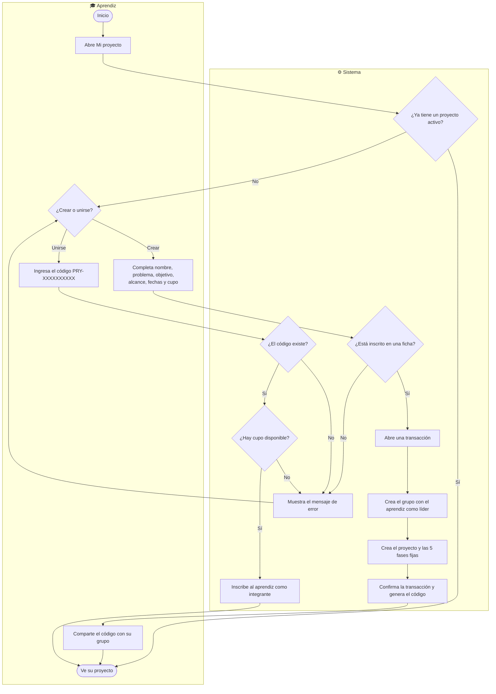
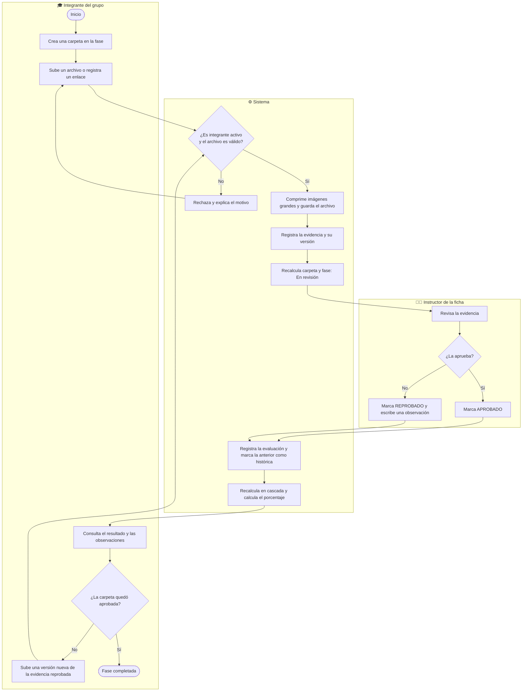
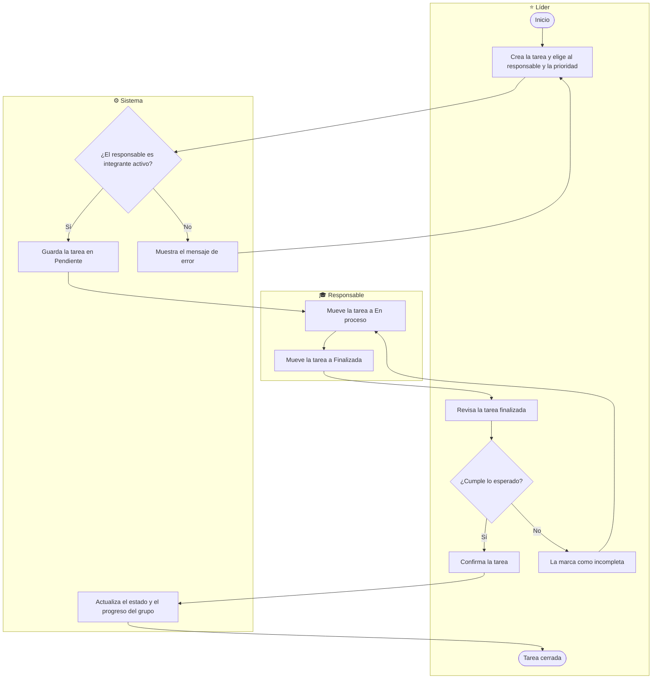
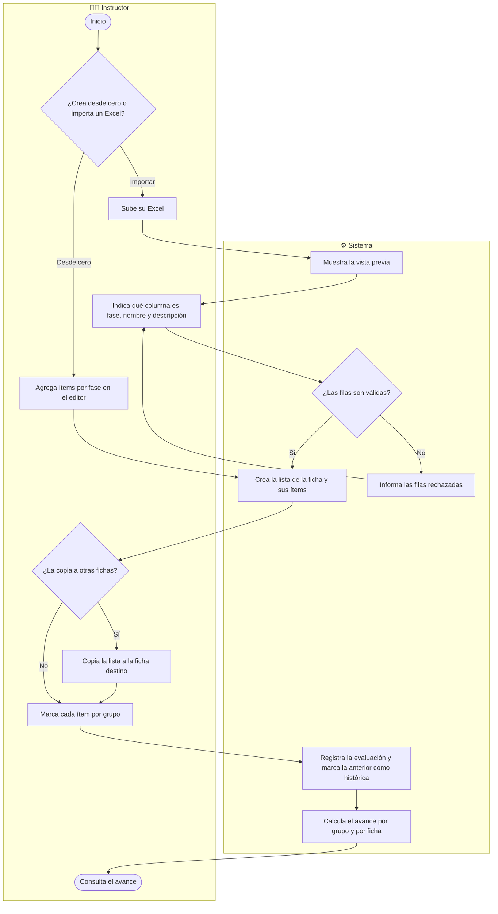
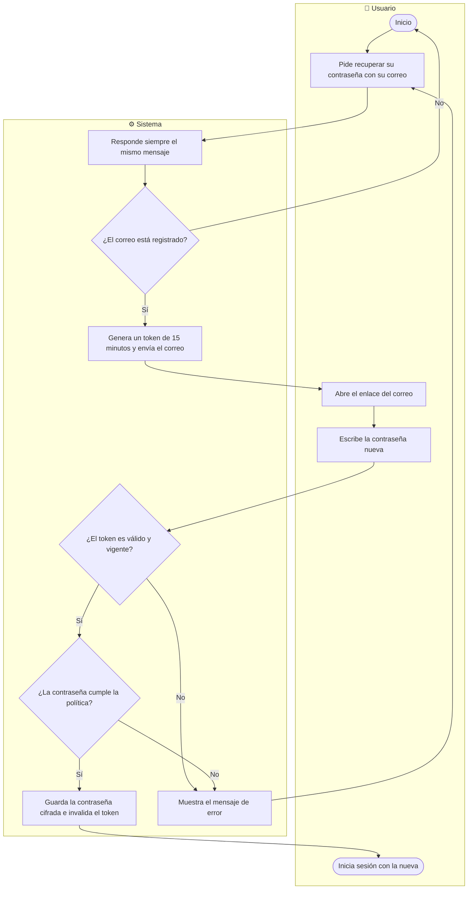

# Diagramas de actividades — ZENDA

<!--
  ¿Qué? Flujo paso a paso de los procesos principales de ZENDA, con las decisiones y los responsables de cada actividad.
  ¿Para qué? Ver el comportamiento de extremo a extremo que los requisitos describen por separado.
  ¿Impacto? Revela pasos olvidados, decisiones sin salida y responsabilidades poco claras antes de programar.
-->

---

## Identificación

| Campo | Valor |
|---|---|
| **Notación** | UML de actividades con carriles (Mermaid `flowchart`) |
| **Procesos** | 6 |
| **Complementa** | [Estados](estados.md) · [BPMN](bpmn.md) · [Mapa de procesos](mapa-procesos.md) |
| **Fecha** | Octubre 2026 |

**Leyenda:** ⬭ inicio y fin · ▭ actividad · ◇ decisión · cada carril (*subgraph*) es un actor.

---

## 1. Registro de aprendiz

Requisito: [RF-001](../requisitos/RFs/RF-001_registro_de_aprendiz.md) · Historia: [HU-001](../requisitos/HUs/HU-001_registro_de_aprendiz.md)

| Regla | Detalle |
|---|---|
| Correo | Debe terminar en `@soy.sena.edu.co` ([RN-001](../requisitos/reglas-de-negocio.md#rn-001--registro-limitado-a-aprendices-con-correo-institucional)). |
| Aceptación legal | Las 4 casillas son obligatorias ([RN-004](../requisitos/reglas-de-negocio.md#rn-004--aceptación-legal-obligatoria)). |
| Grupo `General` | Se crea si la ficha aún no lo tiene ([RN-006](../requisitos/reglas-de-negocio.md#rn-006--grupo-general-por-ficha)). |
| Verificación | Paso de v12; las cuentas existentes se consideran verificadas. |

---

## 2. Crear un proyecto o unirse a uno

Requisitos: [RF-014](../requisitos/RFs/RF-014_creacion_de_proyecto.md), [RF-015](../requisitos/RFs/RF-015_unirse_a_un_proyecto.md) · Historias: [HU-014](../requisitos/HUs/HU-014_creacion_de_proyecto.md), [HU-015](../requisitos/HUs/HU-015_unirse_a_un_proyecto.md)

| Regla | Detalle |
|---|---|
| Un proyecto activo | [RN-007](../requisitos/reglas-de-negocio.md#rn-007--un-proyecto-activo-por-aprendiz) |
| El creador es el líder y queda fijo | [RN-008](../requisitos/reglas-de-negocio.md#rn-008--líder-del-grupo) |
| Cupo | [RN-009](../requisitos/reglas-de-negocio.md#rn-009--cupo-del-grupo) |
| La creación es **atómica**: si falla un paso, no queda nada a medias | [Arquitectura 6.4](../referencia-tecnica/arquitectura.md#64-creación-de-proyecto) |

---

## 3. Entrega y evaluación de evidencias

Requisitos: [RF-019](../requisitos/RFs/RF-019_carpetas_de_una_fase.md), [RF-020](../requisitos/RFs/RF-020_subida_de_evidencias.md), [RF-022](../requisitos/RFs/RF-022_versiones_y_eliminacion_de_evidencias.md), [RF-023](../requisitos/RFs/RF-023_evaluacion_de_evidencias.md), [RF-025](../requisitos/RFs/RF-025_estado_y_porcentaje_de_avance.md)

| Regla | Detalle |
|---|---|
| Nadie queda bloqueado: se puede seguir subiendo con la fase en revisión | [RN-015](../requisitos/reglas-de-negocio.md#rn-015--sin-bloqueo-por-fase) |
| Una evidencia aprobada queda protegida | [RN-014](../requisitos/reglas-de-negocio.md#rn-014--versionado-y-borrado-lógico) |
| La evaluación se agrega, no se sobrescribe | [RN-017](../requisitos/reglas-de-negocio.md#rn-017--historial-de-evaluaciones) |
| Cascada y porcentaje | [RN-018](../requisitos/reglas-de-negocio.md#rn-018--cascada-de-estados), [RN-020](../requisitos/reglas-de-negocio.md#rn-020--porcentaje-de-avance-de-la-fase) |

---

## 4. Gestión de tareas

Requisitos: [RF-028](../requisitos/RFs/RF-028_creacion_y_asignacion_de_tareas.md) a [RF-031](../requisitos/RFs/RF-031_tablero_y_progreso_de_tareas.md)

| Regla | Detalle |
|---|---|
| Solo el líder crea, asigna y confirma | [RN-021](../requisitos/reglas-de-negocio.md#rn-021--tareas-creadas-solo-por-el-líder) |
| Solo el responsable mueve su tarea | [RN-022](../requisitos/reglas-de-negocio.md#rn-022--flujo-de-estados-de-la-tarea) |

---

## 5. Lista de chequeo del instructor

Requisitos: [RF-036](../requisitos/RFs/RF-036_creacion_de_lista_de_chequeo.md), [RF-037](../requisitos/RFs/RF-037_importacion_exportacion_y_copia_de_listas.md), [RF-038](../requisitos/RFs/RF-038_evaluacion_con_lista_de_chequeo.md)

| Regla | Detalle |
|---|---|
| La lista pertenece a la ficha, no al instructor | [RN-026](../requisitos/reglas-de-negocio.md#rn-026--lista-de-chequeo-por-ficha) |
| El avance cuenta ítems obligatorios aprobados | [RN-027](../requisitos/reglas-de-negocio.md#rn-027--avance-de-la-lista-de-chequeo) |
| Es independiente de la cascada de evidencias | [Dominio, sección 5](modelo-dominio.md#5-cómo-se-calcula-lo-que-importa) |

---

## 6. Recuperación de contraseña

Requisito: [RF-003](../requisitos/RFs/RF-003_recuperacion_de_contrasena.md) · Historia: [HU-003](../requisitos/HUs/HU-003_recuperacion_de_contrasena.md)

> El sistema responde igual exista o no el correo, para no revelar qué cuentas están registradas ([RNF-001.6](../requisitos/RNFs/RNF-001_seguridad.md)). Hoy (v11) responde `404` si no existe; es un cambio aprobado.

---

## Documentos relacionados

- [Estados](estados.md) · [BPMN](bpmn.md) · [Mapa de procesos](mapa-procesos.md)
- [Requisitos](../requisitos/matriz-trazabilidad.md) · [Reglas de negocio](../requisitos/reglas-de-negocio.md)
