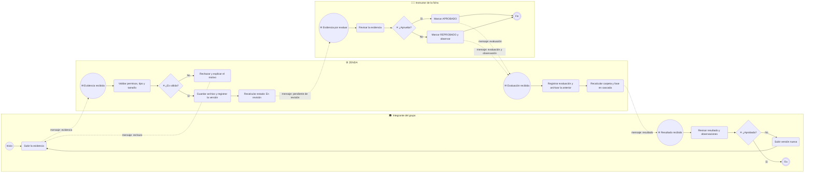
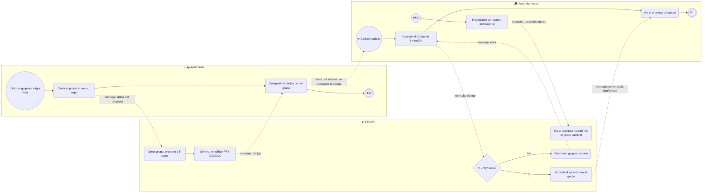
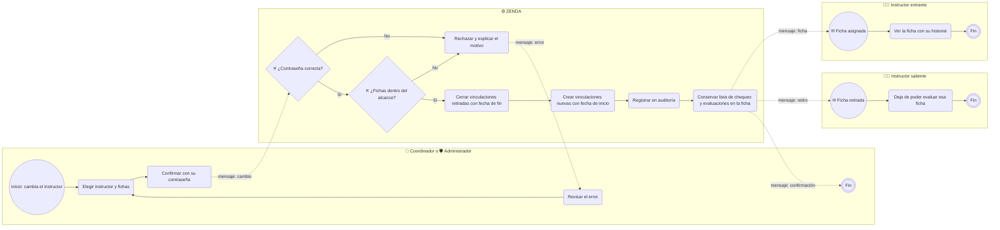
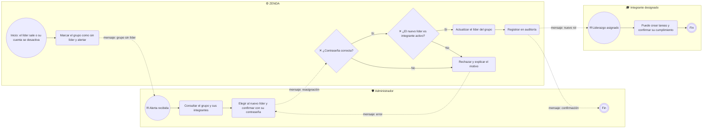

# Diagramas BPMN — ZENDA

<!--
  ¿Qué? Procesos de colaboración entre participantes (aprendices, sistema, instructores, administración) con eventos, tareas, decisiones y mensajes.
  ¿Para qué? Mostrar quién hace qué y qué se envían entre sí los participantes, algo que el diagrama de actividades no destaca.
  ¿Impacto? Aclara los traspasos entre personas y sistema, que es donde más se pierden las responsabilidades.
-->

---

## Identificación

| Campo | Valor |
|---|---|
| **Notación** | BPMN **representado** con Mermaid `flowchart` (no es BPMN 2.0 formal) |
| **Procesos** | 4 |
| **Complementa** | [Actividades](actividades.md) · [Mapa de procesos](mapa-procesos.md) |
| **Fecha** | Octubre 2026 |

> **Limitación:** Mermaid no soporta BPMN 2.0 de forma nativa. Estos diagramas usan la misma lógica y los mismos símbolos, y cada uno trae una **tabla de elementos** con tipo, participante y requisito, de modo que se pueden redibujar tal cual en [bpmn.io](https://bpmn.io) si el instructor exige el formato `.bpmn` estricto.

## Equivalencia de símbolos

| BPMN 2.0 | En estos diagramas |
|---|---|
| Evento de inicio | Círculo `(( ))` con el texto "Inicio" o el disparador |
| Evento de fin | Círculo doble `((( )))` |
| Tarea | Rectángulo redondeado `( )` |
| Pasarela exclusiva (XOR) | Rombo `{ }` con "✕" |
| Evento intermedio de mensaje | Círculo con ✉ |
| Flujo de secuencia | Flecha continua `-->` |
| Flujo de mensaje entre participantes | Flecha punteada `-.->` |
| Piscina (participante) | Recuadro con el nombre del participante |

---

## 1. Evaluación de una evidencia

Requisitos: [RF-020](../requisitos/RFs/RF-020_subida_de_evidencias.md), [RF-023](../requisitos/RFs/RF-023_evaluacion_de_evidencias.md), [RF-025](../requisitos/RFs/RF-025_estado_y_porcentaje_de_avance.md)

| ID | Tipo | Elemento | Participante | Requisito |
|---|---|---|---|---|
| a1 | Tarea | Subir la evidencia | Integrante | [RF-020](../requisitos/RFs/RF-020_subida_de_evidencias.md) |
| s1–s2 | Tarea y pasarela | Validar permisos, tipo y tamaño | ZENDA | [RN-012](../requisitos/reglas-de-negocio.md#rn-012--carpetas-y-evidencias-por-cualquier-integrante), [RN-013](../requisitos/reglas-de-negocio.md#rn-013--tipos-de-evidencia-y-límites) |
| s4–s5 | Tarea | Registrar versión y recalcular a En revisión | ZENDA | [RN-014](../requisitos/reglas-de-negocio.md#rn-014--versionado-y-borrado-lógico) |
| i1–i2 | Tarea y pasarela | Revisar y decidir | Instructor | [RN-016](../requisitos/reglas-de-negocio.md#rn-016--evaluación-por-el-instructor-asignado) |
| s7 | Tarea | Registrar evaluación y archivar la anterior | ZENDA | [RN-017](../requisitos/reglas-de-negocio.md#rn-017--historial-de-evaluaciones) |
| s8 | Tarea | Recalcular en cascada | ZENDA | [RN-018](../requisitos/reglas-de-negocio.md#rn-018--cascada-de-estados) |
| a4 | Pasarela | ¿Aprobada? | Integrante | [RF-025](../requisitos/RFs/RF-025_estado_y_porcentaje_de_avance.md) |

---

## 2. Incorporación del aprendiz y conformación del grupo

Requisitos: [RF-001](../requisitos/RFs/RF-001_registro_de_aprendiz.md), [RF-014](../requisitos/RFs/RF-014_creacion_de_proyecto.md), [RF-015](../requisitos/RFs/RF-015_unirse_a_un_proyecto.md)

El grupo define **fuera del sistema** (en papel o de palabra) quién será el líder y qué integrantes lo forman; ZENDA solo refleja esa decisión.

| ID | Tipo | Elemento | Participante | Requisito |
|---|---|---|---|---|
| n1 / z0 | Tarea | Registro e inscripción en `General` | Aprendiz / ZENDA | [RN-006](../requisitos/reglas-de-negocio.md#rn-006--grupo-general-por-ficha) |
| l1 / z1 | Tarea | Crear grupo, proyecto y fases | Líder / ZENDA | [RN-008](../requisitos/reglas-de-negocio.md#rn-008--líder-del-grupo), [RN-011](../requisitos/reglas-de-negocio.md#rn-011--cinco-fases-fijas) |
| z2 | Tarea | Generar código | ZENDA | [RN-010](../requisitos/reglas-de-negocio.md#rn-010--código-de-invitación) |
| l2 → n2 | Mensaje externo | Compartir el código | Líder → Aprendiz | Fuera del sistema |
| z3 | Pasarela | ¿Hay cupo? | ZENDA | [RN-009](../requisitos/reglas-de-negocio.md#rn-009--cupo-del-grupo) |

---

## 3. Cambio de instructor de una ficha

Requisito: [RF-011](../requisitos/RFs/RF-011_asignacion_de_instructores_a_fichas.md)

| ID | Tipo | Elemento | Participante | Requisito |
|---|---|---|---|---|
| c2 / z1 | Tarea y pasarela | Confirmación con contraseña | Coordinador o administrador / ZENDA | [RN-028](../requisitos/reglas-de-negocio.md#rn-028--confirmación-con-contraseña) |
| z2 | Pasarela | El coordinador solo opera en fichas ADSO | ZENDA | [RN-025](../requisitos/reglas-de-negocio.md#rn-025--alcance-del-coordinador) |
| z3–z4 | Tarea | Cerrar y crear vinculaciones con fechas | ZENDA | [RN-024](../requisitos/reglas-de-negocio.md#rn-024--asignación-instructorficha-con-historial) |
| z6 | Tarea | La lista y las evaluaciones pertenecen a la ficha | ZENDA | [RN-026](../requisitos/reglas-de-negocio.md#rn-026--lista-de-chequeo-por-ficha) |
| o2 | Tarea | Pierde el permiso de evaluar, conserva su historial | Instructor saliente | [RN-016](../requisitos/reglas-de-negocio.md#rn-016--evaluación-por-el-instructor-asignado) |

> Hoy (v11) la reasignación borra las vinculaciones y las vuelve a crear, por lo que no queda historial. Este es el flujo objetivo.

---

## 4. Reasignación de liderazgo

Requisito: [RF-018](../requisitos/RFs/RF-018_reasignacion_de_liderazgo.md)

| ID | Tipo | Elemento | Participante | Requisito |
|---|---|---|---|---|
| z0–z1 | Evento y tarea | Detectar grupo sin líder y alertar | ZENDA | [RF-007](../requisitos/RFs/RF-007_desactivacion_y_eliminacion_de_usuarios.md) |
| a3 / z3 | Tarea y pasarela | Confirmación con contraseña | Administrador / ZENDA | [RN-028](../requisitos/reglas-de-negocio.md#rn-028--confirmación-con-contraseña) |
| z2 | Pasarela | Solo integrantes activos pueden ser líder | ZENDA | [RN-030](../requisitos/reglas-de-negocio.md#rn-030--reasignación-de-liderazgo-por-el-administrador) |
| n2 | Tarea | Ejerce los permisos del líder | Integrante designado | [RN-008](../requisitos/reglas-de-negocio.md#rn-008--líder-del-grupo) |

> El liderazgo **no se transfiere entre aprendices**: esta es la única vía, y la ejecuta el administrador.

---

## Documentos relacionados

- [Actividades](actividades.md) · [Mapa de procesos](mapa-procesos.md) · [Estados](estados.md)
- [Reglas de negocio](../requisitos/reglas-de-negocio.md) · [Matriz de permisos](../requisitos/matriz-permisos.md)
