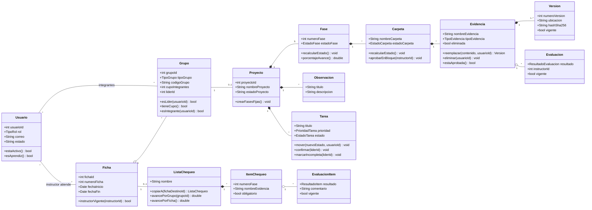
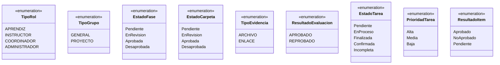

# Diagrama de clases — ZENDA v12

<!--
  ¿Qué? Diseño de clases del software: entidades con sus atributos y operaciones, servicios, controladores y enumeraciones.
  ¿Para qué? Guiar la reorganización del código y que cada responsabilidad tenga un único dueño.
  ¿Impacto? Sin un diseño claro, la lógica de negocio se repite en varios controladores y se desincroniza.
-->

---

## Identificación

| Campo | Valor |
|---|---|
| **Nivel** | Diseño (UML de clases) |
| **Notación** | Mermaid `classDiagram` |
| **Se basa en** | [Modelo de dominio](modelo-dominio.md) y [MR](mer-mr.md) |
| **Fecha** | Octubre 2026 |

> **Cómo leerlo:** el backend de ZENDA está escrito con módulos y funciones (no con clases de JavaScript). Cada "clase" de este diagrama representa una **responsabilidad** (un módulo o archivo) y sus operaciones son las funciones que debe exponer. Es el diseño objetivo de v12; lo que ya existe en v11 se indica en la tabla de la sección 5.

---

## 1. Entidades y sus operaciones

Los atributos siguen las columnas del [MR](mer-mr.md); aquí se muestran solo los más relevantes.

---

## 2. Servicios y controladores

Los **controladores** reciben la petición y responden; los **servicios** contienen las reglas reutilizables y no conocen `req` ni `res` ([reglas de dependencia](componentes.md#6-reglas-de-dependencia)).

```mermaid
classDiagram
    direction TB

    class AuthController {
        <<controller>>
        +registrar()
        +iniciarSesion()
        +solicitarRecuperacion()
        +restablecer()
        +renovarSesion()
        +cerrarSesion()
    }
    class ProyectoController {
        <<controller>>
        +crearProyecto()
        +unirse()
        +miProyecto()
        +crearCarpeta()
        +subirEvidencia()
        +reemplazarEvidencia()
        +eliminarEvidencia()
    }
    class TareaController {
        <<controller>>
        +crear()
        +listar()
        +cambiarEstado()
        +progreso()
    }
    class InstructorController {
        <<controller>>
        +misFichas()
        +evaluarEvidencia()
        +aprobarCarpeta()
        +crearObservacion()
        +evaluarItemChequeo()
    }
    class CoordinadorController {
        <<controller>>
        +dashboard()
        +supervisar()
        +reasignarInstructor()
    }
    class AdminController {
        <<controller>>
        +gestionarUsuarios()
        +gestionarFichas()
        +reasignarLider()
        +diagnostico()
    }

    class CascadaService {
        <<service>>
        +recalcularCarpeta(carpetaId)
        +recalcularFase(faseId)
    }
    class AvanceService {
        <<service>>
        +avanceFase(faseId)
        +avanceTareas(proyectoId)
        +avanceLista(fichaId)
    }
    class PermisosService {
        <<service>>
        +esIntegranteActivo(usuarioId, grupoId)
        +esLider(usuarioId, grupoId)
        +instructorDeFicha(instructorId, fichaId)
    }
    class AlmacenamientoService {
        <<service>>
        +validar(archivo)
        +comprimir(imagen)
        +guardar(archivo)
        +urlDeDescarga(rutaArchivo)
    }
    class AuditoriaService {
        <<service>>
        +registrar(usuarioId, accion, entidad, detalle)
    }
    class SesionService {
        <<service>>
        +emitirTokens(usuario)
        +rotarRefresco(token)
        +revocar(token)
    }

    ProyectoController ..> PermisosService
    ProyectoController ..> CascadaService
    ProyectoController ..> AlmacenamientoService
    TareaController ..> PermisosService
    TareaController ..> AvanceService
    InstructorController ..> PermisosService
    InstructorController ..> CascadaService
    InstructorController ..> AvanceService
    InstructorController ..> AuditoriaService
    CoordinadorController ..> AvanceService
    AdminController ..> AuditoriaService
    AuthController ..> SesionService
```

| Servicio | Responsabilidad única | Requisito |
|---|---|---|
| `CascadaService` | Recalcular estados de carpeta y fase a partir de las evaluaciones vigentes. | [RF-025](../requisitos/RFs/RF-025_estado_y_porcentaje_de_avance.md) |
| `AvanceService` | Calcular porcentajes de fase, tareas y lista de chequeo. | [RF-031](../requisitos/RFs/RF-031_tablero_y_progreso_de_tareas.md), [RF-038](../requisitos/RFs/RF-038_evaluacion_con_lista_de_chequeo.md) |
| `PermisosService` | Responder "¿puede este usuario hacer esto aquí?" (grupo, líder, ficha). | [Matriz de permisos](../requisitos/matriz-permisos.md) |
| `AlmacenamientoService` | Todo lo relativo a archivos: validar, comprimir, guardar y entregar. | [RF-020](../requisitos/RFs/RF-020_subida_de_evidencias.md) |
| `AuditoriaService` | Registrar quién hizo una acción crítica. | [RNF-011](../requisitos/RNFs/RNF-011_observabilidad_y_auditoria.md) |
| `SesionService` | Emitir, rotar y revocar tokens de sesión. | [RF-004](../requisitos/RFs/RF-004_sesion_segura.md) |

---

## 3. Enumeraciones

> `EnRevision`, `EnProceso` y `NoAprobado` son los nombres del diagrama; en la base de datos se guardan como `En revisión`, `En proceso` y `No aprobado` ([valores permitidos](../referencia-tecnica/esquema-bd.md#3-valores-permitidos)).

---

## 4. Operaciones y reglas que las gobiernan

| Operación | Clase | Regla | Quién puede |
|---|---|---|---|
| `tieneCupo()` | `Grupo` | [RN-009](../requisitos/reglas-de-negocio.md#rn-009--cupo-del-grupo) | Sistema, al unirse |
| `crearFasesFijas()` | `Proyecto` | [RN-011](../requisitos/reglas-de-negocio.md#rn-011--cinco-fases-fijas) | Sistema, al crear el proyecto |
| `reemplazar()` / `eliminar()` | `Evidencia` | [RN-014](../requisitos/reglas-de-negocio.md#rn-014--versionado-y-borrado-lógico) | Autor o líder; nunca si está aprobada |
| `aprobarEnBloque()` | `Carpeta` | [RN-019](../requisitos/reglas-de-negocio.md#rn-019--aprobación-de-carpeta-en-bloque) | Instructor de la ficha |
| `mover()` | `Tarea` | [RN-022](../requisitos/reglas-de-negocio.md#rn-022--flujo-de-estados-de-la-tarea) | Responsable de la tarea |
| `confirmar()` / `marcarIncompleta()` | `Tarea` | [RN-022](../requisitos/reglas-de-negocio.md#rn-022--flujo-de-estados-de-la-tarea) | Solo el líder |
| `copiarA()` | `ListaChequeo` | [RN-026](../requisitos/reglas-de-negocio.md#rn-026--lista-de-chequeo-por-ficha) | Instructor de ambas fichas |
| `recalcularEstado()` | `Fase`, `Carpeta` | [RN-018](../requisitos/reglas-de-negocio.md#rn-018--cascada-de-estados) | Sistema, tras cada evaluación |

---

## 5. Qué existe hoy y qué es nuevo

| Elemento | v11 | Cambio en v12 |
|---|---|---|
| Controladores por rol | ✅ Existen (con lógica de negocio dentro) | Se adelgazan: delegan en servicios. |
| `CascadaService` | La lógica está dentro del controlador del instructor | Se extrae a un servicio compartido. |
| `PermisosService` | Las verificaciones se repiten en cada controlador | Se centralizan. |
| `AvanceService` | Cálculos dispersos en los resúmenes | Se unifican. |
| `AlmacenamientoService` | No existe (solo enlaces) | 🆕 |
| `AuditoriaService`, `SesionService` | No existen | 🆕 |
| `Carpeta.estadoCarpeta`, `Version`, `ListaChequeo`, `EvaluacionItem` | No existen | 🆕 ([migración](../../Database/migraciones/001_v12.sql)) |

---

## Documentos relacionados

- [Modelo de dominio](modelo-dominio.md) · [Componentes](componentes.md) · [MER y MR](mer-mr.md) · [Estados](estados.md)
- [Arquitectura](../referencia-tecnica/arquitectura.md) · [Reglas de negocio](../requisitos/reglas-de-negocio.md)
