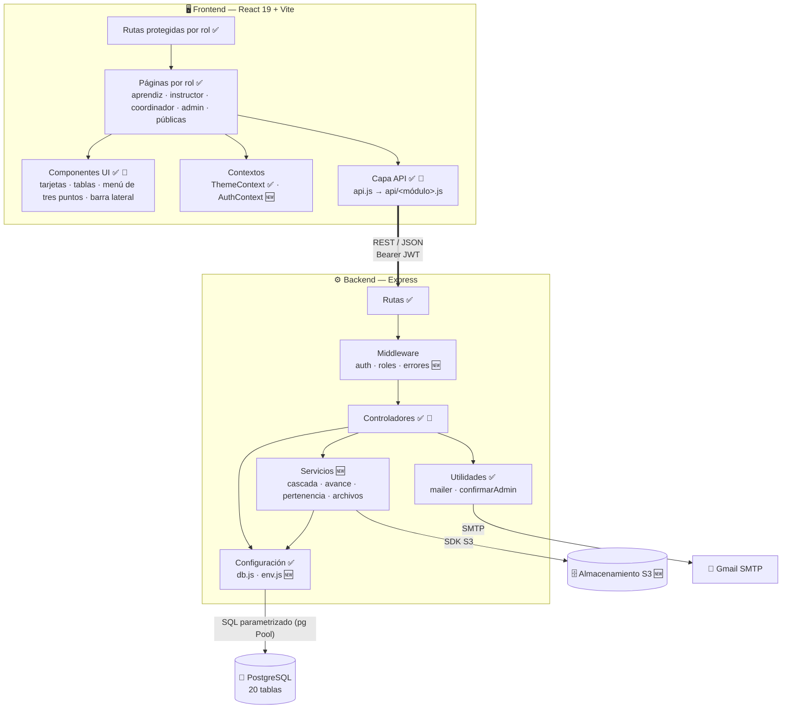
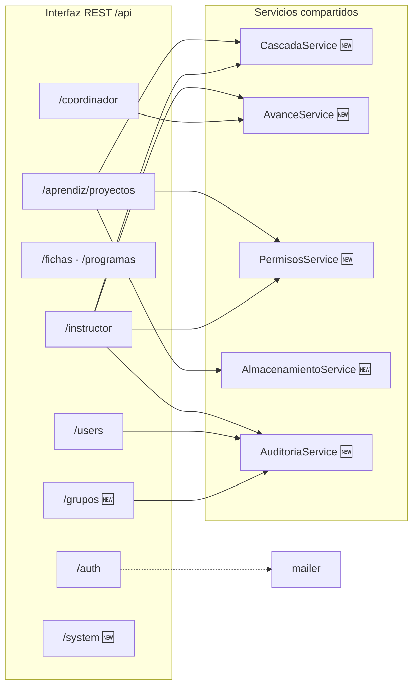

# Diagrama de componentes — ZENDA

<!--
  ¿Qué? Descomposición de ZENDA en componentes de software, con las interfaces que ofrecen y las dependencias entre ellos.
  ¿Para qué? Saber qué pieza responde a cada requisito y qué se ve afectado cuando una cambia.
  ¿Impacto? Si un componente depende de otro sin estar documentado, un cambio local rompe algo lejano.
-->

---

## Identificación

| Campo | Valor |
|---|---|
| **Nivel** | Componentes (UML) |
| **Notación** | Mermaid (flujo con subgrafos) |
| **Contexto** | [Diagrama de contexto](contexto.md) |
| **Capas y flujos** | [Arquitectura](../referencia-tecnica/arquitectura.md) |
| **Fecha** | Octubre 2026 |

**Leyenda:** ✅ existe en v11 · 🆕 nuevo en v12 · 🔄 se reorganiza en v12.

---

## 1. Vista general

---

## 2. Componentes del frontend

| Componente | Responsabilidad | Depende de | Estado |
|---|---|---|:---:|
| **Páginas** (`pages/<rol>`) | Pantallas de cada rol: paneles, proyecto, fases, tareas, evaluación, administración. | UI, contextos, capa API | ✅ |
| **Componentes UI** | Piezas reutilizables con tema claro y oscuro: tarjetas, tablas, botones, menú de tres puntos, barra lateral colapsable. | Contexto de tema | ✅ 🔄 |
| **Rutas protegidas** | Bloquean pantallas según sesión y rol. | Contexto de autenticación | ✅ |
| **ThemeContext** | Tema claro u oscuro y su persistencia. | — | ✅ |
| **AuthContext** | Usuario, rol, renovación de token y cierre por inactividad. | Capa API | 🆕 |
| **Capa API** | Única puerta de salida hacia el backend: adjunta el token y unifica el manejo de errores. | `VITE_API_URL` | ✅ 🔄 |
| **Gráficas** | Dashboards con Recharts. | Páginas | ✅ |
| **CookieBanner y páginas legales** | Aviso de cookies y textos legales. | — | ✅ 🆕 |

---

## 3. Componentes del backend por módulo

| Servicio | Responsabilidad | Lo usan | Requisito |
|---|---|---|---|
| `CascadaService` | Recalcula el estado de carpeta y de fase a partir de las evaluaciones vigentes. | Aprendiz, instructor | [RF-025](../requisitos/RFs/RF-025_estado_y_porcentaje_de_avance.md) |
| `AvanceService` | Calcula porcentajes de fase, de lista de chequeo y de tareas. | Instructor, coordinador | [RF-025](../requisitos/RFs/RF-025_estado_y_porcentaje_de_avance.md), [RF-038](../requisitos/RFs/RF-038_evaluacion_con_lista_de_chequeo.md) |
| `PermisosService` | Verifica pertenencia al grupo, condición de líder y vinculación del instructor con la ficha. | Aprendiz, instructor | [Matriz de permisos](../requisitos/matriz-permisos.md) |
| `AlmacenamientoService` | Valida, comprime, guarda y entrega archivos. | Aprendiz | [RF-020](../requisitos/RFs/RF-020_subida_de_evidencias.md) |
| `AuditoriaService` | Registra acciones críticas (quién, qué, cuándo). | Usuarios, grupos, instructor | [RNF-011](../requisitos/RNFs/RNF-011_observabilidad_y_auditoria.md) |

---

## 4. Interfaces

| Interfaz | Ofrece | Consume | Contrato |
|---|---|---|---|
| **API REST** | Backend | Frontend | [api-endpoints.md](../referencia-tecnica/api-endpoints.md) |
| **Pool de PostgreSQL** | `config/db.js` | Controladores y servicios | [esquema-bd.md](../referencia-tecnica/esquema-bd.md) |
| **SMTP** | Gmail | `utils/mailer.js` | [variables de entorno](../setup/variables-de-entorno.md) |
| **API S3** 🆕 | Almacenamiento | `AlmacenamientoService` | [RNF-012](../requisitos/RNFs/RNF-012_gestion_de_archivos_y_almacenamiento.md) |
| **Almacenamiento del navegador** | Navegador | Contextos | Token y tema (`localStorage`) |

---

## 5. Matriz de acceso a datos por módulo

`C` crea · `R` lee · `U` actualiza · `D` elimina (o cierra, en tablas con historial).

| Tabla | auth | users | fichas | aprendiz | instructor | coordinador |
|---|:---:|:---:|:---:|:---:|:---:|:---:|
| `usuarios` | C R U | C R U D | R | R | R | R |
| `programas` | | | R | | | R |
| `fichas` | R | R | C R U D | R | R | R |
| `instructor_ficha` | | C R D | | | R | C R D |
| `grupos` | C R | | C R | C R U | R | R |
| `integrantes_grupo` | C | | C U | C R U | R | R |
| `proyectos` | | | | C R U | R | R |
| `fases` | | | | C R U | R U | R |
| `carpetas` | | | | C R U | R U | |
| `evidencias` | | | | C R U D | R | |
| `evidencia_versiones` | | | | C R | R | |
| `evaluaciones` | | | | R | C U | R |
| `observaciones` | | | | R | C R | |
| `tareas` | | | | C R U | | R |
| `listas_chequeo`, ítems y evaluaciones 🆕 | | | | | C R U D | R |
| `sesiones_refresh`, `tokens_verificacion_correo` 🆕 | C R U | | | | | |
| `auditoria` 🆕 | | C | | | C | |

> Para `evaluaciones`, `U` significa marcar la anterior como no vigente; nunca se sobrescribe el resultado ([RN-017](../requisitos/reglas-de-negocio.md#rn-017--historial-de-evaluaciones)).

---

## 6. Reglas de dependencia

| Regla | Motivo |
|---|---|
| Las rutas no llaman a la base de datos. | Mantener la lógica en controladores y servicios. |
| Los servicios no conocen `req` ni `res`. | Poder probarlos sin servidor. |
| Los controladores de un rol no importan los de otro rol. | Lo compartido va a `services/`. |
| El frontend solo habla con el backend a través de la capa API. | Un cambio de ruta se corrige en un solo lugar. |
| Ningún componente lee secretos fuera de `config/`. | [RS-001](../requisitos/restricciones.md#rs-001--secretos-fuera-del-código-y-del-repositorio) |

---

## Documentos relacionados

- [Contexto](contexto.md) · [Clases](clases.md) · [MER y MR](mer-mr.md)
- [Arquitectura](../referencia-tecnica/arquitectura.md) · [Matriz de permisos](../requisitos/matriz-permisos.md)
