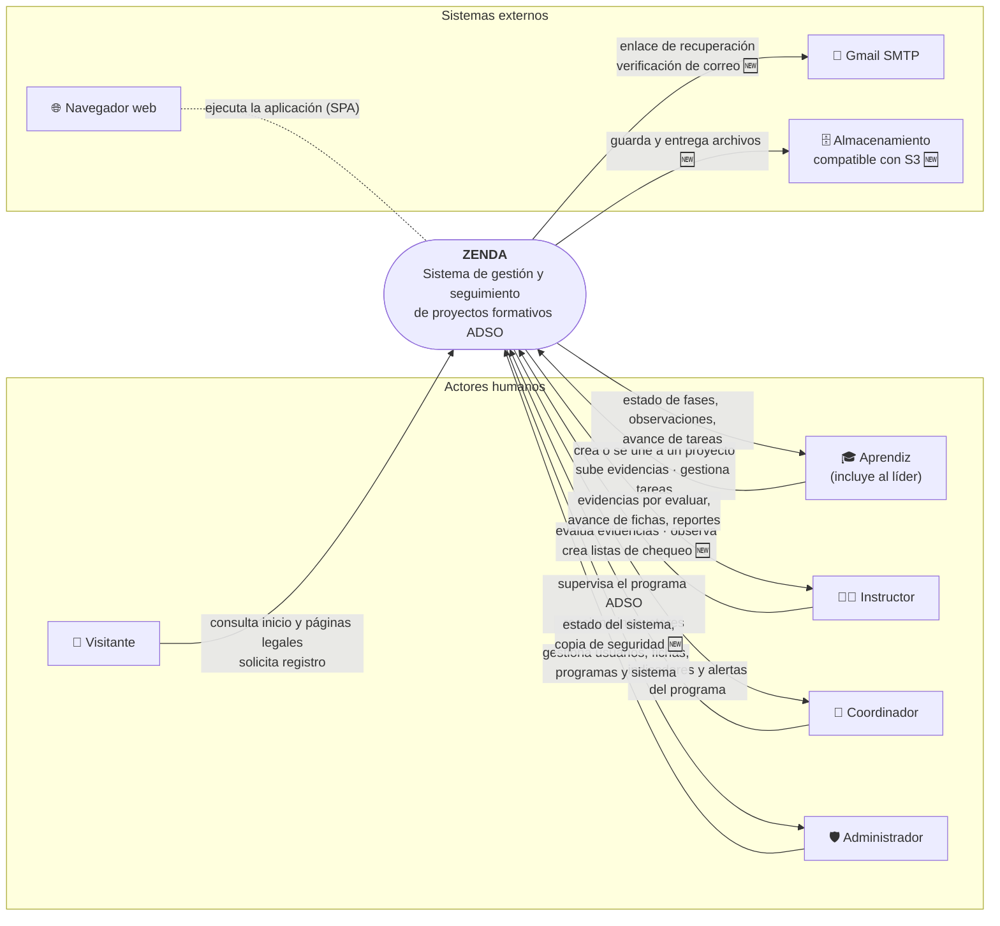

# Diagrama de contexto — ZENDA

<!--
  ¿Qué? Vista de ZENDA como una caja negra: quién lo usa, con qué sistemas externos habla y qué datos cruzan su frontera.
  ¿Para qué? Delimitar el alcance del sistema antes de entrar en su interior.
  ¿Impacto? Lo que no aparece aquí queda fuera del alcance; lo que aparece obliga a definir su interfaz.
-->

---

## Identificación

| Campo | Valor |
|---|---|
| **Nivel** | Contexto del sistema (nivel 0) |
| **Notación** | Mermaid (flujo con relaciones etiquetadas) |
| **Detalle interno** | [Componentes](componentes.md) · [Arquitectura](../Referencia-Tecnica/arquitectura.md) |
| **Fecha** | Octubre 2026 |

**Leyenda:** línea continua = existe en el código actual · 🆕 = propuesto para las Semanas 3–6.

---

## 1. Diagrama

---

## 2. Actores

| Actor | Objetivo principal | Qué recibe de ZENDA | Requisitos |
|---|---|---|---|
| **Visitante** | Conocer el sistema y registrarse. | Página de inicio, páginas legales, formulario de registro. | RF-001, RF-039, RF-042 |
| **Aprendiz** | Desarrollar su proyecto por fases. | Estado de fases, observaciones, tablero de tareas, porcentaje de avance. | RF-014 a RF-031 |
| **Líder** (aprendiz) | Coordinar a su grupo. | Lo del aprendiz, más la gestión de tareas. | RF-028, RF-030 |
| **Instructor** | Evaluar y acompañar a sus fichas. | Evidencias por revisar, avance por grupo y por ficha, reportes. | RF-023 a RF-026, RF-033 a RF-038 |
| **Coordinador** | Supervisar el programa ADSO. | Indicadores, alertas pedagógicas, supervisión de proyectos. | RF-011, RF-032, RF-033 |
| **Administrador** | Mantener la plataforma. | Gestión de usuarios y fichas, diagnóstico, copias de seguridad. | RF-006 a RF-013, RF-018 |

El detalle de qué puede hacer cada uno está en la [matriz de permisos](../Requisitos/matriz-permisos.md).

---

## 3. Sistemas externos

| Sistema | Dirección | Qué cruza la frontera | Protocolo | Estado |
|---|---|---|---|---|
| **Gmail SMTP** | ZENDA → Gmail | Correo con enlace de recuperación de contraseña y de verificación de correo. | SMTP con contraseña de aplicación | ✅ recuperación · 🆕 verificación |
| **Almacenamiento S3** | ZENDA ↔ almacenamiento | Archivos de evidencias y su entrega con autorización. | API compatible con S3 | 🆕 |
| **Navegador web** | Usuario ↔ ZENDA | La SPA, las llamadas a la API y el token de sesión. | HTTPS, JSON | ✅ |

---

## 4. Flujos de datos de la frontera

| # | Flujo | Origen → Destino | Datos | Requisito |
|:---:|---|---|---|---|
| 1 | Registro | Visitante → ZENDA | Datos personales, correo institucional, ficha, aceptaciones legales | [RF-001](../Requisitos/RFs/RF-001_registro_de_aprendiz.md) |
| 2 | Autenticación | Usuario → ZENDA | Correo y contraseña; devuelve token | [RF-002](../Requisitos/RFs/RF-002_inicio_de_sesion.md) |
| 3 | Recuperación de contraseña | ZENDA → Gmail → Usuario | Enlace con token de 15 minutos | [RF-003](../Requisitos/RFs/RF-003_recuperacion_de_contrasena.md) |
| 4 | Proyecto del grupo | Aprendiz ↔ ZENDA | Datos del proyecto, código de invitación, integrantes | [RF-014](../Requisitos/RFs/RF-014_creacion_de_proyecto.md), [RF-015](../Requisitos/RFs/RF-015_unirse_a_un_proyecto.md) |
| 5 | Entrega de evidencias | Aprendiz → ZENDA → Almacenamiento | Archivos o enlaces, carpeta, autor | [RF-020](../Requisitos/RFs/RF-020_subida_de_evidencias.md) |
| 6 | Evaluación | Instructor → ZENDA → Aprendiz | Resultado por evidencia, observaciones, estado de fase | [RF-023](../Requisitos/RFs/RF-023_evaluacion_de_evidencias.md), [RF-026](../Requisitos/RFs/RF-026_observaciones_del_instructor.md) |
| 7 | Tareas | Líder ↔ Aprendiz ↔ ZENDA | Tareas, estados, confirmación | [RF-028](../Requisitos/RFs/RF-028_creacion_y_asignacion_de_tareas.md) a [RF-031](../Requisitos/RFs/RF-031_tablero_y_progreso_de_tareas.md) |
| 8 | Lista de chequeo | Instructor ↔ ZENDA | Ítems, evaluaciones por grupo, avance; Excel de entrada y salida | [RF-036](../Requisitos/RFs/RF-036_creacion_de_lista_de_chequeo.md) a [RF-038](../Requisitos/RFs/RF-038_evaluacion_con_lista_de_chequeo.md) |
| 9 | Seguimiento y reportes | ZENDA → Instructor, Coordinador | Métricas, PDF, Excel | [RF-032](../Requisitos/RFs/RF-032_paneles_de_resumen_por_rol.md) a [RF-035](../Requisitos/RFs/RF-035_reporte_en_excel.md) |
| 10 | Administración | Administrador ↔ ZENDA | Usuarios, fichas, programas, diagnóstico, copia | [RF-006](../Requisitos/RFs/RF-006_gestion_de_usuarios.md) a [RF-013](../Requisitos/RFs/RF-013_diagnostico_y_copia_de_seguridad.md) |

---

## 5. Fuera del alcance

Estos elementos **no** están en el contexto porque se decidió no construirlos ([RO-004](../Requisitos/restricciones.md#ro-004--alcance-excluido)):

| Excluido | Motivo |
|---|---|
| Chatbot | Descartado por el equipo. |
| Calendario de eventos y anuncios | Descartados desde el análisis del MVP. |
| Recordatorios masivos y notificaciones por correo | El correo se reserva para recuperar contraseña y verificar el correo; los recordatorios se sustituyen por [mensajes guiados](../Requisitos/RFs/RF-041_mensajes_guiados.md). |
| Sistemas externos del SENA (por ejemplo, Sofía Plus) | No hay integración. |
| Pagos y proveedores de identidad externos | No aplican; la autenticación es propia ([RT-004](../Requisitos/restricciones.md#rt-004--método-de-autenticación)). |

---

## Documentos relacionados

- [Componentes](componentes.md) · [Arquitectura](../Referencia-Tecnica/arquitectura.md)
- [Matriz de permisos](../Requisitos/matriz-permisos.md) · [Restricciones](../Requisitos/restricciones.md)
