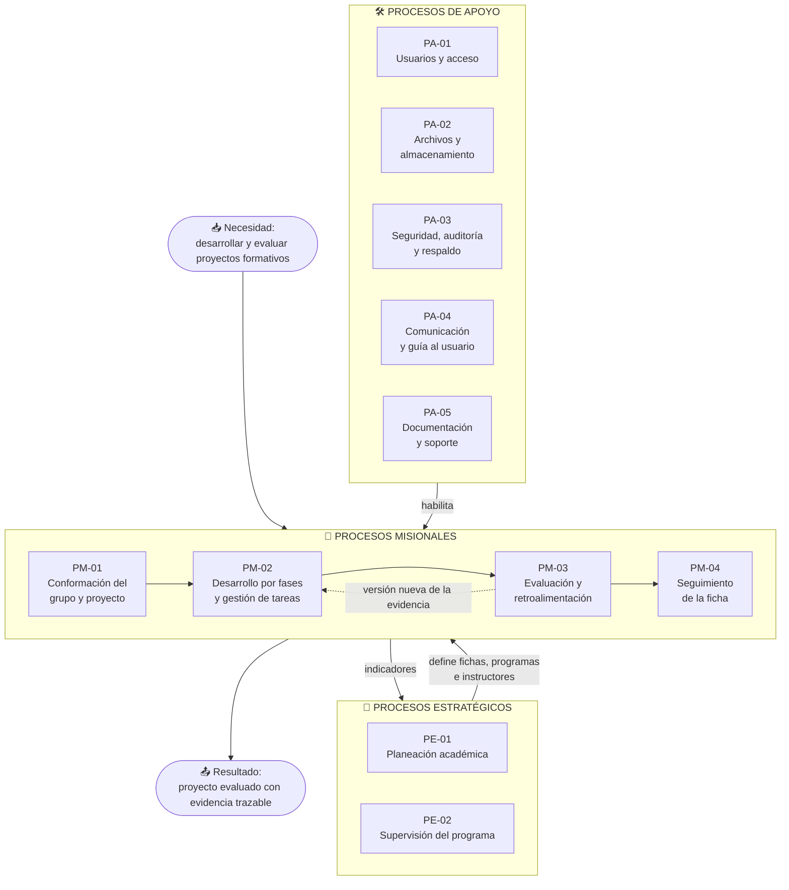

# Mapa de procesos — ZENDA

<!--
  ¿Qué? Vista de alto nivel de los procesos que ZENDA soporta, clasificados en estratégicos, misionales y de apoyo.
  ¿Para qué? Ubicar cada requisito en el proceso del negocio al que sirve y saber quién es responsable de cada uno.
  ¿Impacto? Sin esta vista, las funcionalidades se ven como pantallas sueltas y no como un flujo de valor.
-->

---

## Identificación

| Campo | Valor |
|---|---|
| **Alcance** | Procesos del seguimiento de proyectos formativos ADSO que ZENDA soporta |
| **Clasificación** | Estratégicos · Misionales · De apoyo |
| **Notación** | Mermaid `flowchart` por franjas |
| **Detalle de cada proceso** | [Actividades](actividades.md) · [BPMN](bpmn.md) |
| **Fecha** | Octubre 2026 |

---

## 1. Mapa

---

## 2. Fichas de proceso

### Procesos estratégicos

| Código | Proceso | Responsable | Entradas | Salidas | Requisitos |
|---|---|---|---|---|---|
| **PE-01** | Planeación académica | Administrador, Coordinador | Programas, fichas, instructores disponibles | Fichas creadas y atendidas por un instructor, con historial | [RF-009](../requisitos/RFs/RF-009_gestion_de_fichas.md), [RF-010](../requisitos/RFs/RF-010_aprendices_en_una_ficha.md), [RF-011](../requisitos/RFs/RF-011_asignacion_de_instructores_a_fichas.md), [RF-012](../requisitos/RFs/RF-012_gestion_de_programas_de_formacion.md) |
| **PE-02** | Supervisión del programa | Coordinador | Avance de proyectos y fichas | Indicadores, alertas pedagógicas, reasignaciones | [RF-032](../requisitos/RFs/RF-032_paneles_de_resumen_por_rol.md), [RF-033](../requisitos/RFs/RF-033_seguimiento_academico_de_fichas_y_proyectos.md), [RF-035](../requisitos/RFs/RF-035_reporte_en_excel.md) |

### Procesos misionales

| Código | Proceso | Responsable | Entradas | Salidas | Requisitos |
|---|---|---|---|---|---|
| **PM-01** | Conformación del grupo y proyecto | Aprendiz (líder) | Aprendices inscritos en una ficha | Grupo con líder, cupo, código de invitación, proyecto y 5 fases | [RF-014](../requisitos/RFs/RF-014_creacion_de_proyecto.md), [RF-015](../requisitos/RFs/RF-015_unirse_a_un_proyecto.md), [RF-016](../requisitos/RFs/RF-016_consulta_de_mi_proyecto.md), [RF-017](../requisitos/RFs/RF-017_cambio_de_ficha_del_aprendiz.md) |
| **PM-02** | Desarrollo por fases y gestión de tareas | Aprendices, líder | Plan del proyecto | Carpetas, evidencias con versiones, tareas confirmadas | [RF-019](../requisitos/RFs/RF-019_carpetas_de_una_fase.md), [RF-020](../requisitos/RFs/RF-020_subida_de_evidencias.md), [RF-022](../requisitos/RFs/RF-022_versiones_y_eliminacion_de_evidencias.md), [RF-028](../requisitos/RFs/RF-028_creacion_y_asignacion_de_tareas.md) a [RF-031](../requisitos/RFs/RF-031_tablero_y_progreso_de_tareas.md) |
| **PM-03** | Evaluación y retroalimentación | Instructor | Evidencias entregadas | Evaluaciones con historial, observaciones, estados de carpeta y fase | [RF-021](../requisitos/RFs/RF-021_consulta_de_evidencias_y_fases.md), [RF-023](../requisitos/RFs/RF-023_evaluacion_de_evidencias.md) a [RF-027](../requisitos/RFs/RF-027_consulta_de_observaciones.md) |
| **PM-04** | Seguimiento de la ficha | Instructor | Lista de chequeo, evaluaciones | Avance por grupo y por ficha, reportes | [RF-033](../requisitos/RFs/RF-033_seguimiento_academico_de_fichas_y_proyectos.md), [RF-034](../requisitos/RFs/RF-034_reporte_en_pdf.md), [RF-036](../requisitos/RFs/RF-036_creacion_de_lista_de_chequeo.md) a [RF-038](../requisitos/RFs/RF-038_evaluacion_con_lista_de_chequeo.md) |

### Procesos de apoyo

| Código | Proceso | Responsable | Qué provee | Requisitos |
|---|---|---|---|---|
| **PA-01** | Usuarios y acceso | Administrador | Cuentas, roles, inicio de sesión, recuperación, sesión segura | [RF-001](../requisitos/RFs/RF-001_registro_de_aprendiz.md) a [RF-008](../requisitos/RFs/RF-008_carga_masiva_de_usuarios.md), [RF-018](../requisitos/RFs/RF-018_reasignacion_de_liderazgo.md) |
| **PA-02** | Archivos y almacenamiento | Sistema | Validación, compresión, almacenamiento y entrega de archivos | [RF-020](../requisitos/RFs/RF-020_subida_de_evidencias.md), [RNF-012](../requisitos/RNFs/RNF-012_gestion_de_archivos_y_almacenamiento.md) |
| **PA-03** | Seguridad, auditoría y respaldo | Administrador | Control de acceso, registro de acciones críticas, diagnóstico, copias | [RF-013](../requisitos/RFs/RF-013_diagnostico_y_copia_de_seguridad.md), [RNF-001](../requisitos/RNFs/RNF-001_seguridad.md), [RNF-011](../requisitos/RNFs/RNF-011_observabilidad_y_auditoria.md) |
| **PA-04** | Comunicación y guía al usuario | Sistema | Correo de recuperación y verificación, mensajes guiados, páginas legales | [RF-039](../requisitos/RFs/RF-039_paginas_legales_y_aviso_de_cookies.md), [RF-041](../requisitos/RFs/RF-041_mensajes_guiados.md), [RF-042](../requisitos/RFs/RF-042_pagina_de_inicio_publica.md) |
| **PA-05** | Documentación y soporte | Equipo de desarrollo | Documentación en `docs/`, guías de instalación, decisiones | [RNF-015](../requisitos/RNFs/RNF-015_documentacion_y_soporte.md) |

---

## 3. Quién interviene en cada proceso

`R` ejecuta · `A` responde por el resultado · `C` es consultado · `I` es informado · `—` no interviene.

| Proceso | Aprendiz | Líder | Instructor | Coordinador | Administrador |
|---|:---:|:---:|:---:|:---:|:---:|
| PE-01 Planeación académica | — | — | I | R | A |
| PE-02 Supervisión del programa | I | I | C | A R | I |
| PM-01 Conformación del grupo y proyecto | R | A R | I | — | C |
| PM-02 Desarrollo por fases y tareas | R | A R | I | — | — |
| PM-03 Evaluación y retroalimentación | I | I | A R | I | — |
| PM-04 Seguimiento de la ficha | I | I | A R | I | — |
| PA-01 Usuarios y acceso | I | I | I | I | A R |
| PA-02 Archivos y almacenamiento | R | R | I | — | A |
| PA-03 Seguridad, auditoría y respaldo | — | — | — | I | A R |
| PA-04 Comunicación y guía | I | I | I | I | A |
| PA-05 Documentación y soporte | — | — | — | — | C |

El equipo de desarrollo es responsable (`A R`) de PA-05 y de la operación técnica de PA-02, PA-03 y PA-04.

---

## 4. Qué proceso resuelve cada necesidad

| Necesidad del usuario | Proceso | Resultado visible |
|---|---|---|
| "Quiero empezar mi proyecto con mi grupo" | PM-01 | Código de invitación y 5 fases |
| "Quiero entregar mi trabajo" | PM-02 | Evidencia en su carpeta |
| "Quiero saber si lo hice bien" | PM-03 | Estado de la fase y observaciones |
| "Quiero saber cómo va mi ficha" | PM-04 | Avance por grupo y reportes |
| "Quiero que mi ficha tenga instructor" | PE-01 | Vinculación con historial |
| "Quiero ver cómo va el programa" | PE-02 | Panel del coordinador |
| "No puedo entrar" | PA-01 | Recuperación o reactivación de la cuenta |

---

## Documentos relacionados

- [Actividades](actividades.md) · [BPMN](bpmn.md) · [Contexto](contexto.md)
- [Matriz de trazabilidad](../requisitos/matriz-trazabilidad.md) · [Matriz de permisos](../requisitos/matriz-permisos.md)
