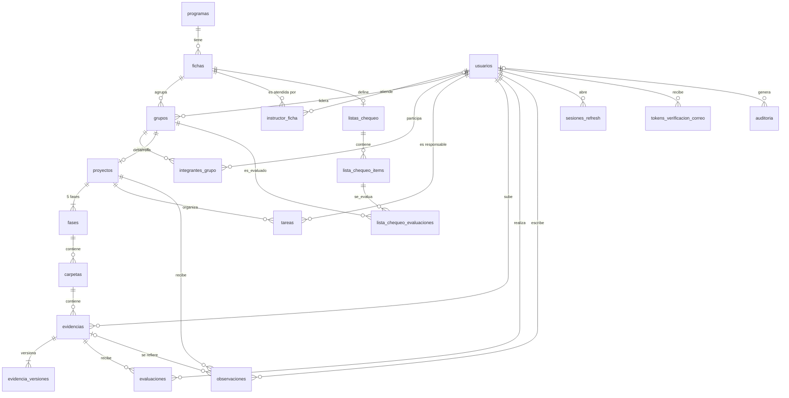
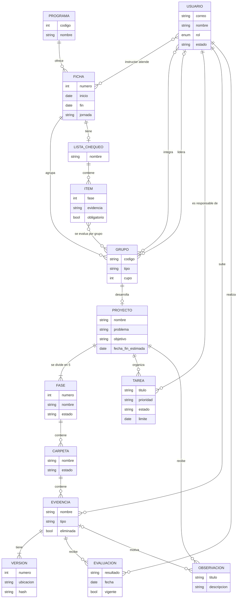
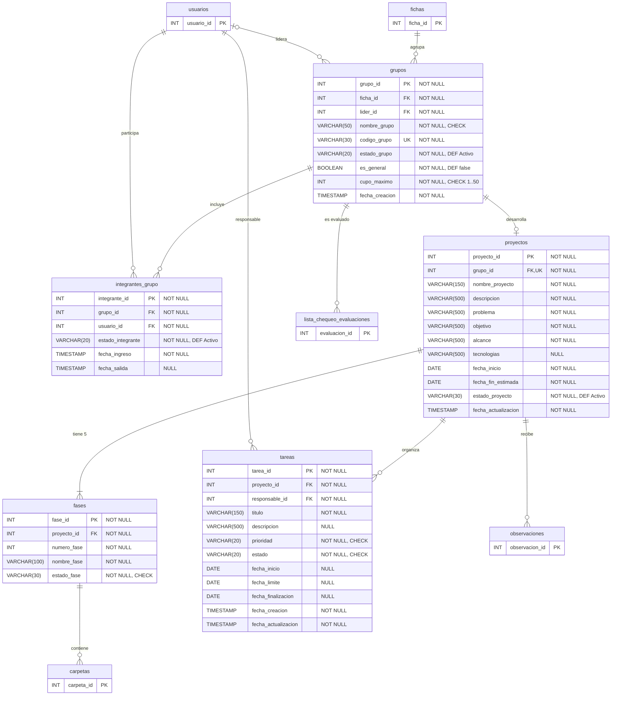
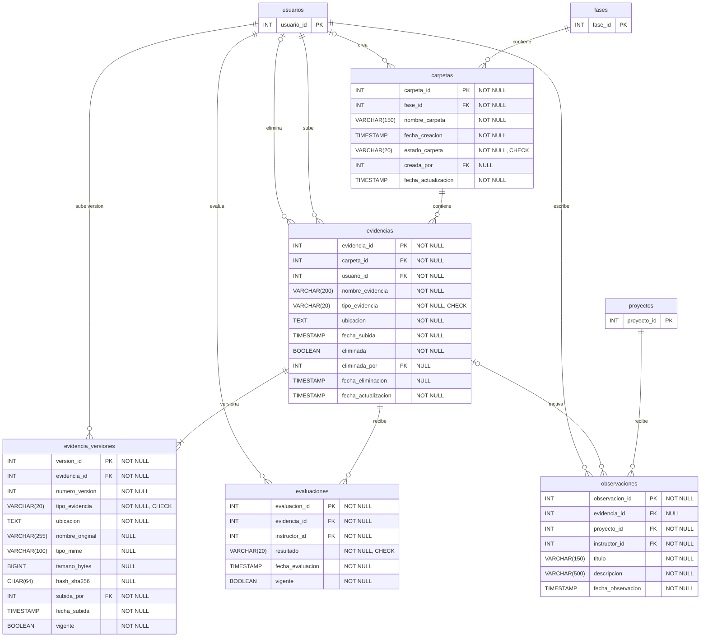
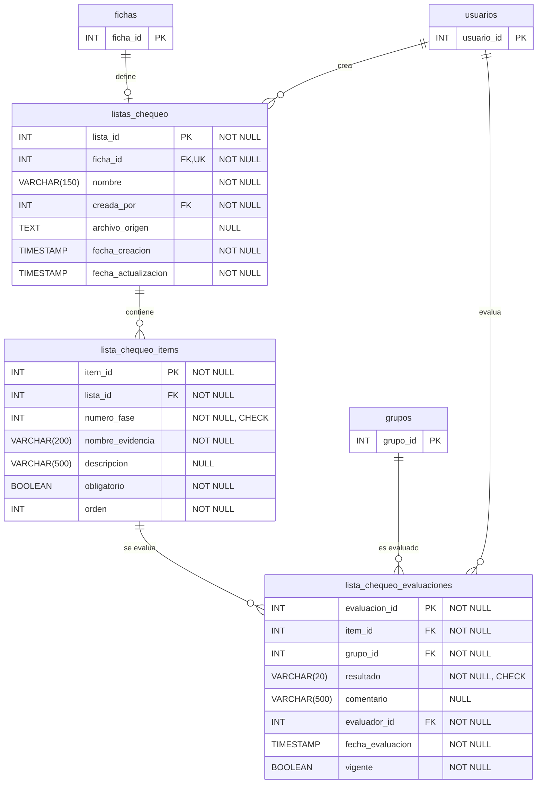

# Modelos MER y MR — ZENDA v12

<!--
  ¿Qué? Modelo entidad-relación (conceptual) y modelo relacional (lógico) de la base de datos de ZENDA.
  ¿Para qué? Entender primero el negocio (MER) y luego su implementación en tablas, tipos y restricciones (MR).
  ¿Impacto? El MR es lo que el backend consulta con SQL directo: un cambio aquí afecta a todas las consultas.
-->

---

## Identificación

| Campo | Valor |
| --- | --- |
| **Motor** | PostgreSQL 14 o superior |
| **Tablas** | 20 (de las cuales 7 son nuevas en v12) |
| **Fuente** | `Database/zenda_bd.sql` + `Database/migrations/002_semana2.sql` |
| **Diccionario y restricciones** | [`esquema-bd.md`](../referencia-tecnica/esquema-bd.md) |
| **Fecha** | Octubre 2026 |

---

## 1. MER y MR: en qué se diferencian

| | MER (conceptual) | MR (relacional) |
|---|---|---|
| **Pregunta que responde** | ¿Qué cosas existen en el negocio y cómo se relacionan? | ¿Cómo se guardan en tablas? |
| **Muestra** | Entidades, atributos clave y relaciones con cardinalidad | Tablas, columnas, tipos, `PK`, `FK`, `UK` y nulabilidad |
| **Relaciones N:M** | Se dibujan directas | Se resuelven con tabla asociativa (`instructor_ficha`, `integrantes_grupo`) |
| **Audiencia** | Instructor, coordinador, equipo | Quien escribe el SQL |

---

## 2. Diagrama entidad-relación (MER)

## 2.1 Modelo Relacional (MR)

Solo el dominio del negocio: se omiten las tablas técnicas (`sesiones_refresh`, `tokens_verificacion_correo`, `auditoria`).

---

| Relación | Cardinalidad | Cómo se lee |
|---|:---:|---|
| Programa – Ficha | 1 : N | Un programa ofrece varias fichas; cada ficha es de un programa. |
| Usuario (instructor) – Ficha | N : M | Un instructor atiende varias fichas y una ficha puede cambiar de instructor. Se guarda con historial. |
| Usuario – Grupo | N : M | Un usuario integra grupos (el `General` y, a lo sumo, uno de proyecto activo). |
| Usuario – Grupo (líder) | 1 : N, opcional | Un grupo de proyecto tiene un líder; el grupo `General` no. |
| Grupo – Proyecto | 1 : 0..1 | Un grupo de proyecto tiene un proyecto. |
| Proyecto – Fase | 1 : 5 | Cada proyecto tiene exactamente 5 fases fijas. |
| Fase – Carpeta – Evidencia | 1 : N : N | Las fases contienen carpetas y estas, evidencias. |
| Evidencia – Versión | 1 : 1..N | Toda evidencia tiene al menos una versión. |
| Evidencia – Evaluación | 1 : N | Se conserva el historial; solo una es la vigente. |
| Ficha – Lista de chequeo | 1 : 0..1 | Una lista por ficha. |
| Ítem – Grupo | N : M | Cada ítem se evalúa por grupo. |

---

## 3. Modelo relacional (MR)

**Cómo leerlo:** cada columna muestra `tipo nombre llaves "nulabilidad y restricciones"`.

| Símbolo | Significado |
|---|---|
| `PK` | Clave primaria (identidad generada) |
| `FK` | Clave foránea |
| `UK` | Valor único por sí solo |
| `NOT NULL` / `NULL` | Obligatoria u opcional |
| `CHECK` | Valores limitados (ver [valores permitidos](../referencia-tecnica/esquema-bd.md#3-valores-permitidos)) |
| `DEF x` | Valor por defecto `x` |

Los diagramas se dividen por módulo para que sean legibles. Las tablas de otros módulos aparecen solo con su clave.

### 3.1 Acceso y estructura académica

**Tablas:** `programas`, `fichas`, `usuarios`, `instructor_ficha`, `sesiones_refresh`, `tokens_verificacion_correo`, `auditoria`. Tablas referenciadas desde otros módulos (solo su clave): `carpetas`, `evaluaciones`, `evidencia_versiones`, `evidencias`, `grupos`, `integrantes_grupo`, `lista_chequeo_evaluaciones`, `listas_chequeo`, `observaciones`, `tareas`.

```mermaid
erDiagram
    programas ||--o{ fichas : "tiene"
    fichas ||--o{ grupos : "agrupa"
    fichas ||--o{ instructor_ficha : "asigna"
    usuarios ||--o{ instructor_ficha : "atiende"
    usuarios |o--o{ grupos : "lidera"
    usuarios ||--o{ integrantes_grupo : "participa"
    usuarios ||--o{ tareas : "responsable"
    usuarios |o--o{ carpetas : "crea"
    usuarios ||--o{ evidencias : "sube"
    usuarios |o--o{ evidencias : "elimina"
    usuarios ||--o{ evidencia_versiones : "sube version"
    usuarios ||--o{ evaluaciones : "evalua"
    usuarios ||--o{ observaciones : "escribe"
    fichas ||--o| listas_chequeo : "define"
    usuarios ||--o{ listas_chequeo : "crea"
    usuarios ||--o{ lista_chequeo_evaluaciones : "evalua"
    usuarios ||--o{ sesiones_refresh : "abre"
    usuarios ||--o{ tokens_verificacion_correo : "recibe"
    usuarios |o--o{ auditoria : "genera"
    programas {
        INT programa_id PK "NOT NULL"
        INT codigo_programa UK "NOT NULL"
        VARCHAR(220) nombre_programa "NOT NULL"
    }
    fichas {
        INT ficha_id PK "NOT NULL"
        INT programa_id FK "NOT NULL"
        INT numero_ficha UK "NOT NULL"
        DATE fecha_inicio "NOT NULL"
        DATE fecha_fin "NOT NULL"
        VARCHAR(20) jornada "NULL"
    }
    usuarios {
        INT usuario_id PK "NOT NULL"
        tipo_rol rol "NOT NULL"
        VARCHAR(100) nombre "NOT NULL"
        VARCHAR(100) apellido "NOT NULL"
        VARCHAR(150) correo UK "NOT NULL"
        VARCHAR(255) contrasena "NOT NULL"
        VARCHAR(10) tipo_documento "NULL, CHECK, DEF CC"
        VARCHAR(30) numero_documento "NULL"
        VARCHAR(20) estado "NOT NULL, DEF Activo"
        TIMESTAMP acepto_legales_en "NULL"
        TIMESTAMP correo_verificado_en "NULL"
        TIMESTAMP fecha_creacion "NOT NULL"
        TIMESTAMP fecha_actualizacion "NOT NULL"
    }
    instructor_ficha {
        INT instructor_ficha_id PK "NOT NULL"
        INT instructor_id FK "NOT NULL"
        INT ficha_id FK "NOT NULL"
        TIMESTAMP fecha_inicio "NOT NULL"
        TIMESTAMP fecha_fin "NOT NULL"
    }
    sesiones_refresh {
        INT sesion_id PK "NOT NULL"
        INT usuario_id FK "NOT NULL"
        CHAR(64) token_hash UK "NOT NULL"
        TIMESTAMP fecha_creacion "NOT NULL"
        TIMESTAMP fecha_expiracion "NOT NULL"
        BOOLEAN revocada "NOT NULL"
    }
    tokens_verificacion_correo {
        INT token_id PK "NOT NULL"
        INT usuario_id FK "NOT NULL"
        CHAR(64) token_hash UK "NOT NULL"
        TIMESTAMP fecha_expiracion "NOT NULL"
        TIMESTAMP usado_en "NULL"
    }
    auditoria {
        INT auditoria_id PK "NOT NULL"
        INT usuario_id FK "NULL"
        VARCHAR(60) accion "NOT NULL"
        VARCHAR(40) entidad "NOT NULL"
        INT entidad_id "NULL"
        JSONB detalle "NULL"
        TIMESTAMP fecha "NOT NULL"
    }
    carpetas {
        INT carpeta_id PK
    }
    evaluaciones {
        INT evaluacion_id PK
    }
    evidencia_versiones {
        INT version_id PK
    }
    evidencias {
        INT evidencia_id PK
    }
    grupos {
        INT grupo_id PK
    }
    integrantes_grupo {
        INT integrante_id PK
    }
    lista_chequeo_evaluaciones {
        INT evaluacion_id PK
    }
    listas_chequeo {
        INT lista_id PK
    }
    observaciones {
        INT observacion_id PK
    }
    tareas {
        INT tarea_id PK
    }
```

### 3.2 Grupos, proyecto, fases y tareas

**Tablas:** `grupos`, `integrantes_grupo`, `proyectos`, `fases`, `tareas`. Tablas referenciadas desde otros módulos (solo su clave): `carpetas`, `fichas`, `lista_chequeo_evaluaciones`, `observaciones`, `usuarios`.

### 3.3 Carpetas, evidencias y evaluación

**Tablas:** `carpetas`, `evidencias`, `evidencia_versiones`, `evaluaciones`, `observaciones`. Tablas referenciadas desde otros módulos (solo su clave): `fases`, `proyectos`, `usuarios`.

### 3.4 Lista de chequeo

**Tablas:** `listas_chequeo`, `lista_chequeo_items`, `lista_chequeo_evaluaciones`. Tablas referenciadas desde otros módulos (solo su clave): `fichas`, `grupos`, `usuarios`.

---

## 4. Restricciones compuestas y parciales

No caben en el diagrama por columna; están en el [esquema](../referencia-tecnica/esquema-bd.md#4-restricciones-de-integridad-clave):

| Restricción | Tabla | Tipo |
|---|---|---|
| `(grupo_id, usuario_id)` | `integrantes_grupo` | Única compuesta |
| `(proyecto_id, numero_fase)` | `fases` | Única compuesta |
| `(evidencia_id, numero_version)` | `evidencia_versiones` | Única compuesta |
| `(instructor_id, ficha_id)` donde `fecha_fin IS NULL` | `instructor_ficha` | Única parcial |
| `(evidencia_id)` donde `vigente` | `evaluaciones`, `evidencia_versiones` | Única parcial |
| `(item_id, grupo_id)` donde `vigente` | `lista_chequeo_evaluaciones` | Única parcial |

---

## Documentos relacionados

- [Esquema de base de datos](../referencia-tecnica/esquema-bd.md) · [Arquitectura](../referencia-tecnica/arquitectura.md)
- [Reglas de negocio](../requisitos/reglas-de-negocio.md)
