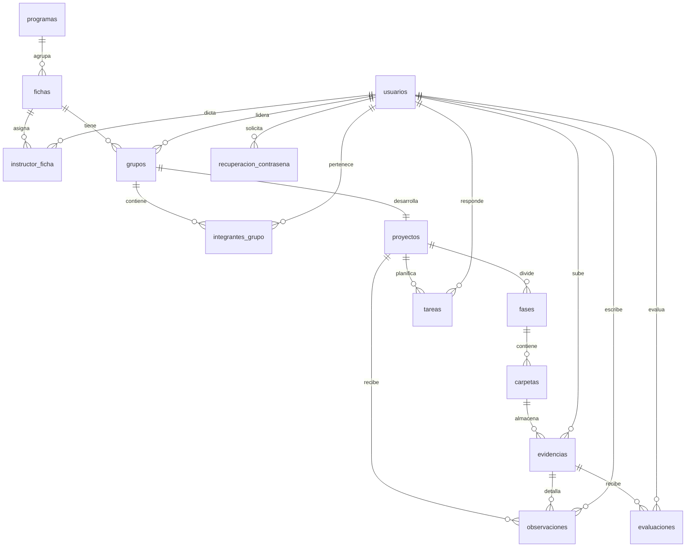

# Modelos MER y MR — ZENDA

<!--
  ¿Qué? Modelo entidad-relación (conceptual) y modelo relacional (lógico) de
  la base de datos real de ZENDA.
  ¿Para qué? Entender primero el negocio (MER) y luego su implementación en
  tablas, tipos y restricciones (MR).
  ¿Impacto? El MR es lo que el backend consulta con SQL directo: un cambio
  aquí afecta a todas las consultas.
-->

---

## Identificación

| Campo | Valor |
|---|---|
| **Motor** | PostgreSQL 16 |
| **Tablas** | **14** |
| **Tipos enumerados** | 1 (`tipo_rol`) |
| **Fuente** | `Database/zenda_bd.sql` + `Database/migrations/002_semana2.sql` |
| **Diccionario y restricciones** | [`esquema-bd.md`](../Referencia-Tecnica/esquema-bd.md) |
| **Fecha** | 23-oct-2026 |

> **Alcance real.** Este documento describe el esquema que existe hoy. Las
> tablas `evidencia_versiones`, `listas_chequeo`, `lista_chequeo_items`,
> `lista_chequeo_evaluaciones`, `sesiones_refresh`,
> `tokens_verificacion_correo` y `auditoria` **no existen**: son propuestas de
> las Semanas 3–6 y no deben usarse en consultas.

---

## 1. MER y MR: en qué se diferencian

| | MER (conceptual) | MR (relacional) |
|---|---|---|
| **Pregunta que responde** | ¿Qué cosas existen en el negocio y cómo se relacionan? | ¿Cómo se guardan en tablas? |
| **Muestra** | Entidades, atributos clave y relaciones con cardinalidad | Tablas, columnas, tipos, `PK`, `FK`, `UK` y nulabilidad |
| **Relaciones N:M** | Se dibujan directas | Se resuelven con tabla asociativa (`instructor_ficha`, `integrantes_grupo`) |
| **Audiencia** | Instructor, coordinador, equipo | Quien escribe el SQL |

---

## 2. Diagrama entidad-relación (MER)

### 2.1 Entidades y su papel

| Entidad | Papel en el negocio |
|---|---|
| `programas` | Catálogo de programas de formación (por ejemplo, ADSO). |
| `fichas` | Grupo de aprendices de un programa, con fechas y jornada. |
| `usuarios` | Cuenta de cualquier rol: aprendiz, instructor, coordinador o administrador. |
| `instructor_ficha` | Historial de qué instructor dicta qué ficha y desde/hasta cuándo. |
| `grupos` | Grupo de trabajo de una ficha; también el grupo General de la ficha. |
| `integrantes_grupo` | Pertenencia de un aprendiz a un grupo. |
| `proyectos` | Proyecto formativo de un grupo (relación 1 a 1). |
| `fases` | Las 5 fases del proyecto. |
| `carpetas` | Agrupación de evidencias dentro de una fase. |
| `evidencias` | Enlace entregado por un aprendiz. |
| `evaluaciones` | Historial de aprobaciones y reprobaciones por evidencia. |
| `observaciones` | Comentario del instructor sobre el proyecto o una evidencia. |
| `tareas` | Trabajo interno del grupo, con responsable y flujo de estados. |
| `recuperacion_contrasena` | Tokens de un solo uso para restablecer la clave. |

---

## 3. Modelo relacional (MR)

Convenciones: `PK` clave primaria, `FK` clave foránea, `UK` restricción única.
Todas las FK son `DEFERRABLE` salvo `recuperacion_contrasena.usuario_id`, que
es `ON DELETE CASCADE`.

### 3.1 Acceso y estructura académica

**`programas`**

| Columna | Tipo | Restricción |
|---|---|---|
| `programa_id` | `INT` | PK, identidad |
| `codigo_programa` | `INT` | NOT NULL, UK |
| `nombre_programa` | `VARCHAR(220)` | NOT NULL |

**`fichas`**

| Columna | Tipo | Restricción |
|---|---|---|
| `ficha_id` | `INT` | PK, identidad |
| `programa_id` | `INT` | FK → `programas` |
| `numero_ficha` | `INT` | NOT NULL, UK |
| `fecha_inicio` | `DATE` | NOT NULL |
| `fecha_fin` | `DATE` | NOT NULL |
| `jornada` | `VARCHAR(20)` | NULL |

**`usuarios`**

| Columna | Tipo | Restricción |
|---|---|---|
| `usuario_id` | `INT` | PK, identidad |
| `rol` | `tipo_rol` | NOT NULL (`APRENDIZ`, `INSTRUCTOR`, `COORDINADOR`, `ADMINISTRADOR`) |
| `nombre` | `VARCHAR(100)` | NOT NULL |
| `apellido` | `VARCHAR(100)` | NOT NULL |
| `correo` | `VARCHAR(150)` | NOT NULL, UK |
| `contrasena` | `VARCHAR(255)` | NOT NULL (hash bcrypt) |
| `tipo_documento` | `VARCHAR(10)` | NULL, default `'CC'` |
| `numero_documento` | `VARCHAR(30)` | NULL |
| `estado` | `VARCHAR(20)` | NOT NULL, default `'Activo'` |
| `token_version` | `INT` | NOT NULL, default `0` |
| `acepta_terminos` | `BOOLEAN` | NOT NULL, default `false` |
| `acepta_privacidad` | `BOOLEAN` | NOT NULL, default `false` |
| `acepta_cookies` | `BOOLEAN` | NOT NULL, default `false` |
| `acepta_tratamiento_datos` | `BOOLEAN` | NOT NULL, default `false` |
| `fecha_aceptacion_legal` | `TIMESTAMP` | NULL |
| `fecha_creacion` | `TIMESTAMP` | NOT NULL, default `now()` |
| `fecha_actualizacion` | `TIMESTAMP` | NOT NULL, default `now()` |

**`instructor_ficha`**

| Columna | Tipo | Restricción |
|---|---|---|
| `instructor_ficha_id` | `INT` | PK, identidad |
| `instructor_id` | `INT` | FK → `usuarios` |
| `ficha_id` | `INT` | FK → `fichas` |
| `fecha_inicio` | `DATE` | NOT NULL, default `CURRENT_DATE` |
| `fecha_fin` | `DATE` | NULL |
| `estado` | `VARCHAR(20)` | NOT NULL, default `'Activo'` |

Restricciones:

- `chk_instructor_ficha_fechas`: `fecha_fin IS NULL OR fecha_fin >= fecha_inicio`.
- `chk_instructor_ficha_estado`: `Activo` ⇒ `fecha_fin IS NULL`; `Inactivo` ⇒
  `fecha_fin IS NOT NULL`.
- `uq_instructor_ficha_vigente`: UK parcial
  `(instructor_id, ficha_id) WHERE fecha_fin IS NULL`.

### 3.2 Grupos, proyecto, fases y tareas

**`grupos`**

| Columna | Tipo | Restricción |
|---|---|---|
| `grupo_id` | `INT` | PK, identidad |
| `ficha_id` | `INT` | FK → `fichas` |
| `lider_id` | `INT` | FK → `usuarios` |
| `nombre_grupo` | `VARCHAR(50)` | NOT NULL |
| `codigo_grupo` | `VARCHAR(30)` | NOT NULL, UK |
| `cupo_maximo` | `INT` | NOT NULL, default `6`, CHECK 1–50 |
| `estado_grupo` | `VARCHAR(20)` | NOT NULL, default `'Activo'` |
| `es_general` | `BOOLEAN` | NOT NULL, default `false` |
| `fecha_creacion` | `TIMESTAMP` | NOT NULL, default `now()` |

Restricciones:

- `chk_grupos_general_nombre`: si `es_general`, `nombre_grupo = 'General'`.
- `uq_grupo_general_por_ficha`: UK parcial `ficha_id WHERE es_general`.

**`integrantes_grupo`**

| Columna | Tipo | Restricción |
|---|---|---|
| `integrante_id` | `INT` | PK, identidad |
| `grupo_id` | `INT` | FK → `grupos` |
| `usuario_id` | `INT` | FK → `usuarios` |
| `estado_integrante` | `VARCHAR(20)` | NOT NULL, default `'Activo'` |
| `fecha_ingreso` | `TIMESTAMP` | NOT NULL, default `now()` |
| `fecha_salida` | `TIMESTAMP` | NULL |

Restricción `unq_integrantes_grupo (grupo_id, usuario_id)`.

**`proyectos`**

| Columna | Tipo | Restricción |
|---|---|---|
| `proyecto_id` | `INT` | PK, identidad |
| `grupo_id` | `INT` | FK → `grupos`, UK (1 proyecto por grupo) |
| `nombre_proyecto` | `VARCHAR(150)` | NOT NULL |
| `descripcion` | `VARCHAR(500)` | NOT NULL |
| `problema` | `VARCHAR(500)` | NOT NULL |
| `objetivo` | `VARCHAR(500)` | NOT NULL |
| `alcance` | `VARCHAR(500)` | NOT NULL |
| `tecnologias` | `VARCHAR(500)` | NULL |
| `fecha_inicio` | `DATE` | NOT NULL |
| `fecha_fin_estimada` | `DATE` | NOT NULL |
| `estado_proyecto` | `VARCHAR(30)` | NOT NULL, default `'Activo'` |

**`fases`**

| Columna | Tipo | Restricción |
|---|---|---|
| `fase_id` | `INT` | PK, identidad |
| `proyecto_id` | `INT` | FK → `proyectos` |
| `numero_fase` | `INT` | NOT NULL, UK junto a `proyecto_id` |
| `nombre_fase` | `VARCHAR(100)` | NOT NULL |
| `estado_fase` | `VARCHAR(30)` | NOT NULL, default `'Pendiente'`, CHECK |

Restricción `unq_fases_proyecto (proyecto_id, numero_fase)` y
`chk_fases_estado` con `Pendiente`, `En revisión`, `Aprobada`, `Desaprobada`.

**`tareas`**

| Columna | Tipo | Restricción |
|---|---|---|
| `tarea_id` | `INT` | PK, identidad |
| `proyecto_id` | `INT` | FK → `proyectos` |
| `responsable_id` | `INT` | FK → `usuarios` |
| `titulo` | `VARCHAR(150)` | NOT NULL |
| `descripcion` | `VARCHAR(500)` | NULL |
| `prioridad` | `VARCHAR(20)` | NOT NULL, default `'Media'`, CHECK |
| `estado` | `VARCHAR(20)` | NOT NULL, default `'Pendiente'`, CHECK |
| `fecha_inicio` | `DATE` | NULL |
| `fecha_limite` | `DATE` | NULL |
| `fecha_finalizacion` | `DATE` | NULL |

Flujo de `estado`: `Pendiente → En proceso → Finalizada → Confirmada` y
`Finalizada → Incompleta → En proceso`.

### 3.3 Carpetas, evidencias y evaluación

**`carpetas`**

| Columna | Tipo | Restricción |
|---|---|---|
| `carpeta_id` | `INT` | PK, identidad |
| `fase_id` | `INT` | FK → `fases` |
| `nombre_carpeta` | `VARCHAR(150)` | NOT NULL |
| `estado_carpeta` | `VARCHAR(20)` | NOT NULL, default `'Pendiente'`, CHECK |
| `fecha_creacion` | `TIMESTAMP` | NOT NULL, default `now()` |

`chk_carpetas_estado` usa los mismos cuatro estados que la fase.

**`evidencias`**

| Columna | Tipo | Restricción |
|---|---|---|
| `evidencia_id` | `INT` | PK, identidad |
| `carpeta_id` | `INT` | FK → `carpetas` |
| `usuario_id` | `INT` | FK → `usuarios` |
| `nombre_evidencia` | `VARCHAR(200)` | NOT NULL |
| `tipo_evidencia` | `VARCHAR(20)` | NOT NULL, CHECK |
| `ubicacion` | `TEXT` | NOT NULL, CHECK URL `http(s)` ≤ 500 |
| `fecha_subida` | `TIMESTAMP` | NOT NULL, default `now()` |

`chk_evidencias_tipo`: `Documento`, `Imagen`, `Video` o `Enlace`.
`chk_evidencias_ubicacion` se añade como `NOT VALID` para conservar
ubicaciones heredadas inválidas.

**`evaluaciones`**

| Columna | Tipo | Restricción |
|---|---|---|
| `evaluacion_id` | `INT` | PK, identidad |
| `evidencia_id` | `INT` | FK → `evidencias` |
| `instructor_id` | `INT` | FK → `usuarios` |
| `resultado` | `VARCHAR(20)` | NOT NULL, CHECK `APROBADO`/`REPROBADO` |
| `fecha_evaluacion` | `TIMESTAMP` | NOT NULL, default `now()` |

Índice `idx_evaluaciones_evidencia (evidencia_id, evaluacion_id DESC)`. La
evaluación vigente es la de mayor `evaluacion_id`; nunca se actualiza una fila.

**`observaciones`**

| Columna | Tipo | Restricción |
|---|---|---|
| `observacion_id` | `INT` | PK, identidad |
| `evidencia_id` | `INT` | FK → `evidencias`, NULL |
| `proyecto_id` | `INT` | FK → `proyectos` |
| `instructor_id` | `INT` | FK → `usuarios` |
| `titulo` | `VARCHAR(150)` | NOT NULL |
| `descripcion` | `VARCHAR(500)` | NOT NULL |
| `fecha_observacion` | `TIMESTAMP` | NOT NULL, default `now()` |

### 3.4 Seguridad de la cuenta

**`recuperacion_contrasena`**

| Columna | Tipo | Restricción |
|---|---|---|
| `recuperacion_id` | `INT` | PK, identidad |
| `usuario_id` | `INT` | FK → `usuarios`, `ON DELETE CASCADE` |
| `token_hash` | `CHAR(64)` | NOT NULL, UK (SHA-256 hex) |
| `expira_en` | `TIMESTAMP` | NOT NULL |
| `usado_en` | `TIMESTAMP` | NULL |
| `creado_en` | `TIMESTAMP` | NOT NULL, default `now()` |

Índice `idx_recuperacion_usuario (usuario_id, expira_en DESC)`.

---

## 4. Restricciones compuestas y parciales

| Restricción | Tabla | Tipo |
|---|---|---|
| `(proyecto_id, numero_fase)` | `fases` | Única compuesta |
| `(grupo_id, usuario_id)` | `integrantes_grupo` | Única compuesta |
| `(instructor_id, ficha_id) WHERE fecha_fin IS NULL` | `instructor_ficha` | Única parcial (vigente) |
| `(ficha_id) WHERE es_general` | `grupos` | Única parcial (un General por ficha) |
| `grupo_id` | `proyectos` | Única simple (1 proyecto por grupo) |
| `codigo_programa` | `programas` | Única simple |
| `codigo_grupo` | `grupos` | Única simple |
| `correo` | `usuarios` | Única simple |
| `numero_ficha` | `fichas` | Única simple |
| `token_hash` | `recuperacion_contrasena` | Única simple |

### 4.1 Índices de consulta

| Índice | Tabla | Columnas |
|---|---|---|
| `idx_fichas_programa` | `fichas` | (`programa_id`) |
| `idx_grupos_ficha` | `grupos` | (`ficha_id`) |
| `idx_integrantes_grupo_grupo` | `integrantes_grupo` | (`grupo_id`) |
| `idx_integrantes_grupo_usuario` | `integrantes_grupo` | (`usuario_id`) |
| `idx_fases_proyecto` | `fases` | (`proyecto_id`) |
| `idx_carpetas_fase` | `carpetas` | (`fase_id`) |
| `idx_evidencias_carpeta` | `evidencias` | (`carpeta_id`) |
| `idx_evaluaciones_evidencia` | `evaluaciones` | (`evidencia_id`, `evaluacion_id DESC`) |
| `idx_recuperacion_usuario` | `recuperacion_contrasena` | (`usuario_id`, `expira_en DESC`) |

---

## 5. Funciones de cascada

| Función | Entrada | Efecto |
|---|---|---|
| `zenda_recalcular_carpeta(p_carpeta_id INT)` | Carpeta | Actualiza `carpetas.estado_carpeta` con la evaluación vigente de sus evidencias |
| `zenda_recalcular_fase(p_fase_id INT)` | Fase | Actualiza `fases.estado_fase` a partir de todas sus evidencias |

Regla (RN-018): sin evidencias → `Pendiente`; alguna reprobada → `Desaprobada`;
todas aprobadas → `Aprobada`; cualquier otra → `En revisión`. La misma regla
vive en `backend/src/domain/reglas.js`.

---

## 6. Qué no existe (Semanas 3–6)

| Propuesta | Semana | Estado |
|---|:---:|---|
| `evidencia_versiones` (versiones y borrado lógico) | 4 | No implementado |
| `listas_chequeo`, `lista_chequeo_items`, `lista_chequeo_evaluaciones` | 5 | No implementado |
| `sesiones_refresh` (refresh tokens) | 3–6 | No implementado |
| `tokens_verificacion_correo` | 3–6 | No implementado |
| `auditoria` | 3–6 | No implementado |

El esquema actual se documenta columna por columna en
[`esquema-bd.md`](../Referencia-Tecnica/esquema-bd.md).

---

## Documentos relacionados

- [Esquema de base de datos](../Referencia-Tecnica/esquema-bd.md)
- [Modelo de dominio](modelo-dominio.md) · [Diagrama de clases](clases.md)
- [Reglas de negocio](../Requisitos/reglas-de-negocio.md)
