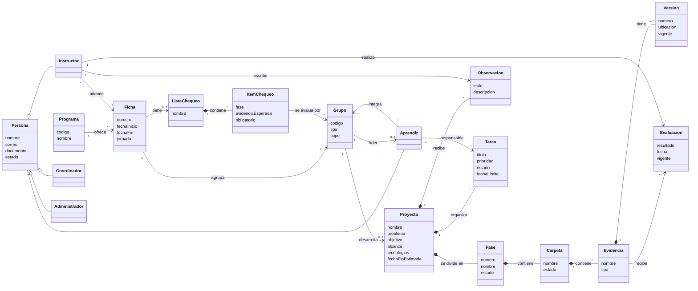

# Modelo de dominio — ZENDA

<!--
  ¿Qué? Los conceptos del negocio de ZENDA, sus relaciones y las reglas que los gobiernan, en lenguaje del negocio y no de la base de datos.
  ¿Para qué? Que el equipo, el instructor y el cliente hablen de lo mismo antes de pensar en tablas o código.
  ¿Impacto? Un concepto mal entendido produce requisitos equivocados que luego cuestan caro corregir.
-->

---

## Identificación

| Campo | Valor |
|---|---|
| **Nivel** | Conceptual (negocio) |
| **Notación** | Diagrama de clases UML simplificado en Mermaid |
| **Se complementa con** | [MER y MR](mer-mr.md) (datos) · [Clases](clases.md) (diseño de software) |
| **Fecha** | Octubre 2026 |

---

## 1. Qué es el dominio de ZENDA

En el SENA, los aprendices de **Análisis y Desarrollo de Software** realizan un **proyecto formativo en grupo**, dividido en **cinco fases**. En cada fase entregan **evidencias** que el **instructor** de su **ficha** evalúa. ZENDA digitaliza ese seguimiento.

---

## 2. Diagrama del dominio

---

## 3. Conceptos del dominio

| Concepto | Qué es | Reglas clave |
|---|---|---|
| **Programa** | Programa de formación (por ejemplo, ADSO, código `2338`). | El coordinador solo supervisa ADSO ([RN-025](../requisitos/reglas-de-negocio.md#rn-025--alcance-del-coordinador)). |
| **Ficha** | Grupo de formación de un programa, con número, fechas y jornada. | Tiene un grupo especial `General` ([RN-006](../requisitos/reglas-de-negocio.md#rn-006--grupo-general-por-ficha)). |
| **Persona / Usuario** | Quien accede al sistema, con uno de cuatro roles. | Sin sub-roles ([RN-005](../requisitos/reglas-de-negocio.md#rn-005--roles-sin-sub-roles)). |
| **Aprendiz** | Integrante de un grupo. | Un solo proyecto activo ([RN-007](../requisitos/reglas-de-negocio.md#rn-007--un-proyecto-activo-por-aprendiz)). |
| **Líder** | Aprendiz que creó el proyecto. | Fijo; solo el administrador reasigna ([RN-008](../requisitos/reglas-de-negocio.md#rn-008--líder-del-grupo), [RN-030](../requisitos/reglas-de-negocio.md#rn-030--reasignación-de-liderazgo-por-el-administrador)). |
| **Instructor** | Evalúa las fichas a las que está vinculado. | Vinculación con historial ([RN-024](../requisitos/reglas-de-negocio.md#rn-024--asignación-instructorficha-con-historial)). |
| **Grupo** | Conjunto de aprendices. Puede ser `General` (inscripción a la ficha) o de proyecto. | Cupo definido por el líder ([RN-009](../requisitos/reglas-de-negocio.md#rn-009--cupo-del-grupo)); código `PRY-XXXXXXXXXX` ([RN-010](../requisitos/reglas-de-negocio.md#rn-010--código-de-invitación)). |
| **Proyecto** | Trabajo formativo de un grupo. | Un proyecto por grupo. |
| **Fase** | Una de las cinco etapas: Análisis, Diseño, Desarrollo, Pruebas y Cierre/Entrega. | Fijas y automáticas ([RN-011](../requisitos/reglas-de-negocio.md#rn-011--cinco-fases-fijas)). |
| **Carpeta** | Agrupador de evidencias dentro de una fase, creado por los aprendices. | Cualquier integrante la crea ([RN-012](../requisitos/reglas-de-negocio.md#rn-012--carpetas-y-evidencias-por-cualquier-integrante)). |
| **Evidencia** | Archivo o enlace que prueba el trabajo. | Versionada, con borrado lógico ([RN-014](../requisitos/reglas-de-negocio.md#rn-014--versionado-y-borrado-lógico)). |
| **Evaluación** | Resultado `APROBADO` o `REPROBADO` de una evidencia. | Historial, solo la última vale ([RN-017](../requisitos/reglas-de-negocio.md#rn-017--historial-de-evaluaciones)). |
| **Observación** | Comentario del instructor sobre un proyecto. | Solo el instructor de la ficha ([RN-023](../requisitos/reglas-de-negocio.md#rn-023--observaciones-del-instructor)). |
| **Tarea** | Trabajo asignado a un integrante. | Solo el líder crea y asigna ([RN-021](../requisitos/reglas-de-negocio.md#rn-021--tareas-creadas-solo-por-el-líder)). |
| **Lista de chequeo** | Evidencias esperadas de una ficha, por fase. | Pertenece a la ficha, no al instructor ([RN-026](../requisitos/reglas-de-negocio.md#rn-026--lista-de-chequeo-por-ficha)). |

---

## 4. Agregados

Un **agregado** es un conjunto de objetos que se tratan como una unidad: se modifican juntos y siempre a través de su raíz.

| Agregado | Raíz | Contiene | Garantiza |
|---|---|---|---|
| **Proyecto** | `Proyecto` | Fases, carpetas, evidencias (con versiones y evaluaciones), observaciones, tareas | Que las cinco fases existan y que los estados en cascada sean coherentes. |
| **Grupo** | `Grupo` | Integrantes y líder | Que no se supere el cupo y que haya un solo proyecto activo por aprendiz. |
| **Ficha** | `Ficha` | Vinculaciones de instructores, lista de chequeo y sus ítems | Que el historial de instructores y de evaluaciones se conserve. |
| **Usuario** | `Usuario` | Sesiones de refresco y verificación de correo | Que solo las cuentas activas inicien sesión. |

---

## 5. Cómo se calcula lo que importa

| Resultado | Se obtiene de | Regla |
|---|---|---|
| Estado de una **carpeta** | Evaluaciones vigentes de sus evidencias | Una reprobada la desaprueba; todas aprobadas, la aprueba; si no, queda en revisión ([RN-018](../requisitos/reglas-de-negocio.md#rn-018--cascada-de-estados)). |
| Estado de una **fase** | Estados de sus carpetas | Una carpeta desaprobada la desaprueba; todas aprobadas, la aprueba ([RN-018](../requisitos/reglas-de-negocio.md#rn-018--cascada-de-estados)). |
| **Porcentaje de la fase** | Evidencias aprobadas ÷ evidencias totales | Se muestra también "carpetas aprobadas X de Y" ([RN-020](../requisitos/reglas-de-negocio.md#rn-020--porcentaje-de-avance-de-la-fase)). |
| **Progreso de tareas** | Tareas confirmadas ÷ total | [RF-031](../requisitos/RFs/RF-031_tablero_y_progreso_de_tareas.md) |
| **Avance de lista de chequeo** | Ítems obligatorios aprobados por grupo; promedio por ficha | [RN-027](../requisitos/reglas-de-negocio.md#rn-027--avance-de-la-lista-de-chequeo) |

Las dos formas de avance (cascada de evidencias y lista de chequeo) son **independientes**: la lista es la hoja de seguimiento del instructor y no cambia el estado de las fases.

---

## 6. Lenguaje del dominio (glosario básico)

| Término | Significado en ZENDA |
|---|---|
| **ADSO** | Programa Análisis y Desarrollo de Software, código `2338`. |
| **Ficha** | Número oficial que identifica a un grupo de formación. |
| **General** | Grupo automático de cada ficha que representa la inscripción del aprendiz; no es un proyecto. |
| **Código de invitación** | Código `PRY-XXXXXXXXXX` con el que un aprendiz se une a un proyecto. |
| **Evidencia** | Producto entregable del proyecto, como archivo o enlace. |
| **Cascada** | Recalculo automático de los estados de carpeta y fase tras evaluar. |
| **Vigente** | Último registro válido de algo que conserva historial (evaluación, versión). |
| **Cupo** | Cantidad máxima de integrantes de un grupo de proyecto. |
| **PPT** | Permiso por Protección Temporal, tipo de documento de identidad aceptado. |

El glosario completo irá en `requisitos/glosario.md`.

---

## Documentos relacionados

- [MER y MR](mer-mr.md) · [Clases](clases.md) · [Estados](estados.md)
- [Reglas de negocio](../requisitos/reglas-de-negocio.md) · [Matriz de permisos](../requisitos/matriz-permisos.md)
