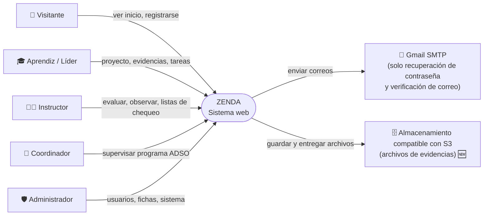
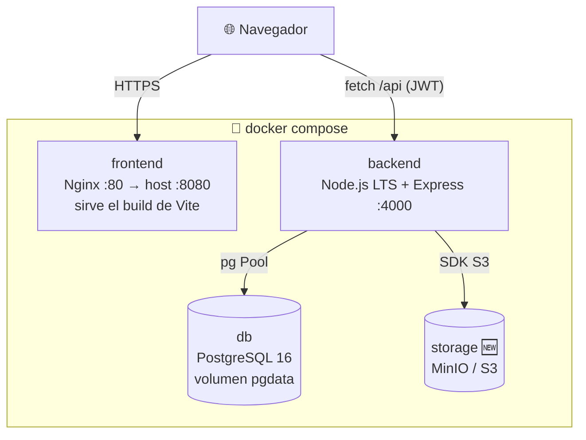
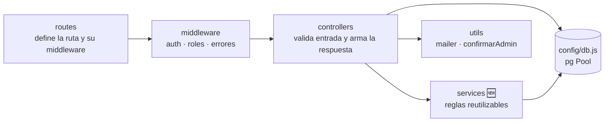
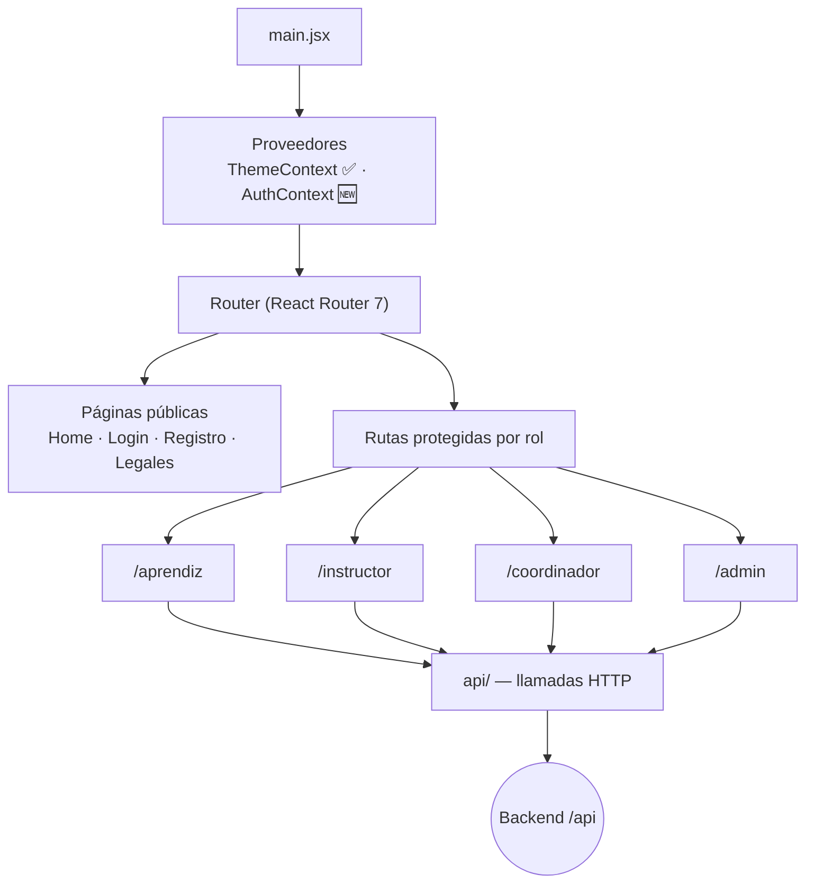
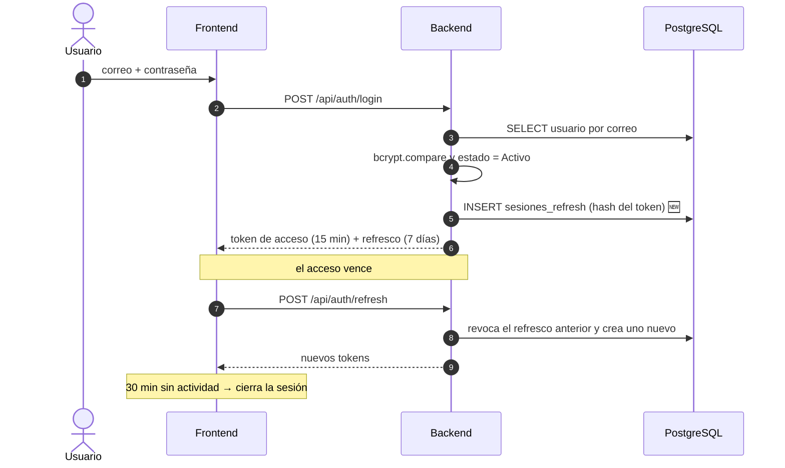
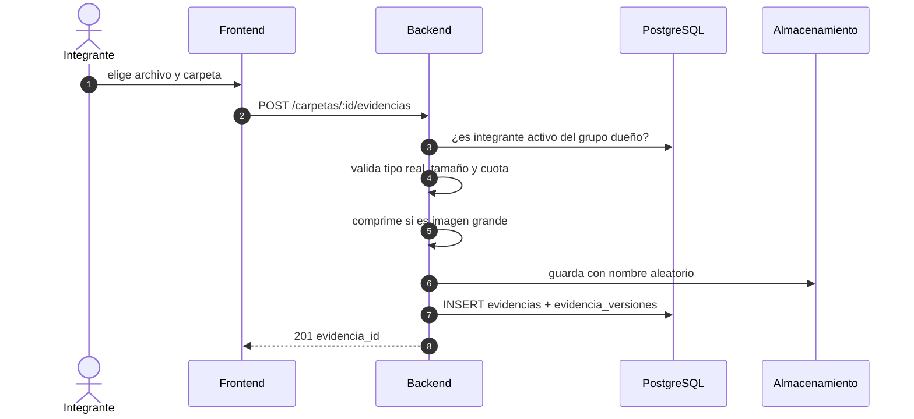
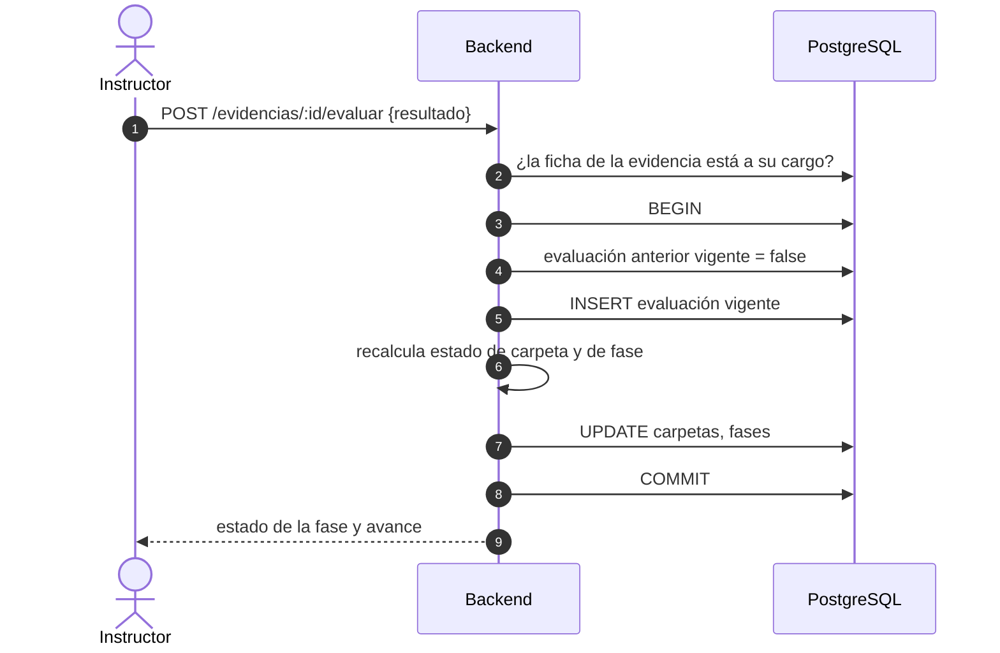
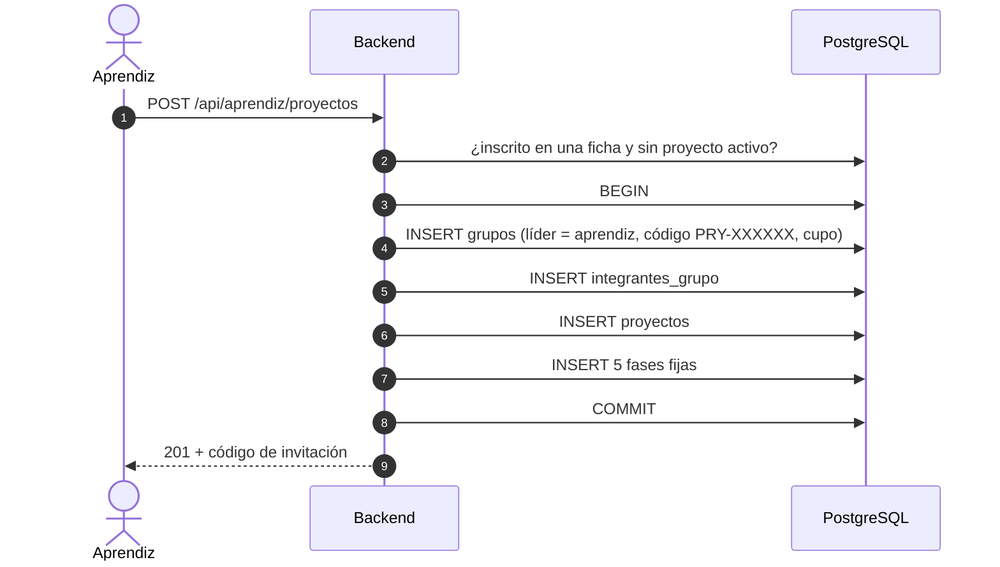

# Arquitectura — ZENDA v12

<!--
  ¿Qué? Descripción de la arquitectura de ZENDA: contexto, contenedores, componentes, flujos clave, seguridad y estructura de código.
  ¿Para qué? Que cualquier integrante entienda cómo está construido el sistema y dónde debe ir cada cambio.
  ¿Impacto? Sin una arquitectura clara, el código crece desordenado y cada cambio arriesga romper otra parte.
-->

---

## Identificación

| Campo | Valor |
|---|---|
| **Sistema** | ZENDA — gestión y seguimiento de proyectos formativos ADSO |
| **Estilo** | Cliente–servidor, SPA + API REST + base de datos relacional |
| **Versión documentada** | v12 (objetivo) sobre la base real de v11 |
| **Fecha** | Octubre 2026 |

**Leyenda de estado:** ✅ existe en v11 · 🔄 cambio aprobado · 🆕 componente nuevo.

---

## 1. Visión general

ZENDA permite que grupos de aprendices desarrollen su proyecto formativo por fases, suban evidencias y reciban la evaluación del instructor, con supervisión del coordinador y administración centralizada ([README](../../README.md)).

| Principio | Qué significa en ZENDA |
|---|---|
| **Separación por capas** | Las rutas no contienen lógica; los controladores no construyen respuestas HTML; el acceso a datos está centralizado. |
| **El servidor manda** | Toda autorización se valida en el backend ([RS-004](../requisitos/restricciones.md#rs-004--autorización-siempre-en-el-servidor)). |
| **SQL explícito** | Consultas parametrizadas con `pg`, sin ORM ([RT-001](../requisitos/restricciones.md#rt-001--stack-de-backend-obligatorio)). |
| **Configuración por entorno** | Nada sensible ni dependiente del entorno vive en el código ([RS-001](../requisitos/restricciones.md#rs-001--secretos-fuera-del-código-y-del-repositorio)). |
| **Sin romper el contrato** | Rutas y nombres de campos se mantienen estables mientras se reorganiza el código interno. |

---

## 2. Contexto del sistema



| Sistema externo | Uso | Estado |
|---|---|---|
| Gmail SMTP | Recuperación de contraseña y verificación de correo, con contraseña de aplicación ([RT-007](../requisitos/restricciones.md#rt-007--correo-electrónico-limitado)). | ✅ recuperación · 🆕 verificación |
| Almacenamiento S3 | Archivos de evidencias; MinIO en desarrollo, R2 o S3 en producción ([RT-006](../requisitos/restricciones.md#rt-006--evidencias-como-archivo-o-enlace)). | 🆕 |

---

## 3. Contenedores y despliegue



| Contenedor | Imagen base | Puerto | Responsabilidad |
|---|---|---|---|
| `frontend` | `node:<LTS>-alpine` (build) → `nginx:alpine` | 80 → 8080 | Compila con Vite y sirve la SPA; `try_files` devuelve `index.html` para las rutas de React Router. |
| `backend` | `node:<LTS>-alpine` | 4000 | API REST. Corre como usuario `node`, no como `root`. |
| `db` | `postgres:16-alpine` | 5432 (interno) | Persistencia; carga `zenda_bd.sql` la primera vez y `001_v12.sql` se aplica después. |
| `storage` 🆕 | `minio/minio` (solo desarrollo) | 9000 | Archivos de evidencias. En producción se reemplaza por un servicio gestionado. |

> **Importante:** `VITE_API_URL` se incrusta al **compilar** el frontend. Debe ser la URL del backend tal como la ve el navegador, no el nombre interno del contenedor. Detalle en `setup/`.

---

## 4. Backend

### 4.1 Capas



| Capa | Responsabilidad | No debe |
|---|---|---|
| `routes` | Asociar método + ruta con middlewares y controlador. | Contener lógica de negocio. |
| `middleware` | `auth` (valida JWT), `isAdmin`, `isCoordinador`, `isInstructor`, `isAprendiz`. | Consultar datos del negocio. |
| `controllers` | Validar la entrada, llamar a servicios o a la base y responder con el código HTTP correcto. | Duplicar reglas entre controladores. |
| `services` 🆕 | Reglas compartidas: recalcular estados en cascada, calcular avances, validar pertenencia al grupo. | Conocer `req` ni `res`. |
| `config` | Pool de PostgreSQL y lectura de variables de entorno. | Tener valores por defecto sensibles. |

### 4.2 Módulos por rol

| Prefijo de la API | Rol | Módulos | Requisitos |
|---|---|---|---|
| `/api/auth` | Público | Registro, inicio de sesión, recuperación, refresco 🆕 | RF-001 a RF-004 |
| `/api/users` | Administrador | Usuarios, rol, fichas del instructor | RF-006 a RF-008, RF-011 |
| `/api/fichas` | Administrador (y público para el selector) | Fichas, aprendices, programas | RF-009, RF-010, RF-012 |
| `/api/aprendiz/proyectos` | Aprendiz | Proyecto, fases, carpetas, evidencias, tareas, observaciones | RF-014 a RF-031 |
| `/api/instructor` | Instructor | Fichas, evaluación, observaciones, listas de chequeo 🆕 | RF-023 a RF-026, RF-033, RF-036 a RF-038 |
| `/api/coordinador` | Coordinador | Dashboard, supervisión, reasignación | RF-011, RF-032, RF-033 |
| `/api/system` 🆕 | Administrador | Diagnóstico y copia de seguridad | RF-013 |

### 4.3 Estado de los componentes del backend

| Componente | Estado | Nota |
|---|:---:|---|
| Pool de PostgreSQL con SQL parametrizado | ✅ | |
| Middlewares de autenticación y rol | ✅ | |
| Transacciones en operaciones compuestas | ✅ | `crearProyecto`, `evaluarEvidencia`. |
| Confirmación del administrador con contraseña | ✅ | `utils/confirmarAdmin.js`. |
| Capa `services/` | 🆕 | Hoy la cascada vive dentro del controlador del instructor. |
| Manejo de errores centralizado | 🆕 | Hoy cada controlador captura y responde por su cuenta. |
| Token de refresco y cierre de sesión | 🔄 | Hoy el JWT dura 24 horas. |
| Almacenamiento de archivos | 🆕 | Hoy solo se guardan enlaces. |
| Auditoría de acciones críticas | 🆕 | Tabla `auditoria`. |

---

## 5. Frontend



| Elemento | Responsabilidad | Estado |
|---|---|:---:|
| `api.js` | Concentra todas las llamadas HTTP, adjunta el token y centraliza el manejo de errores. Se divide por módulo. | ✅ 🔄 |
| `ThemeContext` | Tema claro y oscuro. | ✅ |
| `AuthContext` 🆕 | Usuario, rol, renovación del token y cierre por inactividad. | 🆕 |
| Rutas protegidas | Bloquean pantallas según sesión y rol. | ✅ |
| `components/ui` | Componentes reutilizables (tarjetas, botones, tablas, menú de tres puntos). | ✅ 🔄 |
| `Recharts` | Gráficas de los dashboards. | ✅ |
| `CookieBanner` | Aviso de cookies. | ✅ |

---

## 6. Flujos clave

### 6.1 Inicio de sesión y renovación



### 6.2 Subida de una evidencia (archivo)



### 6.3 Evaluación y cascada de estados



**Algoritmo de la cascada** ([RN-018](../requisitos/reglas-de-negocio.md#rn-018--cascada-de-estados), [RN-020](../requisitos/reglas-de-negocio.md#rn-020--porcentaje-de-avance-de-la-fase)):

1. Para cada carpeta, tomar la evaluación vigente de cada evidencia no eliminada.
2. Si alguna es `REPROBADO` → carpeta `Desaprobada`; si todas son `APROBADO` → `Aprobada`; si no → `En revisión`.
3. Si alguna carpeta está `Desaprobada` → fase `Desaprobada`; si todas están `Aprobada` → fase `Aprobada`; si no → `En revisión`.
4. Avance de la fase = evidencias aprobadas ÷ evidencias totales; además se informa "carpetas aprobadas X de Y".

### 6.4 Creación de proyecto



---

## 7. Seguridad por capas

| Capa | Medida | Requisito |
|---|---|---|
| Navegador | Bloqueo de pegado en la confirmación de contraseña; medidor de fortaleza; cierre por inactividad. | [RS-006](../requisitos/restricciones.md#rs-006--registro-seguro-y-humano) |
| Transporte | HTTPS en producción; cabeceras de seguridad en Nginx y en la API. | [RNF-001](../requisitos/RNFs/RNF-001_seguridad.md) |
| API | JWT de corta duración, CORS restringido al frontend, límite de intentos. | [RT-004](../requisitos/restricciones.md#rt-004--método-de-autenticación) |
| Autorización | Middleware de rol + verificación de pertenencia (grupo, ficha, líder). | [Matriz de permisos](../requisitos/matriz-permisos.md) |
| Datos | SQL parametrizado, bcrypt, secretos en variables de entorno, transacciones. | [RS-003](../requisitos/restricciones.md#rs-003--no-exponer-contraseñas), [RS-005](../requisitos/restricciones.md#rs-005--consultas-sql-parametrizadas) |
| Archivos | Lista blanca por contenido, nombre aleatorio, cuota, descarga con autorización. | [RNF-012](../requisitos/RNFs/RNF-012_gestion_de_archivos_y_almacenamiento.md) |
| Contenedores | Proceso sin `root`, `.dockerignore` que excluye `.env`, imágenes LTS. | [RT-008](../requisitos/restricciones.md#rt-008--contenedores-con-docker) |

---

## 8. Estructura de carpetas

### 8.1 Backend

| Hoy (v11) | Objetivo (v12) | Cambio |
|---|---|---|
| `server.js` | `server.js` (solo arranque) + `src/app.js` (Express y rutas) | Separar el arranque de la configuración |
| `src/config/db.js` | `src/config/db.js` + `src/config/env.js` | Validar variables al iniciar |
| `src/middleware/auth.js` y `is*` | `auth.js` + `roles.js` + `errores.js` | Unificar roles; error central |
| `src/routes/<rol>/…` | `src/routes/<rol>/<modulo>.routes.js` | Nombre uniforme |
| `src/controllers/<rol>Controller/…` | `src/controllers/<rol>/<modulo>.controller.js` | Quitar sufijo `Controller` de las carpetas |
| *(no existe)* | `src/services/` | Cascada, avance, pertenencia |
| *(no existe)* | `src/constants/` | Fases, estados, prioridades |
| `src/utils/` | `src/utils/` | Sin cambios |

### 8.2 Frontend

| Hoy (v11) | Objetivo (v12) | Cambio |
|---|---|---|
| `src/api.js` | `src/api/<modulo>.js` + `src/api/cliente.js` | Dividir por módulo |
| `src/context/ThemeContext` | `+ AuthContext` | Sesión centralizada |
| `src/components/{Auth,admin,ui}` | `src/components/{ui,layout,auth,admin}` | Agregar `layout/` (barra lateral, pie) |
| `src/pages/<rol>` | `src/pages/{publicas,aprendiz,instructor,coordinador,admin}` | Agrupar páginas públicas |
| `Tareas.tsx` | `Tareas.jsx` | Un solo lenguaje |
| *(no existe)* | `src/hooks/`, `src/routes/` | Inactividad; rutas protegidas |
| `src/styles` | `src/styles` | Sin cambios |

> **Cómo moverlo sin romper nada:** `git mv`, un cambio de carpeta por commit, `pnpm build` y `pnpm lint` después de cada uno, y actualizar el árbol del README en el mismo commit.

### 8.3 Raíz del repositorio

```text
ZENDA/
├── README.md
├── docker-compose.yml        .env.example        .gitignore
├── Database/                 zenda_bd.sql · migraciones/
├── backend/                  Dockerfile · .dockerignore · .env.example
├── frontend/                 Dockerfile · .dockerignore · nginx.conf · .env.example
└── docs/                     requisitos/ · referencia-tecnica/ · diagramas/ · setup/ · …
```

---

## 9. Decisiones de arquitectura

| # | Decisión | Motivo | Alternativa descartada |
|:---:|---|---|---|
| 1 | Express + SQL directo con `pg` | Control total de las consultas y aprendizaje del modelo relacional. | ORM (Sequelize, Prisma). |
| 2 | JWT *stateless* con refresco rotativo | Escala sin sesiones en memoria y permite revocar. | Sesiones de servidor. |
| 3 | Rol en la BD + líder como condición del grupo | Sin sub-roles Scrum; un solo permiso extra y fijo. | Sub-roles por integrante. |
| 4 | Cascada calculada en el servidor | El estado no depende de la interfaz y es consistente. | Calcularla en el navegador. |
| 5 | Archivos en almacenamiento S3, metadatos en PostgreSQL | No llena el contenedor ni la base de datos; escala. | Disco del contenedor; `BYTEA`. |
| 6 | Evaluaciones y versiones solo se agregan | Conservan la autoría ante cambios de instructor. | `UPDATE` sobre el registro. |
| 7 | Lista de chequeo independiente de la cascada | No toca lo que ya funciona. | Unificarla con las evidencias (camino B). |
| 8 | pnpm + versiones exactas + Node LTS | Instalaciones reproducibles y menor superficie de ataque. | npm con rangos `^`. |
| 9 | Docker Compose para desarrollo y despliegue inicial | Un comando levanta todo. | Instalación manual. |

---

## 10. Atributos de calidad

| Atributo | Cómo lo soporta la arquitectura | RNF |
|---|---|---|
| Seguridad | Capas de la sección 7 | [RNF-001](../requisitos/RNFs/RNF-001_seguridad.md) |
| Rendimiento | Pool de conexiones, índices, paginación, compresión | [RNF-002](../requisitos/RNFs/RNF-002_rendimiento.md) |
| Mantenibilidad | Capas, `services/`, constantes, estructura uniforme | [RNF-005](../requisitos/RNFs/RNF-005_mantenibilidad_y_calidad.md) |
| Portabilidad | Docker y configuración por entorno | [RNF-006](../requisitos/RNFs/RNF-006_compatibilidad_y_portabilidad.md) |
| Escalabilidad | Backend sin estado y almacenamiento externo | [RNF-010](../requisitos/RNFs/RNF-010_escalabilidad.md) |
| Observabilidad | Registro de errores y auditoría | [RNF-011](../requisitos/RNFs/RNF-011_observabilidad_y_auditoria.md) |

---

## 11. Deuda técnica y riesgos

| Riesgo | Efecto | Mitigación |
|---|---|---|
| No existen pruebas automatizadas | Un refactor puede romper algo sin aviso. | Lista de humo manual y pruebas de integración de los flujos críticos. |
| Lógica de cascada dentro del controlador | Difícil de probar y de reutilizar. | Extraer a `services/`. |
| Token en `localStorage` | Expuesto ante un fallo XSS. | Tokens cortos, cabeceras de seguridad y, si es posible, cookie `HttpOnly` para el refresco. |
| `cors()` abierto | Cualquier origen puede llamar a la API. | Restringir al origen del frontend. |
| Secretos por defecto en el código | Credenciales débiles si falta `.env`. | Validar variables al iniciar y fallar si faltan. |
| Migración no probada contra una base real | Pérdida de datos. | Copia previa y prueba sobre una copia. |

---

## Documentos relacionados

- [Esquema de base de datos](esquema-bd.md)
- [Restricciones](../requisitos/restricciones.md) · [Reglas de negocio](../requisitos/reglas-de-negocio.md) · [Matriz de permisos](../requisitos/matriz-permisos.md)
- [Requisitos no funcionales](../requisitos/RNFs/)
