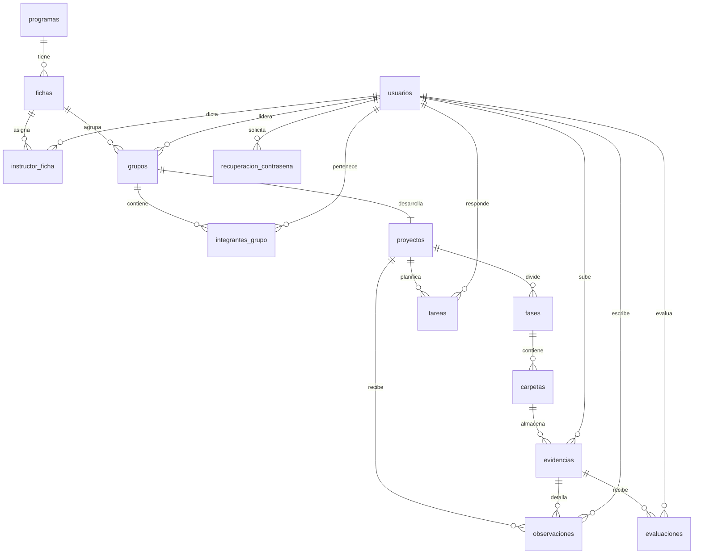

# Esquema de base de datos — ZENDA

<!--
  ¿Qué? Diccionario del esquema real de PostgreSQL: tablas, columnas, tipos,
  restricciones, índices, funciones y migración.
  ¿Para qué? Que cualquier integrante pueda leer el modelo sin abrir el SQL y
  sepa exactamente qué existe hoy y qué no.
  ¿Impacto? Un esquema mal documentado produce consultas y migraciones sobre
  columnas que no existen.
-->

---

## Identificación

| Campo | Valor |
|---|---|
| **Motor** | PostgreSQL 16 |
| **Esquema oficial** | [`Database/zenda_bd.sql`](../../Database/zenda_bd.sql) |
| **Migración incremental** | [`Database/migrations/002_semana2.sql`](../../Database/migrations/002_semana2.sql) |
| **Tablas** | **14** |
| **Tipos enumerados** | 1 (`tipo_rol`) |
| **Funciones** | 2 (`zenda_recalcular_carpeta`, `zenda_recalcular_fase`) |
| **Disparadores (triggers)** | 0 |
| **Última verificación** | 23-oct-2026, contra PostgreSQL 16 en Docker |

> **Fuente de verdad:** el esquema se verificó consultando `information_schema`,
> `pg_constraint`, `pg_indexes` y `pg_proc` sobre una base creada con
> `Database/zenda_bd.sql` y actualizada con la migración. Las tablas que
> aparecían en versiones anteriores de este documento (`evidencia_versiones`,
> `listas_chequeo`, `lista_chequeo_items`, `lista_chequeo_evaluaciones`,
> `sesiones_refresh`, `tokens_verificacion_correo`, `auditoria`) **no existen**
> en el código actual: pertenecen a propuestas de Semanas 3–6.

---

## 1. Resumen del modelo

| Tabla | Propósito | Filas que crecen |
|---|---|---|
| `programas` | Catálogo de programas de formación | Poco |
| `usuarios` | Todas las cuentas, con rol y aceptaciones legales | Sí |
| `recuperacion_contrasena` | Tokens de un solo uso para restablecer la clave | Sí |
| `fichas` | Fichas de formación de un programa | Poco |
| `instructor_ficha` | Historial de instructores asignados a cada ficha | Sí |
| `grupos` | Grupos de trabajo y el grupo General de cada ficha | Sí |
| `integrantes_grupo` | Pertenencia de aprendices a grupos | Sí |
| `proyectos` | Proyecto formativo de un grupo (1 a 1 con `grupos`) | Sí |
| `fases` | Las 5 fases de un proyecto | Sí |
| `carpetas` | Carpetas de evidencias dentro de una fase | Sí |
| `evidencias` | Enlaces entregados por los aprendices | Sí |
| `evaluaciones` | Historial de evaluaciones por evidencia | Sí |
| `observaciones` | Observaciones del instructor, opcionalmente ligadas a una evidencia | Sí |
| `tareas` | Tablero de tareas del proyecto | Sí |

### 1.1 Relaciones principales



Todas las claves foráneas son `DEFERRABLE` (se validan al confirmar la
transacción), salvo `recuperacion_contrasena.usuario_id`, que además es
`ON DELETE CASCADE`. No hay borrado en cascada en el resto del modelo: las
entidades se desactivan (`estado`, `estado_grupo`, `estado_integrante`,
`fecha_fin`).

---

## 2. Diccionario de tablas

Convenciones de las tablas siguientes:

- **Nulo:** `NO` significa `NOT NULL`.
- **Default:** `—` significa que no hay valor por defecto.
- Los `*_id` son `INT GENERATED BY DEFAULT AS IDENTITY PRIMARY KEY`.
- Las fechas de negocio son `DATE`; las marcas de tiempo son `TIMESTAMP`
  (sin zona horaria) y usan `now()`.

### 2.1 `programas`

| Columna | Tipo | Nulo | Default | Descripción |
|---|---|:---:|---|---|
| `programa_id` | `INT` | NO | identidad | PK |
| `codigo_programa` | `INT` | NO | — | Código del programa; **UNIQUE** |
| `nombre_programa` | `VARCHAR(220)` | NO | — | Nombre del programa |

### 2.2 `usuarios`

| Columna | Tipo | Nulo | Default | Descripción |
|---|---|:---:|---|---|
| `usuario_id` | `INT` | NO | identidad | PK |
| `rol` | `tipo_rol` | NO | — | `APRENDIZ`, `INSTRUCTOR`, `COORDINADOR` o `ADMINISTRADOR` |
| `nombre` | `VARCHAR(100)` | NO | — | Nombres |
| `apellido` | `VARCHAR(100)` | NO | — | Apellidos |
| `correo` | `VARCHAR(150)` | NO | — | **UNIQUE**; en el registro debe ser `@soy.sena.edu.co` |
| `contrasena` | `VARCHAR(255)` | NO | — | Hash bcrypt (10 rondas) |
| `tipo_documento` | `VARCHAR(10)` | Sí | `'CC'` | `CC`, `TI`, `CE`, `PA` o `PPT` (validado en la aplicación) |
| `numero_documento` | `VARCHAR(30)` | Sí | — | Número de documento |
| `estado` | `VARCHAR(20)` | NO | `'Activo'` | `Activo` / `Inactivo` (validado en la aplicación) |
| `token_version` | `INT` | NO | `0` | Se incrementa al cambiar la clave para invalidar sesiones |
| `acepta_terminos` | `BOOLEAN` | NO | `false` | Aceptación de términos |
| `acepta_privacidad` | `BOOLEAN` | NO | `false` | Aceptación de privacidad |
| `acepta_cookies` | `BOOLEAN` | NO | `false` | Aceptación de cookies |
| `acepta_tratamiento_datos` | `BOOLEAN` | NO | `false` | Aceptación de tratamiento de datos |
| `fecha_aceptacion_legal` | `TIMESTAMP` | Sí | — | Momento de la aceptación |
| `fecha_creacion` | `TIMESTAMP` | NO | `now()` | Alta |
| `fecha_actualizacion` | `TIMESTAMP` | NO | `now()` | Última modificación |

> No existen `sub_rol_intencion`, `correo_verificado_en` ni
> `acepto_legales_en`. El liderazgo de grupo **no** es un sub-rol: vive en
> `grupos.lider_id`.

### 2.3 `recuperacion_contrasena`

| Columna | Tipo | Nulo | Default | Descripción |
|---|---|:---:|---|---|
| `recuperacion_id` | `INT` | NO | identidad | PK |
| `usuario_id` | `INT` | NO | — | FK → `usuarios`, **ON DELETE CASCADE** |
| `token_hash` | `CHAR(64)` | NO | — | SHA-256 hexadecimal del token; **UNIQUE** |
| `expira_en` | `TIMESTAMP` | NO | — | Validez de 15 minutos |
| `usado_en` | `TIMESTAMP` | Sí | — | Marca de un solo uso |
| `creado_en` | `TIMESTAMP` | NO | `now()` | Emisión |

Índice: `idx_recuperacion_usuario (usuario_id, expira_en DESC)`.

### 2.4 `fichas`

| Columna | Tipo | Nulo | Default | Descripción |
|---|---|:---:|---|---|
| `ficha_id` | `INT` | NO | identidad | PK |
| `programa_id` | `INT` | NO | — | FK → `programas` |
| `numero_ficha` | `INT` | NO | — | **UNIQUE** |
| `fecha_inicio` | `DATE` | NO | — | Inicio de la ficha |
| `fecha_fin` | `DATE` | NO | — | Fin de la ficha |
| `jornada` | `VARCHAR(20)` | Sí | — | Mañana / tarde / mixta |

Índice: `idx_fichas_programa (programa_id)`.

### 2.5 `instructor_ficha`

Historial de asignaciones. Una fila **inactiva** conserva el registro; no se
borra.

| Columna | Tipo | Nulo | Default | Descripción |
|---|---|:---:|---|---|
| `instructor_ficha_id` | `INT` | NO | identidad | PK |
| `instructor_id` | `INT` | NO | — | FK → `usuarios` |
| `ficha_id` | `INT` | NO | — | FK → `fichas` |
| `fecha_inicio` | `DATE` | NO | `CURRENT_DATE` | Inicio de la asignación |
| `fecha_fin` | `DATE` | Sí | — | Fin; `NULL` mientras está vigente |
| `estado` | `VARCHAR(20)` | NO | `'Activo'` | `Activo` / `Inactivo` |

Restricciones:

- `chk_instructor_ficha_fechas`: `fecha_fin IS NULL OR fecha_fin >= fecha_inicio`.
- `chk_instructor_ficha_estado`: `Activo` exige `fecha_fin IS NULL`;
  `Inactivo` exige `fecha_fin IS NOT NULL`.
- `uq_instructor_ficha_vigente`: **UNIQUE parcial** sobre
  `(instructor_id, ficha_id) WHERE fecha_fin IS NULL`. Garantiza una sola
  asignación vigente por par instructor–ficha y permite el historial.

### 2.6 `grupos`

| Columna | Tipo | Nulo | Default | Descripción |
|---|---|:---:|---|---|
| `grupo_id` | `INT` | NO | identidad | PK |
| `ficha_id` | `INT` | NO | — | FK → `fichas` |
| `lider_id` | `INT` | NO | — | FK → `usuarios`; líder del grupo |
| `nombre_grupo` | `VARCHAR(50)` | NO | — | Nombre visible |
| `codigo_grupo` | `VARCHAR(30)` | NO | — | **UNIQUE**; `PRY-*` para proyectos y `GEN-<ficha>` para el General |
| `cupo_maximo` | `INT` | NO | `6` | Cupo del grupo |
| `estado_grupo` | `VARCHAR(20)` | NO | `'Activo'` | `Activo` / `Inactivo` |
| `es_general` | `BOOLEAN` | NO | `false` | Marca el grupo General de la ficha |
| `fecha_creacion` | `TIMESTAMP` | NO | `now()` | Alta |

Restricciones:

- `chk_grupos_cupo`: `cupo_maximo BETWEEN 1 AND 50`.
- `chk_grupos_general_nombre`: si `es_general`, el nombre debe ser `'General'`.
- `uq_grupo_general_por_ficha`: **UNIQUE parcial** sobre `ficha_id WHERE es_general`.
  Hay exactamente un General por ficha.
- Índice: `idx_grupos_ficha (ficha_id)`.

> El cupo del General es 50. El cupo de un grupo de trabajo es 1–50, 6 por
> defecto, y nunca puede quedar por debajo de sus integrantes activos.

### 2.7 `integrantes_grupo`

| Columna | Tipo | Nulo | Default | Descripción |
|---|---|:---:|---|---|
| `integrante_id` | `INT` | NO | identidad | PK |
| `grupo_id` | `INT` | NO | — | FK → `grupos` |
| `usuario_id` | `INT` | NO | — | FK → `usuarios` |
| `estado_integrante` | `VARCHAR(20)` | NO | `'Activo'` | `Activo` / `Inactivo` |
| `fecha_ingreso` | `TIMESTAMP` | NO | `now()` | Ingreso |
| `fecha_salida` | `TIMESTAMP` | Sí | — | Salida |

Restricción `unq_integrantes_grupo (grupo_id, usuario_id)` e índices
`idx_integrantes_grupo_grupo`, `idx_integrantes_grupo_usuario`.

> El líder también se registra como integrante: por eso el cupo cuenta
> integrantes activos, no “invitados”.

### 2.8 `proyectos`

| Columna | Tipo | Nulo | Default | Descripción |
|---|---|:---:|---|---|
| `proyecto_id` | `INT` | NO | identidad | PK |
| `grupo_id` | `INT` | NO | — | FK → `grupos`; **UNIQUE** (1 proyecto por grupo) |
| `nombre_proyecto` | `VARCHAR(150)` | NO | — | Nombre |
| `descripcion` | `VARCHAR(500)` | NO | — | Descripción |
| `problema` | `VARCHAR(500)` | NO | — | Problema que resuelve |
| `objetivo` | `VARCHAR(500)` | NO | — | Objetivo |
| `alcance` | `VARCHAR(500)` | NO | — | Alcance |
| `tecnologias` | `VARCHAR(500)` | Sí | — | Tecnologías |
| `fecha_inicio` | `DATE` | NO | — | Inicio |
| `fecha_fin_estimada` | `DATE` | NO | — | Fin estimado |
| `estado_proyecto` | `VARCHAR(30)` | NO | `'Activo'` | `Activo` / `Finalizado` |

> No existe `fecha_actualizacion` en esta tabla.

### 2.9 `fases`

| Columna | Tipo | Nulo | Default | Descripción |
|---|---|:---:|---|---|
| `fase_id` | `INT` | NO | identidad | PK |
| `proyecto_id` | `INT` | NO | — | FK → `proyectos` |
| `numero_fase` | `INT` | NO | — | 1 a 5 |
| `nombre_fase` | `VARCHAR(100)` | NO | — | Nombre |
| `estado_fase` | `VARCHAR(30)` | NO | `'Pendiente'` | Estado derivado |

Restricciones: `unq_fases_proyecto (proyecto_id, numero_fase)` y
`chk_fases_estado` con `Pendiente`, `En revisión`, `Aprobada` o `Desaprobada`.
Índice `idx_fases_proyecto`.

### 2.10 `carpetas`

| Columna | Tipo | Nulo | Default | Descripción |
|---|---|:---:|---|---|
| `carpeta_id` | `INT` | NO | identidad | PK |
| `fase_id` | `INT` | NO | — | FK → `fases` |
| `nombre_carpeta` | `VARCHAR(150)` | NO | — | Nombre |
| `estado_carpeta` | `VARCHAR(20)` | NO | `'Pendiente'` | Estado derivado |
| `fecha_creacion` | `TIMESTAMP` | NO | `now()` | Alta |

Restricción `chk_carpetas_estado` con los mismos cuatro estados e índice
`idx_carpetas_fase`.

> No existen `creada_por` ni `fecha_actualizacion`. La autoría se conoce por
> la evidencia (`evidencias.usuario_id`).

### 2.11 `evidencias`

| Columna | Tipo | Nulo | Default | Descripción |
|---|---|:---:|---|---|
| `evidencia_id` | `INT` | NO | identidad | PK |
| `carpeta_id` | `INT` | NO | — | FK → `carpetas` |
| `usuario_id` | `INT` | NO | — | FK → `usuarios`; quién la subió |
| `nombre_evidencia` | `VARCHAR(200)` | NO | — | Nombre |
| `tipo_evidencia` | `VARCHAR(20)` | NO | — | `Documento`, `Imagen`, `Video` o `Enlace` |
| `ubicacion` | `TEXT` | NO | — | URL `http(s)://…` de hasta 500 caracteres |
| `fecha_subida` | `TIMESTAMP` | NO | `now()` | Primera subida |

Restricciones:

- `chk_evidencias_tipo` con los cuatro tipos.
- `chk_evidencias_ubicacion`: `ubicacion ~* '^https?://[^[:space:]]+$' AND
  length(ubicacion) <= 500`. La migración la añade como **`NOT VALID`** para
  no romper con ubicaciones heredadas; las filas nuevas y las actualizadas sí
  se validan.
- Índice `idx_evidencias_carpeta`.

> No existen columnas de borrado lógico (`eliminada`, `eliminada_por`,
> `fecha_eliminacion`) ni versionado (`evidencia_versiones`,
> `fecha_actualizacion`). En Semana 2 las evidencias son enlaces; los archivos
> reales son de la Semana 4.

### 2.12 `evaluaciones`

| Columna | Tipo | Nulo | Default | Descripción |
|---|---|:---:|---|---|
| `evaluacion_id` | `INT` | NO | identidad | PK |
| `evidencia_id` | `INT` | NO | — | FK → `evidencias` |
| `instructor_id` | `INT` | NO | — | FK → `usuarios` |
| `resultado` | `VARCHAR(20)` | NO | — | `APROBADO` / `REPROBADO` |
| `fecha_evaluacion` | `TIMESTAMP` | NO | `now()` | Momento de la evaluación |

Restricción `chk_evaluaciones_resultado`. Índice
`idx_evaluaciones_evidencia (evidencia_id, evaluacion_id DESC)`.

> **Nunca se actualiza una evaluación.** Cada recalificación inserta una fila
> nueva; la vigente es la de mayor `evaluacion_id` para esa evidencia
> (`LATERAL … ORDER BY evaluacion_id DESC LIMIT 1`).

### 2.13 `observaciones`

| Columna | Tipo | Nulo | Default | Descripción |
|---|---|:---:|---|---|
| `observacion_id` | `INT` | NO | identidad | PK |
| `evidencia_id` | `INT` | Sí | — | FK → `evidencias`; opcional |
| `proyecto_id` | `INT` | NO | — | FK → `proyectos` |
| `instructor_id` | `INT` | NO | — | FK → `usuarios` |
| `titulo` | `VARCHAR(150)` | NO | — | Título |
| `descripcion` | `VARCHAR(500)` | NO | — | Texto |
| `fecha_observacion` | `TIMESTAMP` | NO | `now()` | Alta |

### 2.14 `tareas`

| Columna | Tipo | Nulo | Default | Descripción |
|---|---|:---:|---|---|
| `tarea_id` | `INT` | NO | identidad | PK |
| `proyecto_id` | `INT` | NO | — | FK → `proyectos` |
| `responsable_id` | `INT` | NO | — | FK → `usuarios` |
| `titulo` | `VARCHAR(150)` | NO | — | Título |
| `descripcion` | `VARCHAR(500)` | Sí | — | Detalle |
| `prioridad` | `VARCHAR(20)` | NO | `'Media'` | `Alta`, `Media` o `Baja` |
| `estado` | `VARCHAR(20)` | NO | `'Pendiente'` | Flujo de la tabla siguiente |
| `fecha_inicio` | `DATE` | Sí | — | Inicio |
| `fecha_limite` | `DATE` | Sí | — | Límite |
| `fecha_finalizacion` | `DATE` | Sí | — | Cierre real |

Restricciones `chk_tareas_prioridad` y `chk_tareas_estado`.

Flujo de estados (validado en `tareaController` y en la interfaz):

```text
Pendiente → En proceso → Finalizada → Confirmada
                                    ↘ Incompleta → En proceso
```

> No existen `fecha_creacion` ni `fecha_actualizacion` en `tareas`.

---

## 3. Restricciones e índices

### 3.1 Restricciones `CHECK`

| Nombre | Tabla | Regla |
|---|---|---|
| `chk_grupos_cupo` | `grupos` | `cupo_maximo` entre 1 y 50 |
| `chk_grupos_general_nombre` | `grupos` | El General se llama `General` |
| `chk_carpetas_estado` | `carpetas` | Cuatro estados permitidos |
| `chk_fases_estado` | `fases` | Cuatro estados permitidos |
| `chk_evaluaciones_resultado` | `evaluaciones` | `APROBADO` / `REPROBADO` |
| `chk_evidencias_tipo` | `evidencias` | Cuatro tipos permitidos |
| `chk_evidencias_ubicacion` | `evidencias` | URL `http(s)` de máximo 500 caracteres (`NOT VALID` en datos heredados) |
| `chk_instructor_ficha_fechas` | `instructor_ficha` | `fecha_fin >= fecha_inicio` |
| `chk_instructor_ficha_estado` | `instructor_ficha` | `Activo` sin fecha de fin; `Inactivo` con fecha de fin |
| `chk_tareas_prioridad` | `tareas` | `Alta` / `Media` / `Baja` |
| `chk_tareas_estado` | `tareas` | Cinco estados del flujo |

### 3.2 Índices

| Índice | Tabla | Columnas / condición |
|---|---|---|
| `programas_codigo_programa_key` | `programas` | UNIQUE (`codigo_programa`) |
| `usuarios_correo_key` | `usuarios` | UNIQUE (`correo`) |
| `recuperacion_contrasena_token_hash_key` | `recuperacion_contrasena` | UNIQUE (`token_hash`) |
| `idx_recuperacion_usuario` | `recuperacion_contrasena` | (`usuario_id`, `expira_en DESC`) |
| `fichas_numero_ficha_key` | `fichas` | UNIQUE (`numero_ficha`) |
| `idx_fichas_programa` | `fichas` | (`programa_id`) |
| `uq_instructor_ficha_vigente` | `instructor_ficha` | UNIQUE (`instructor_id`, `ficha_id`) `WHERE fecha_fin IS NULL` |
| `grupos_codigo_grupo_key` | `grupos` | UNIQUE (`codigo_grupo`) |
| `uq_grupo_general_por_ficha` | `grupos` | UNIQUE (`ficha_id`) `WHERE es_general` |
| `idx_grupos_ficha` | `grupos` | (`ficha_id`) |
| `unq_integrantes_grupo` | `integrantes_grupo` | UNIQUE (`grupo_id`, `usuario_id`) |
| `idx_integrantes_grupo_grupo` | `integrantes_grupo` | (`grupo_id`) |
| `idx_integrantes_grupo_usuario` | `integrantes_grupo` | (`usuario_id`) |
| `proyectos_grupo_id_key` | `proyectos` | UNIQUE (`grupo_id`) |
| `unq_fases_proyecto` | `fases` | UNIQUE (`proyecto_id`, `numero_fase`) |
| `idx_fases_proyecto` | `fases` | (`proyecto_id`) |
| `idx_carpetas_fase` | `carpetas` | (`fase_id`) |
| `idx_evidencias_carpeta` | `evidencias` | (`carpeta_id`) |
| `idx_evaluaciones_evidencia` | `evaluaciones` | (`evidencia_id`, `evaluacion_id DESC`) |

Los `*_pkey` de cada tabla son índices únicos implícitos y no se repiten.

---

## 4. Funciones de cascada

La migración `002_semana2.sql` crea dos funciones `plpgsql`. **No están en
`zenda_bd.sql`**: una base creada solo desde el esquema base no las tiene
hasta aplicar la migración.

| Función | Entrada | Devuelve | Qué hace |
|---|---|---|---|
| `zenda_recalcular_carpeta(p_carpeta_id INT)` | ID de carpeta | `VARCHAR` con el estado | Recalcula `carpetas.estado_carpeta` con la evaluación vigente de cada evidencia |
| `zenda_recalcular_fase(p_fase_id INT)` | ID de fase | `VARCHAR` con el estado | Recalcula `fases.estado_fase` a partir de todas las evidencias de sus carpetas |

Regla común (RN-018):

| Situación | Estado |
|---|---|
| Sin evidencias | `Pendiente` |
| Alguna evidencia reprobada | `Desaprobada` |
| Todas las evidencias aprobadas | `Aprobada` |
| Cualquier evidencia sin evaluar | `En revisión` |

La misma regla está implementada en `backend/src/domain/reglas.js`
(`calcularEstadoCarpeta`, `calcularEstadoFase`) y la aplica
`backend/src/services/cascada.js` dentro de la transacción. Las funciones SQL
se usan en la migración para normalizar datos heredados.

---

## 5. Migración `002_semana2.sql`

Se aplica sobre una base creada con una versión anterior del esquema. Es
**idempotente**: puede ejecutarse varias veces sin fallar ni duplicar datos.

```bash
psql "$DATABASE_URL" -v ON_ERROR_STOP=1 -f Database/migrations/002_semana2.sql
```

En Docker la ejecuta el servicio `migrate`; en Render, `backend/scripts/migrar.js`
dentro del `startCommand`.

### 5.1 Qué cambia

| Bloque | Cambio |
|---|---|
| **1. Sin sub-roles Scrum** | Elimina `usuarios.sub_rol_intencion` e `integrantes_grupo.rol_scrum`; el liderazgo queda en `grupos.lider_id`. |
| **2. Seguridad** | Añade `usuarios.token_version` y las cuatro aceptaciones legales con `fecha_aceptacion_legal`. |
| **3. Cupo y General** | Añade `grupos.cupo_maximo` (1–50, 6 por defecto) y `grupos.es_general`; crea el General que falte y su índice único parcial. |
| **4. Historial** | Añade `carpetas.estado_carpeta` y `instructor_ficha.fecha_inicio`, `fecha_fin`, `estado`; sustituye el único antiguo por el índice parcial vigente. |
| **5. Normalización** | Pasa `resultado` a mayúsculas y los tipos de evidencia desconocidos a `Enlace`. |
| **6. Cascada** | Crea `zenda_recalcular_carpeta` y `zenda_recalcular_fase`, y recalcula todos los estados. |
| **7. Restricciones** | Añade los `CHECK` de estado, resultado, tipo, ubicación e historial, y los índices de consulta. |

### 5.2 Decisiones de seguridad de datos

- **Evidencias heredadas:** las `ubicacion` inválidas **no se reescriben**.
  Se conservan y `chk_evidencias_ubicacion` queda `NOT VALID`; las filas
  nuevas sí se validan.
- **Grupo “General” legado:** solo se promueve un grupo llamado `General`
  **sin proyecto**. Un grupo de trabajo legado con ese nombre conserva nombre,
  código, integrantes y proyecto.
- **Colisión `GEN-<ficha>`:** si un General legado con proyecto ya ocupa ese
  código, se conserva y el General nuevo recibe un sufijo estable. El
  *fixture* `Database/fixtures/v11_migracion.sql` reproduce el caso.
- **Cupo:** nunca se deja por debajo de los integrantes activos existentes.
- **Orden:** primero columnas y funciones, después el recálculo y solo al final
  los `CHECK`. Así una base antigua con estados incoherentes no rompe la
  migración.

### 5.3 Verificación

```bash
# 1. Base v11 con datos
psql "$DATABASE_URL" -v ON_ERROR_STOP=1 -f Database/fixtures/v11_migracion.sql

# 2. Migración dos veces (idempotencia)
psql "$DATABASE_URL" -v ON_ERROR_STOP=1 -f Database/migrations/002_semana2.sql
psql "$DATABASE_URL" -v ON_ERROR_STOP=1 -f Database/migrations/002_semana2.sql

# 3. Assertions del upgrade
psql "$DATABASE_URL" -v ON_ERROR_STOP=1 -f Database/fixtures/v11_migracion_assert.sql
```

Resultado esperado: `V11_MIGRATION_OK`, exactamente un General por ficha y
ninguna evidencia, grupo o proyecto perdido. La suite de integración
(`backend/tests/integracion.test.js`) se ejecuta después y debe dar **8/8**.

---

## 6. Cómo recrear la base

```bash
# Opción A — Docker (recomendada)
cp .env.example .env
docker compose up --build -d

# Opción B — PostgreSQL local
psql -U postgres -h localhost -c "CREATE DATABASE zenda;"
psql -U postgres -h localhost -d zenda -f Database/zenda_bd.sql
psql -U postgres -h localhost -d zenda -v ON_ERROR_STOP=1 \
  -f Database/migrations/002_semana2.sql
```

> [!WARNING]
> `Database/zenda_bd.sql` empieza con `DROP TABLE … CASCADE`: **borra** el
> esquema anterior. No lo ejecutes sobre una base con datos que quieras
> conservar; para eso existe la migración.

El *seed* incluye usuarios de demostración (`admin@zenda.com` / `Admin123!` y
cuentas `*.zenda.com` / `Prueba123!`). **No deben usarse en producción.**

---

## 7. Historial de este documento

| Fecha | Cambio |
|---|---|
| 23-oct-2026 | Reescrito contra el esquema real: 14 tablas, columnas, restricciones, índices y funciones verificados en PostgreSQL 16. Se eliminaron las tablas y columnas de Semanas 3–6 que nunca existieron. |
