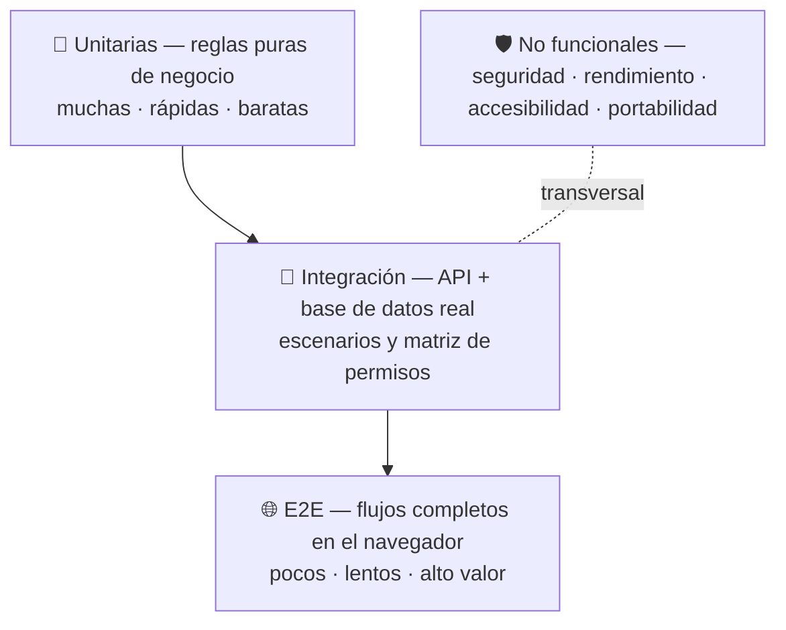
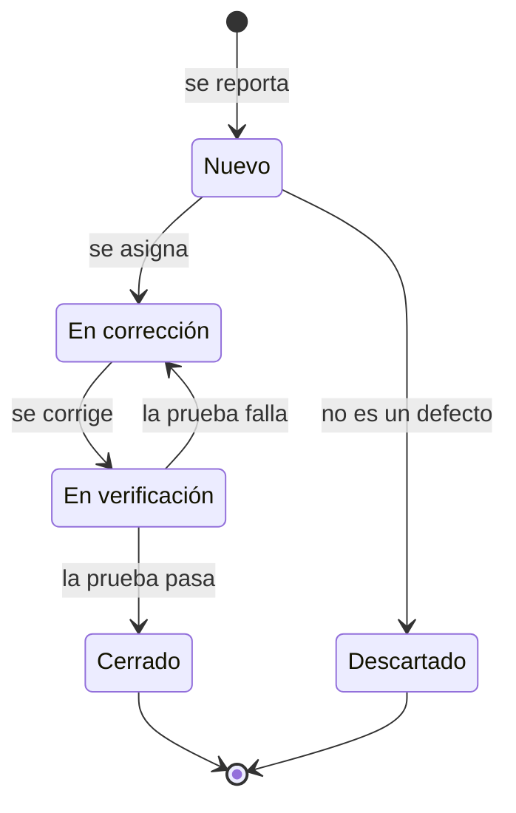

# Plan de pruebas — ZENDA

<!--
  ¿Qué? Estrategia para verificar que ZENDA cumple sus requisitos: niveles de prueba, herramientas, entornos, criterios y gestión de defectos.
  ¿Para qué? Saber qué se prueba, con qué, en qué orden y cuándo se considera que una versión está lista.
  ¿Impacto? Sin plan, las pruebas se improvisan al final y los defectos llegan a la entrega.
-->

---

## Identificación

| Campo | Valor |
|---|---|
| **Sistema** | ZENDA v12 (sobre la base real de v11) |
| **Alcance** | Backend (API REST), frontend (SPA), base de datos, contenedores |
| **Requisitos que cubre** | 42 RF, 15 RNF y 30 reglas de negocio |
| **Casos escritos** | 160 funcionales + escenarios de integración, unitarios y no funcionales |
| **Fecha** | Octubre 2026 |

> **Estado de partida:** el repositorio de v11 **no tenía pruebas automatizadas** (ni scripts `test` ni dependencias de pruebas). En Semana 2 se agregaron Vitest + Supertest: 9 pruebas unitarias y 6 de integración, ejecutadas contra PostgreSQL 18.6 el 22-oct-2026. El resto de los 160 casos sigue documentado para las semanas 3–6.

---

## 1. Objetivos y alcance

| Objetivo | Cómo se mide |
|---|---|
| Verificar cada criterio de aceptación | 160 casos funcionales con trazabilidad ([matriz de cobertura](matriz-cobertura.md)) |
| Proteger las reglas críticas (cascada, permisos, historial) | Pruebas unitarias y de autorización con 100 % de sus casos ejecutados |
| Detectar regresiones al refactorizar | Suite automática que corre en cada Pull Request |
| Comprobar los atributos de calidad | Pruebas no funcionales de seguridad, rendimiento, accesibilidad y portabilidad |

| Dentro del alcance | Fuera del alcance |
|---|---|
| API REST, reglas de negocio, autorización por rol | Pruebas de Gmail ni de proveedores externos (se simulan) |
| Flujos de interfaz de los 4 roles | Pruebas de carga masiva (más de 100 usuarios concurrentes) |
| Migración de la base de datos v11 → v12 | Funcionalidades descartadas (chatbot, calendario, anuncios) |
| Imágenes Docker y despliegue local | Infraestructura del proveedor en producción |

---

## 2. Niveles de prueba



| Nivel | Qué verifica | Documento | Herramienta propuesta | Cantidad inicial |
|---|---|---|---|:---:|
| **Unitarias** | Funciones de negocio sin base de datos: cascada, avances, transiciones, validaciones | [Pruebas unitarias](pruebas-unitarias.md) | Vitest | 108 |
| **Integración** | Rutas HTTP con PostgreSQL real, permisos por rol, transacciones | [Pruebas de integración](pruebas-de-integracion.md) | Vitest + Supertest | 13 documentados; 6 automatizados en Semana 2 |
| **Funcionales** | Criterios de aceptación de cada HU | [Casos funcionales](casos/) | API: Supertest · UI: Playwright | 160 |
| **E2E** | Los 3 recorridos críticos en el navegador | Casos con nivel `E2E` | Playwright | 3 recorridos |
| **No funcionales** | Seguridad, rendimiento, accesibilidad, compatibilidad, disponibilidad | [Pruebas no funcionales](pruebas-no-funcionales.md) | k6, axe-core, ZAP, Lighthouse | 82 |
| **Humo** | Que el sistema arranca y lo esencial funciona | [Lista de humo](../setup/sin-docker.md#8-lista-de-humo-comprobación-rápida) | Manual (10 min) | 7 |

Los tres recorridos E2E críticos: **(1)** registro → crear proyecto → unirse, **(2)** subir evidencia → evaluar → ver estado de la fase, **(3)** crear tarea → mover → confirmar.

---

## 3. Herramientas

> Todas se instalan con **pnpm** y con versión **exacta** ([RH-001](../requisitos/restricciones.md#rh-001--gestor-de-paquetes), [RH-003](../requisitos/restricciones.md#rh-003--versiones-exactas-de-dependencias)). Son una propuesta del equipo de documentación; el equipo de desarrollo confirma la elección.

| Herramienta | Uso | Dónde |
|---|---|---|
| **Vitest** | Ejecutor de pruebas unitarias e integración; encaja con Vite en el frontend | Backend y frontend |
| **Supertest** | Llamar a la API sin levantar un puerto | Backend |
| **Testing Library** | Probar componentes de React por lo que ve el usuario | Frontend |
| **Playwright** | Pruebas E2E en Chromium, Firefox y WebKit | Raíz o `e2e/` |
| **axe-core** (con Playwright) | Accesibilidad automática | E2E |
| **k6** | Carga y rendimiento de la API | Raíz o `perf/` |
| **OWASP ZAP (baseline)** | Escaneo básico de seguridad | Contenedor |
| **Lighthouse** | Rendimiento y accesibilidad de páginas | Navegador o CI |
| **`pnpm audit`** | Vulnerabilidades de dependencias | CI |
| **gitleaks** | Secretos subidos por error al repositorio | CI |

---

## 4. Entornos y datos

| Entorno | Base de datos | Uso |
|---|---|---|
| **Desarrollo** | `zenda` local | Pruebas manuales y depuración |
| **Pruebas automáticas** | `zenda_test`, **aislada y efímera** | Unitarias de integración y E2E |
| **Pre-despliegue** | Copia de una base con datos reales (sin datos personales) | Probar la migración v12 y las copias de seguridad |

Base de datos efímera para pruebas (se agrega a `docker-compose.yml` con un perfil, para que no arranque en uso normal):

```yaml
  db-test:
    image: postgres:16-alpine
    profiles: ["test"]
    environment:
      POSTGRES_USER: zenda_test
      POSTGRES_PASSWORD: zenda_test
      POSTGRES_DB: zenda_test
    ports: ["5433:5432"]
    tmpfs: ["/var/lib/postgresql/data"]   # se borra al detenerla
```

```bash
docker compose --profile test up -d db-test
```

| Tema | Regla |
|---|---|
| **Aislamiento** | Cada suite parte del esquema limpio (`zenda_bd.sql` + `002_semana2.sql`) y limpia lo que crea. Ninguna prueba depende del resultado de otra. |
| **Datos** | Los usuarios y fichas del *seed* ([lista](../setup/sin-docker.md#6-usuarios-de-prueba)); cada prueba crea sus propios proyectos y evidencias. |
| **Correo** | Se simula el transporte; para ver correos reales de prueba se necesita configurar el servidor SMTP por variable (cambio propuesto). |
| **Archivos** | MinIO local en pruebas; nunca el almacenamiento de producción. |
| **Reloj** | Las pruebas de expiración (token de reset de 15 min, sesión actual de 24 h e inactividad de 30 min) usan un reloj simulado, no esperas reales. |

---

## 5. Scripts propuestos

| Dónde | Script | Hace |
|---|---|---|
| `backend/` | `pnpm test` | Unitarias e integración |
| `backend/` | `pnpm test:cov` | Con informe de cobertura |
| `frontend/` | `pnpm test` | Componentes y utilidades |
| raíz | `pnpm e2e` | Playwright contra el entorno levantado |
| raíz | `pnpm perf` | Escenarios k6 |

---

## 6. Criterios de entrada y de salida

| Criterio | Condición |
|---|---|
| **Entrada** | El código compila (`pnpm build`), el lint pasa (`pnpm lint`), la base de pruebas arranca y los requisitos de la historia están aprobados. |
| **Salida de una historia** | Todos sus casos con `Aplica a v11 = Sí` ejecutados y aprobados; sin defectos Crítico ni Alto abiertos. |
| **Salida de la versión** | Lista de humo aprobada; unitarias e integración al 100 %; 3 recorridos E2E aprobados; sin defectos Críticos; Altos con plan documentado. |

### Metas de cobertura (propuesta)

| Parte | Meta |
|---|:---:|
| Servicios (`CascadaService`, `AvanceService`, `PermisosService`) | ≥ 90 % |
| Controladores | ≥ 60 % |
| Validaciones y utilidades | ≥ 80 % |
| Casos de la matriz de permisos | 100 % |

---

## 7. Orden recomendado de ejecución

El riesgo manda: se prueba primero lo que, si falla, hace más daño.

| # | Prueba | Por qué primero |
|:---:|---|---|
| 1 | Lista de humo | Confirma que nada esencial está roto antes de seguir. |
| 2 | Unitarias de la cascada y transiciones de tarea | Son las reglas centrales y es lo que más cambia al refactorizar. |
| 3 | Permisos por rol (matriz) | Un error aquí expone datos de otros grupos. |
| 4 | Integración de entrega y evaluación | Es el flujo que da sentido al sistema. |
| 5 | Migración v11 → v12 sobre una copia | Un fallo puede perder datos. |
| 6 | E2E de los 3 recorridos | Valida lo que ve el usuario. |
| 7 | Seguridad básica (ZAP, secretos, JWT) | Antes de cualquier despliegue. |
| 8 | Accesibilidad y rendimiento | Pedidos por el instructor (contraste, carga). |

---

## 8. Gestión de defectos

### Severidad

| Severidad | Criterio | Ejemplo | Plazo |
|---|---|---|---|
| **Crítica** | Pérdida o exposición de datos, o el sistema no arranca. | Un aprendiz lee evidencias de otro grupo. | Inmediato |
| **Alta** | Una función principal no sirve o rompe una regla de negocio. | La evaluación sobrescribe el historial. | Antes de la versión |
| **Media** | Función con rodeo posible o inconsistencia visible. | Mensaje de error con groserías. | Próxima iteración |
| **Baja** | Detalle cosmético o de código. | Ruta duplicada. | Cuando haya tiempo |

### Ciclo de vida



### Plantilla de reporte

```markdown
**ID:** DEF-000      **Severidad:** Crítica | Alta | Media | Baja
**Caso:** CP-014.2   **Requisito:** RF-014      **Versión/rama:** develop
**Qué pasa:**
**Qué debería pasar:**
**Pasos para reproducirlo:**
1.
**Evidencia:** captura, respuesta de la API o registro
```

Los defectos ya conocidos de v11 están en [hallazgos.md](hallazgos.md).

---

## 9. Roles

| Rol | Responsabilidad |
|---|---|
| **Desarrollador** | Escribir la prueba junto con el cambio (TDD: rojo, verde, refactor) y corregir defectos. |
| **Líder técnico** | Revisar que cada Pull Request incluya sus pruebas y que el CI pase. |
| **Responsable de pruebas** | Mantener este plan, ejecutar la lista de humo y las pruebas E2E antes de cada entrega. |
| **Instructor** | Validar los criterios de aceptación. |

---

## 10. Riesgos

| Riesgo | Efecto | Mitigación |
|---|---|---|
| No hay pruebas automáticas hoy | Un refactor puede romper algo sin aviso. | Empezar por las unitarias de cascada y la matriz de permisos. |
| La lógica está dentro de los controladores | Cuesta probarla sin base de datos. | Extraer funciones puras a `services/` ([clases](../diagramas/clases.md)). |
| La migración no se probó en una base real | Pérdida de datos. | Probarla siempre sobre una copia. |
| Los datos de prueba son inconsistentes | Pruebas que fallan por el *seed*, no por el código. | Corregir el *seed* ([H-11](hallazgos.md)). |
| Falta de tiempo antes de la entrega | Se salta la suite. | Respetar el [orden recomendado](#7-orden-recomendado-de-ejecución). |

---

## Documentos de esta carpeta

| Documento | Contenido |
|---|---|
| [Pruebas unitarias](pruebas-unitarias.md) | Reglas puras de negocio con tablas de casos y ejemplo TDD |
| [Pruebas de integración](pruebas-de-integracion.md) | 13 escenarios de extremo a extremo y la matriz de permisos |
| [Casos funcionales](casos/) | 160 casos derivados de los criterios de aceptación |
| [Pruebas no funcionales](pruebas-no-funcionales.md) | Seguridad, rendimiento, accesibilidad, portabilidad |
| [Matriz de cobertura](matriz-cobertura.md) | Requisito ↔ casos |
| [Hallazgos](hallazgos.md) | Defectos conocidos de v11 |

## Documentos relacionados

- [Requisitos](../requisitos/matriz-trazabilidad.md) · [Reglas de negocio](../requisitos/reglas-de-negocio.md) · [Matriz de permisos](../requisitos/matriz-permisos.md)
- [Arquitectura](../referencia-tecnica/arquitectura.md) · [Instalación sin Docker](../setup/sin-docker.md)
