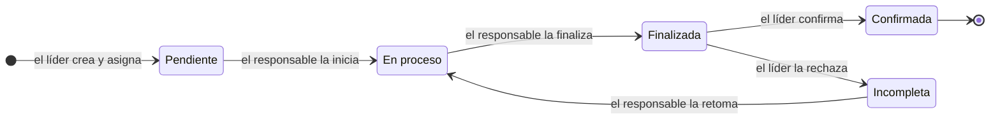
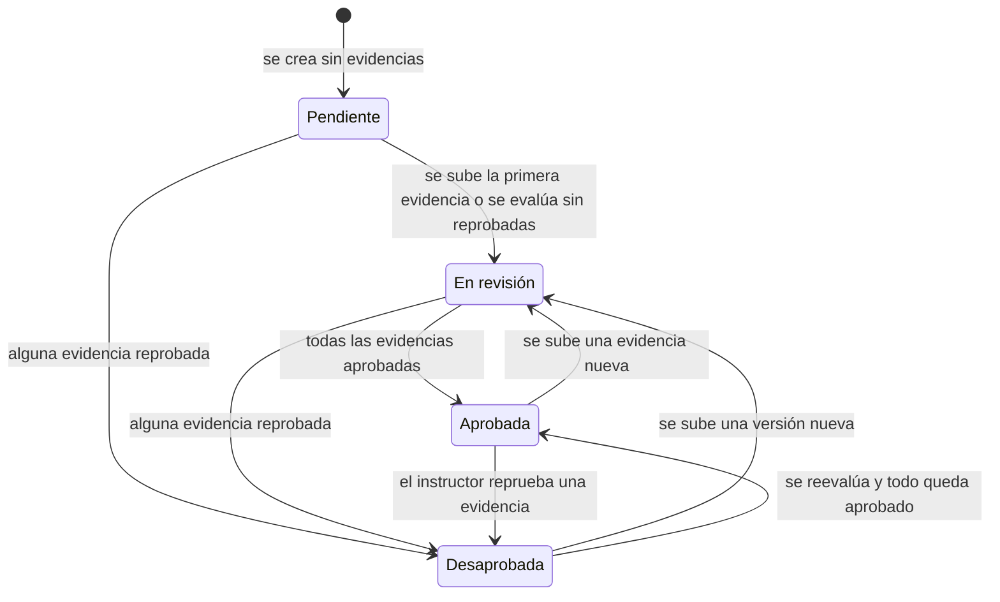
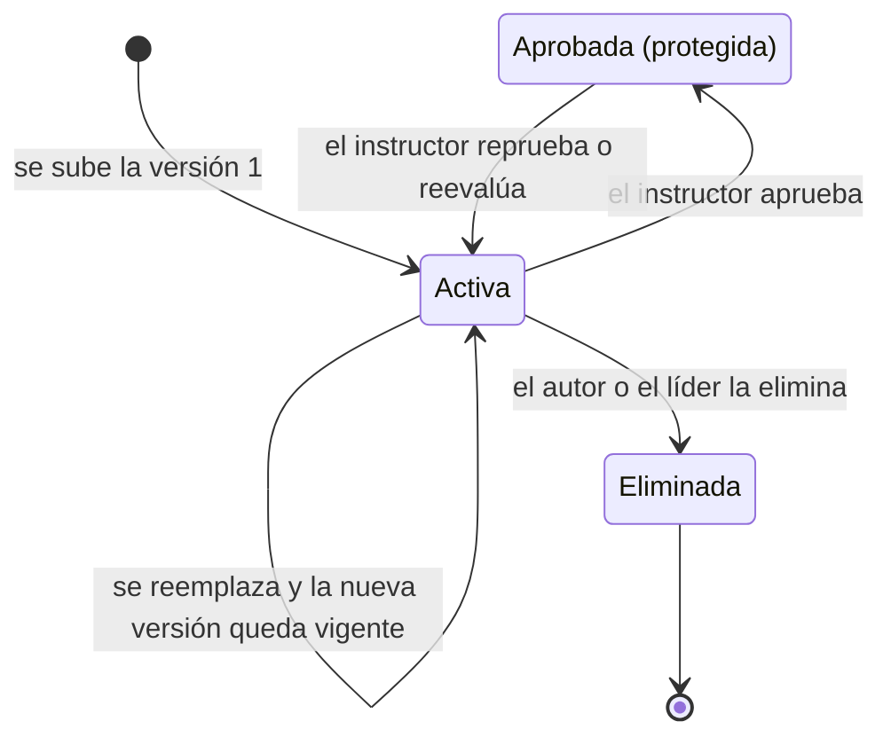
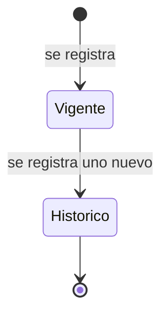
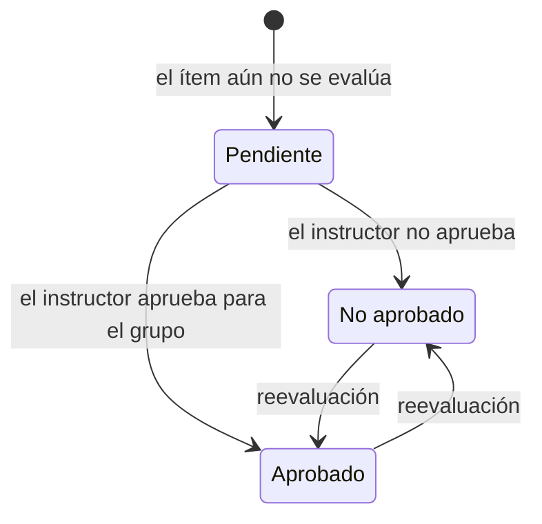
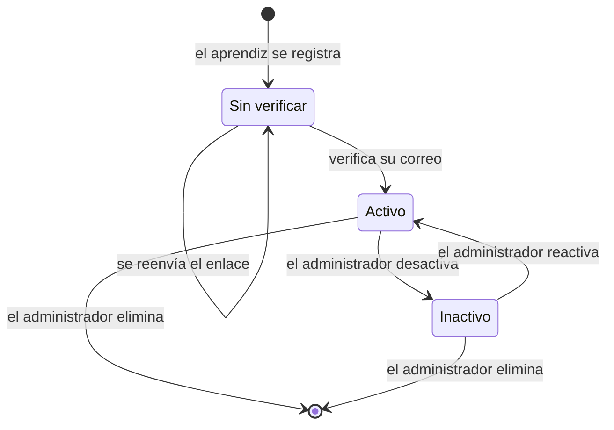
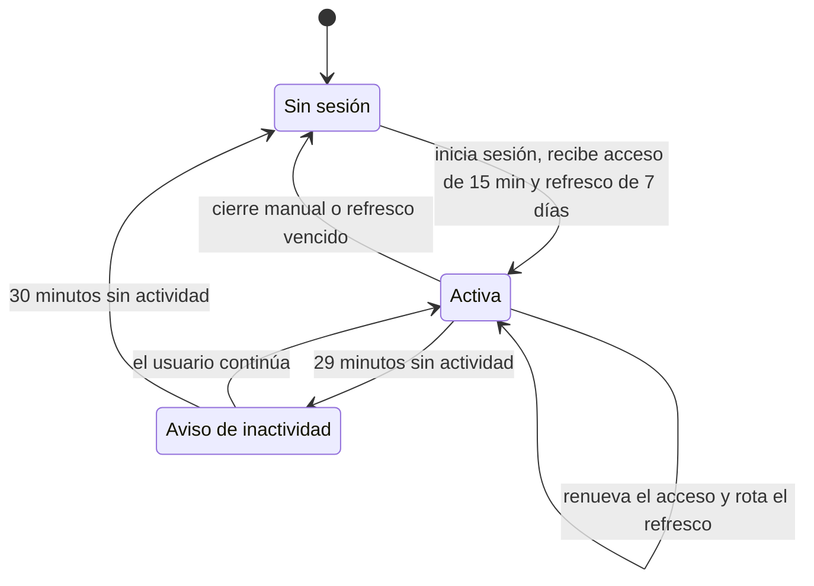
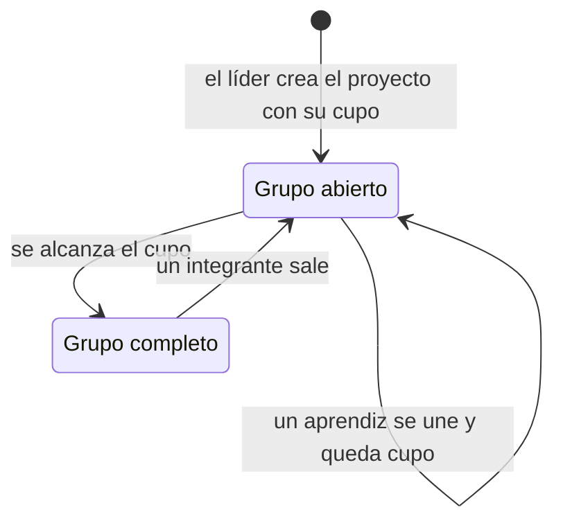
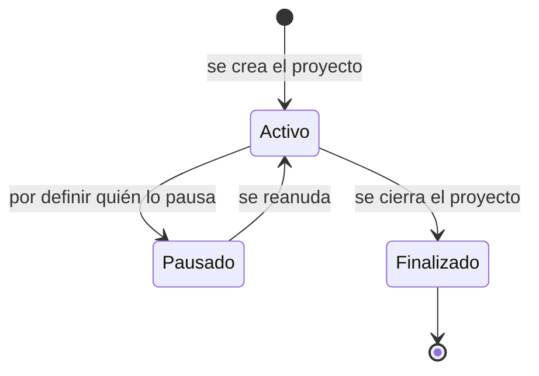

# Diagramas de estados — ZENDA

<!--
  ¿Qué? Ciclo de vida de las entidades que cambian de estado: tarea, fase, carpeta, evidencia, cuenta, sesión, grupo, proyecto y registros con historial.
  ¿Para qué? Dejar claro qué transiciones son válidas, quién las dispara y bajo qué condición.
  ¿Impacto? Una transición no documentada se implementa distinto en cada pantalla y genera estados imposibles.
-->

---

## Identificación

| Campo | Valor |
|---|---|
| **Notación** | Mermaid `stateDiagram-v2` (máquina de estados UML) |
| **Fuentes** | [Reglas de negocio](../requisitos/reglas-de-negocio.md), [esquema](../referencia-tecnica/esquema-bd.md#3-valores-permitidos) y el código de v11 |
| **Fecha** | Octubre 2026 |

**Lectura:** cada flecha es una transición; su etiqueta dice qué la provoca. Los nombres sin espacios de los diagramas (`EnProceso`, `EnRevision`) se guardan en la base de datos como `En proceso` y `En revisión`.

---

## 1. Tarea

| Transición | Quién | Condición | Regla |
|---|---|---|---|
| Crear → `Pendiente` | Líder | Responsable integrante activo del grupo | [RN-021](../requisitos/reglas-de-negocio.md#rn-021--tareas-creadas-solo-por-el-líder) |
| `Pendiente` → `En proceso` → `Finalizada` | Responsable | Solo su propia tarea | [RN-022](../requisitos/reglas-de-negocio.md#rn-022--flujo-de-estados-de-la-tarea) |
| `Finalizada` → `Confirmada` / `Incompleta` | Líder | La tarea está `Finalizada` | [RN-022](../requisitos/reglas-de-negocio.md#rn-022--flujo-de-estados-de-la-tarea) |
| `Incompleta` → `En proceso` | Responsable | Se borra la fecha de finalización | [RN-022](../requisitos/reglas-de-negocio.md#rn-022--flujo-de-estados-de-la-tarea) |

Cualquier otra transición (por ejemplo, de `Pendiente` a `Finalizada`) se rechaza con `400`. Requisitos: [RF-028](../requisitos/RFs/RF-028_creacion_y_asignacion_de_tareas.md) a [RF-030](../requisitos/RFs/RF-030_confirmacion_de_tareas.md).

---

## 2. Fase y carpeta

Ambas usan los mismos cuatro estados y el mismo criterio: **la carpeta se calcula a partir de sus evidencias y la fase, a partir de sus carpetas**.

| Estado | Significado | Se llega cuando |
|---|---|---|
| `Pendiente` | Sin evidencias todavía. | Se crea el proyecto (fases) o la carpeta. |
| `En revisión` | Hay evidencias, ninguna reprobada y no todas aprobadas (incluye las aún sin evaluar). | Se sube la primera evidencia, se evalúa sin reprobadas o se agrega una nueva a una carpeta aprobada. |
| `Aprobada` | Todas las evidencias vigentes están aprobadas. | El instructor aprueba la última o aprueba la carpeta en bloque. |
| `Desaprobada` | Al menos una evidencia está reprobada. | El instructor reprueba una evidencia. |

**Cascada:** evidencia → carpeta → fase ([RN-018](../requisitos/reglas-de-negocio.md#rn-018--cascada-de-estados)). Ninguna transición bloquea la subida de nuevas evidencias ([RN-015](../requisitos/reglas-de-negocio.md#rn-015--sin-bloqueo-por-fase)). El cálculo lo hace `CascadaService` ([clases](clases.md#2-servicios-y-controladores)). Requisitos: [RF-023](../requisitos/RFs/RF-023_evaluacion_de_evidencias.md), [RF-024](../requisitos/RFs/RF-024_aprobacion_de_carpetas_en_bloque.md), [RF-025](../requisitos/RFs/RF-025_estado_y_porcentaje_de_avance.md).

---

## 3. Evidencia

| Transición | Quién | Condición | Regla |
|---|---|---|---|
| Subir → `Activa` | Integrante activo | Archivo válido o enlace | [RN-012](../requisitos/reglas-de-negocio.md#rn-012--carpetas-y-evidencias-por-cualquier-integrante), [RN-013](../requisitos/reglas-de-negocio.md#rn-013--tipos-de-evidencia-y-límites) |
| `Activa` → `Activa` (reemplazo) | Autor o líder | La evidencia **no** está aprobada | [RN-014](../requisitos/reglas-de-negocio.md#rn-014--versionado-y-borrado-lógico) |
| `Activa` → `Aprobada` | Instructor de la ficha | Evaluación vigente `APROBADO` | [RN-016](../requisitos/reglas-de-negocio.md#rn-016--evaluación-por-el-instructor-asignado) |
| `Activa` → `Eliminada` | Autor o líder | No aprobada; borrado lógico | [RN-014](../requisitos/reglas-de-negocio.md#rn-014--versionado-y-borrado-lógico) |

Una evidencia **aprobada** no se puede reemplazar ni eliminar. Requisitos: [RF-020](../requisitos/RFs/RF-020_subida_de_evidencias.md), [RF-022](../requisitos/RFs/RF-022_versiones_y_eliminacion_de_evidencias.md).

---

## 4. Registros con historial

Aplica a las evaluaciones de evidencias, las versiones de evidencias, las evaluaciones de ítems de la lista de chequeo y las vinculaciones instructor–ficha. **Nunca se sobrescribe: se agrega un registro nuevo y el anterior pasa a histórico.**

| Registro | Se vuelve histórico cuando | Garantiza | Regla |
|---|---|---|---|
| Evaluación de evidencia | El instructor recalifica | Autoría del instructor anterior | [RN-017](../requisitos/reglas-de-negocio.md#rn-017--historial-de-evaluaciones) |
| Versión de evidencia | Se sube una versión nueva | Conservar versiones anteriores | [RN-014](../requisitos/reglas-de-negocio.md#rn-014--versionado-y-borrado-lógico) |
| Evaluación de ítem de lista | El instructor reevalúa | Historial al cambiar de instructor | [RN-027](../requisitos/reglas-de-negocio.md#rn-027--avance-de-la-lista-de-chequeo) |
| Vinculación instructor–ficha | Se reasigna la ficha (`fecha_fin`) | Saber quién atendió la ficha y cuándo | [RN-024](../requisitos/reglas-de-negocio.md#rn-024--asignación-instructorficha-con-historial) |

En la base de datos esto se garantiza con índices únicos parciales ([restricciones de integridad](../referencia-tecnica/esquema-bd.md#4-restricciones-de-integridad-clave)).

---

## 5. Evaluación de un ítem de la lista de chequeo

Cada cambio inserta un registro nuevo (sección 4). El avance cuenta solo los ítems **obligatorios** en `Aprobado` ([RN-027](../requisitos/reglas-de-negocio.md#rn-027--avance-de-la-lista-de-chequeo)). Requisito: [RF-038](../requisitos/RFs/RF-038_evaluacion_con_lista_de_chequeo.md).

---

## 6. Cuenta de usuario

| Estado | Puede iniciar sesión | Nota |
|---|:---:|---|
| `Sin verificar` | No | Estado de v12; las cuentas existentes se consideran verificadas en la migración. |
| `Activo` | Sí | Único estado que permite iniciar sesión ([RN-003](../requisitos/reglas-de-negocio.md#rn-003--solo-las-cuentas-activas-inician-sesión)). |
| `Inactivo` | No | Conserva su historial; es la vía recomendada frente a eliminar ([RF-007](../requisitos/RFs/RF-007_desactivacion_y_eliminacion_de_usuarios.md)). |

Las cuentas de instructor, coordinador y administrador las crea un administrador y nacen `Activo`. Si un líder pasa a `Inactivo`, el sistema avisa que el grupo necesita un líder nuevo ([RF-018](../requisitos/RFs/RF-018_reasignacion_de_liderazgo.md)).

---

## 7. Sesión

Requisito: [RF-004](../requisitos/RFs/RF-004_sesion_segura.md). Hoy (v11) existe un único token de 24 horas.

---

## 8. Grupo y proyecto

| Aspecto | Estado |
|---|---|
| Cupo | Definido ([RN-009](../requisitos/reglas-de-negocio.md#rn-009--cupo-del-grupo)); el rango permitido está por definir. |
| Estados del proyecto | Los valores `Activo`, `Pausado` y `Finalizado` existen en la base de datos, pero **ningún requisito define quién cambia el estado ni cuándo**. Propuesta: `Finalizado` cuando la Fase 5 queda aprobada. **Por confirmar.** |
| Un solo proyecto activo | Mientras el proyecto esté `Activo`, sus integrantes no pueden unirse a otro ([RN-007](../requisitos/reglas-de-negocio.md#rn-007--un-proyecto-activo-por-aprendiz)). |

---

## Documentos relacionados

- [Clases](clases.md) · [Modelo de dominio](modelo-dominio.md) · [Actividades](actividades.md)
- [Reglas de negocio](../requisitos/reglas-de-negocio.md) · [Esquema de base de datos](../referencia-tecnica/esquema-bd.md)
